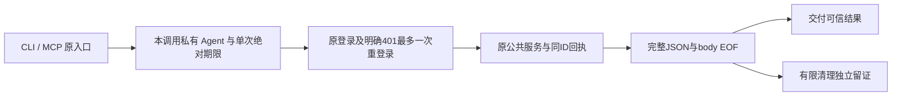

# T1252 独立规格首评

当前合同没有发现阻断。CLI 的 HTTP 等待必须覆盖后台实际串行工作，取得可信成功或业务错误回执后，清理异常只能单独记录，不能把它改成未知或促使重做。

读取真实 dispatch/login/post/unwrap、CLI 调用和 SDK handler，确认当前缺少 dispatcher/signal；安装的 Undici API 支持每请求 dispatcher 与 headers/body/connect 配置，Node25 内置默认 headers/body 各300秒。规格用固定直接依赖及每调用私有资源闭合内层等待，没有修改公开工具参数、鉴权、幂等或业务任务期限。

预算重新核对：结果7,800,000ms，POST8,100,000ms，login780,000ms，含凭据完整17,940,000ms，无凭据8,280,000ms。source-port 的13槽只是有限观察分配，原历史库存无固定上限；不能据此证明所有旧任务必然完成。headers/body 的内层配置与连接阶段都必须在实现候选和真实慢链中验证，外层数字不能代签内层消费者。

MCP 外部调用方默认60秒无法由 server 改写，受控验收必须明确有限 caller timeout 和真实取消。网络前/后取消、并发Agent隔离、原401唯一重试、清理失败不覆盖可信结果均有明确验收；scope只含既有六产品路径、原测试与扫描回归。

来源以 INDEPENDENT_INITIAL_REVIEW_BINDING.json 为准：作者34源与6安装API逐SHA相符，另补实际cli.test.ts。子Agent模型标识无法确认，如实记 unknown/inherited。本次未安装依赖、未启动服务、未执行300秒HTTP、未构建包、未执行Rust公共链或主App。最终裁决由主线程真实 reviewctl 产生。
