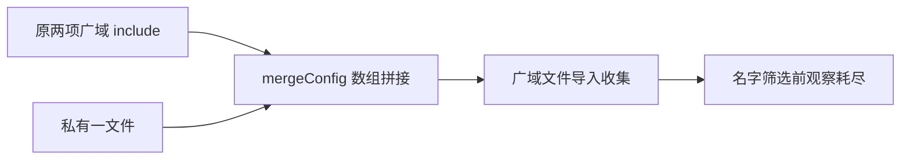

# T1252 公共工具首轮收集失败独立诊断

PT002：确认是工具文件收集范围错误。本轮 list 240,375 ms 后预算耗尽，退出 143，真实进程关闭且组内残留为 0；实际 list JSON 未生成，三个正文都未启动。没有据此证明产品失败。

原配置有 src 与 scripts 两个广域 include。工具用 mergeConfig 添加私有文件，当前 Vite 的真实实现对数组拼接，所以广域输入依然保留。Vitest 先按 include 选文件，再执行文件收集测试，之后才用 testNamePattern 标记任务；名字过滤不能代替文件范围。日志中的 243 个不同告警 PID 和 44 条 CSS 告警只作为扩大导入的旁证，不计成已执行正文。

最小工具修法：合并后明确覆盖 test.include 为私有唯一文件，list/run 也传精确文件作第二道文件范围门。保原三个正文、断言、生成器和所有预算；不加大收集预算。保存本轮全部输出和旧工具，重新封印新候选并独复后才运行。

独立审查人此前 9496 静态审查漏核了实际 include 数组合并行为。该历史报告保留，本报告补充实际首轮缺陷，不改写为历史失败。审查人本轮只读，没有运行或修改 live 工具。
