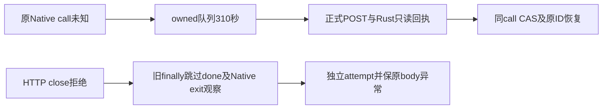

# T1252 公共慢链首候选独复

候选583be699/521ce13a需要窄修清理顺序；未应用或运行。26条真实来源/私有产物SHA核对无漂移，原Native八HTTP正文及断言反变换完整，原60秒任务不续期。

PC001是未执行的静态异常分支，不能补拍成TDD红。修订后始终发送done并观察精确owned Rust退出，不用旧列表72项代ignored正文通过。render的真实register/版本/sourceHash、PNG像素/PDF文字与跨账号/错版本保护完整；公共工具还须独立评审完整串行预算、真实Node/Rust归属、默认连接失效门和收尾。
