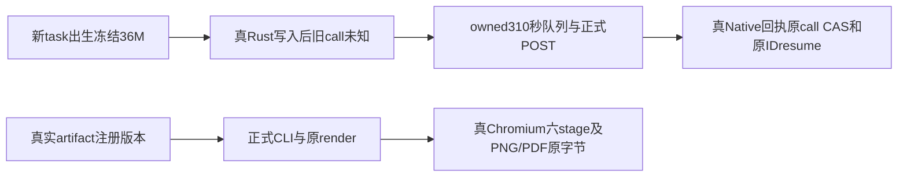

# T1252 公共Native与render候选窄独复

82bc117f/2a15d551精确私有候选通过，PC001关闭。26项真实来源和私有产物SHA全部相符，原Native八HTTP正文/断言完整反变换。没有应用或运行公共正文。

Native清理独立尝试HTTPclose与done，始终观察Rust退出并保原body异常；不确认停止不删目录/不假签clean。render保持当前真实sourceHash、像素/PDF文字/MIME/大小hash与跨账号/错版本门。

此通过仅源码候选。下一工具必须核完整串行budget、同SHA编译产物与exactfilter、真实源前后、默认用户连接拒绝和owned收尾；原60秒任务不续期。b88列表72与私有types overlay0不代ignored正文或标准frontend全局绿，更不代App已验。
