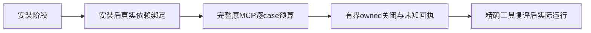

> 准备期动态草稿，不是准入收据。整理时作者已更新case420k并拆开安装/检查；清理改复用393f进行中，等待封印新版本后逐SHA评审。下述是原3c36/be6a发现的历史说明。

# T1252 标准工具只读待修评审

当前工具尚不能签可运行。此次只读核验没有启动安装、测试、构建、服务、PG、App 或模型。

ST001：SDK取消新增case有两个串行120秒观察，case180秒不足；应保更长完整链，原取消、范围和POST次数断言不变。

ST002：当前 compiler 与 runner 哈希指向加载 shim；实际 `_tsc.js` 与 Vitest `dist/cli.js` 实现没绑定。安装后需重新冻结真实运行依赖，不能用候选 overlay 或 shim 代标准实现。

ST003：清理失去孙进程归属时应拒绝发信号，但读取端尚在等待继承管道EOF，只有设置exitCode不保证父工具有界退出。该静态可反驳场景需要owned纯Node真实负路；未知收据保留，不伪造关闭或杀陌生进程。当前pure identity反例没有证明这一生命周期。

原entry/scanner两个缺口作者已给更新候选；旧3c36/be6a未执行历史应保留。精确当前版本和事实见JSON，后续任何source变化都须新绑定。
