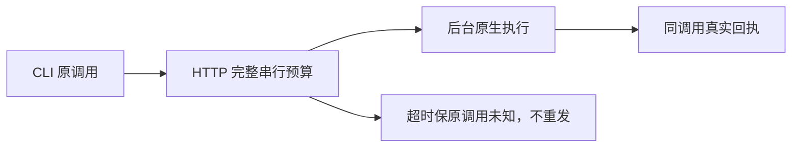

# T-1252：闭合 CLI/MCP HTTP 的真实消费者预算

用户来源：T1246 用户已授权全功能整合、打包、逐项实际验收和集中修复。验收子Agent实际发现 Node25.9 内置 Undici 的 headers/body 默认300000ms，小于本轮原生单RPC420000ms；DispatchClient.post 直接使用默认 fetch，无专用 dispatcher/完成预算。原35秒公共验证只能证明其范围，不能证明完整合法RPC预算。

本任务先只读盘点和独立 SPEC 评审。待补：完整单HTTP串行消费者、真实 Undici 支持API与依赖来源、专用非全局dispatcher及HTTP body EOF/登录401一次重试/取消unknown的整体预算、精确源和测试写集。不得用父测试时间或fetch signal假称底层headers/body计时器已改变；不得修改全局fetch、自动重发超时调用、续原持久任务deadline、透传正式模型或用户凭据作为测试。

大白话：后台还在合法执行时，CLI网络层可能先断开。要让网络等待覆盖真实后台工作，并保留原调用和真实未知状态。

当前验收：待合同和独评；未实现、未代签通过。不得因本任务尚未闭合宣称完整CLI慢链通过。
