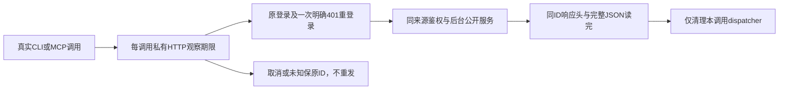

# T-1252：闭合 CLI/MCP HTTP 的真实消费者预算

状态：待独立SPEC评审。此稿仅合同，不是产品实现、打包或运行PASS；不start任务、不改生产源、原测试或用户凭据。用户来源为T1246已授权的全功能整合、开发包、逐项真实验收和首轮后集中修复；本任务补同一授权范围内已证实的CLI/MCP底层缺口，不新增发布、平台登录或主App操作授权。

大白话：后台还在合法执行，CLI的网络层可能已经在第五分钟断开。网络等待要覆盖真实后台串行工作；等不到时仍保留原调用和真实未知状态，不能悄悄再做一次。

## 真实问题与来源

`mcp-server/src/dispatch.ts`的login/post使用global fetch；无私有dispatcher、signal或完整响应body预算。`unwrap`还会await JSON。CLI的`--timeout`仅`tasks wait`观察，不是HTTP设置。CLI `clientFor`与MCP `index.ts`均装配此client；MCP `server.ts`当前忽略SDK RequestHandlerExtra.signal。

实际安装Node `/opt/homebrew/Cellar/node/25.9.0_2/bin/node`内置Undici7.24.4源码`internal/deps/undici/undici`9165/9166给headers/body各300000ms，13616的fetch dispatcher调用不覆写这些值。因此仅增加AbortSignal不能提高内层300秒。原35秒慢公共render只证明原范围，不能证明超过300秒HTTP可用。尚无真实300秒RED，不补拍历史PASS/FAIL。

lock已有`undici@7.27.2`，Node引擎要求>=20.18.1。实际安装源码`lib/web/fetch/index.js:2154`同样使用指定dispatcher，`types/client.d.ts`支持headersTimeout/bodyTimeout/connectTimeout，`types/fetch.d.ts`支持dispatcher及signal。当前mcp-server没有其直接依赖；正式以package精确依赖`"undici":"7.27.2"`注册，不借转依赖、不改既有其他版本或升级整体lock。直接依赖输入与当前安装源码SHA必须列入source binding。

## 实际同步消费者和边界

|入口/消费者|真实串行和预算事实|本任务的HTTP归属|
|---|---|---|
|`workbench.files.reconcile`|CLI→真实HTTP dispatch→workbench-public.transport→fileRecovery.reconcile→原snapshot→Native file_receipt420000→原CAS/finish；DB事务不跨Native等待|确实同步HTTP。保原task/call/claim/inputDigest/requestId/receipt，原public journal用例是完整回归来源|
|`workbench.artifacts.render`|真实dispatch→public transport→persistence render装配→representation→readAll→最多12相对图片→真实离线renderer→元数据/原hash/有效字节→JSON|确实同步HTTP。raw/preview走原正式blob；png/pdf包括完整渲染和清理，不能用单425秒代整个HTTP|
|renderer `renderTrustedWorkbenchHtml`|源码冻结11×120000+60000=1380000ms执行观察；import/真实executable检查/mkdtemp/launch/newContext/newPage/route/goto/screenshot或pdf为顶层9个step，11是保守声明槽，不虚构11个方法；FS检查和格式分支保持；正常close+rm各120000；迟到launch另走同有限清理并保未确认槽|HTTP预算含1380000+240000，不把清理当免费；T1250同期准备期差异须重新绑定最终源|
|browser host普通调用|admission每次真实profile lookup425000＋action至少2RPC；close最多lookup+close+4个stop_proof=6RPC和原600ms间隔；scope/DB/媒体另计|原公共测试多数直host，不声称CLI已调用这些工具。仅用于可信私有预算配方及实际host用例预算，不新建公开browser op|
|`recoverStoppedProfile`|原DB前核120000，两种profile lookup及cleanup各425000，DB后核/释放各120000，结算60000；合1695000。busy-open另含初次lookup、catch lookup、reacquire lookup、open共4×425000；单动作若原可信timeout_ms更长保其公式|恢复属于原host私有服务，不改原30秒admission、不延原任务期限；3395000只是上述RPC+恢复小计，还需admission/postflight等槽|
|artifact.register宿主|20MiB真实文件最多stat＋164个128000字节分页read＋stat，166×420000=69720000，随后blob/原CAS|Worker原宿主链，不是当前同步CLI render。不得把它虚构为已HTTP调用；保原任务剩余deadline，公共fixturedone另独立完整预算|

公开装配真实路径固定：`contract/src/operations/workbench.ts`→`frontend/src/app/api/v1/dispatch/route.ts`→`backend/src/modules/execution/workbench-public.transport.ts`→`frontend/src/server/persistence-client.ts:workbenchPublic`→representation或fileRecovery。原route ctx来源/账号组/当前属主/CLI授权/幂等begin/缓存ownership/成功严格envelope/succeed或fail全部保留，不改为旁路。

`workbench-preview-read.ts`最多12图片，但单个原readRelativeImage/旧版conversationVersion可能沿`legacyRows`枚举所有聊天任务并逐个验证映射，现库存没有固定上限。不得把13个port等同13条DB语句或删除历史限数量。以下有限HTTP槽是观察政策，并非对任意旧历史总时长的数学完成保证；到期只停止本地观察、保原未知/原任务可继续读回。较长原可信内部调用预算可扩大观察，不新增业务执行权限。

## 服务与生命周期合同

FR-1252-1：仅用直接固定Undici7.27.2的**每dispatch私有Agent**，原global fetch通过每请求的`dispatcher`选项使用该Agent（不替换全局函数）；不setGlobalDispatcher、不改global fetch、不修改Node/共享pnpm/官方runtime，不启全局环境注入后门。一dispatch最多原4个HTTP阶段共享本调用dispatcher，并发调用互不销毁。现fetchImpl保原单测注入，但不能用它签真实runtime。https证书、cookie、headers/HEAD来源、重定向/原fetch协议语义不放宽。

FR-1252-2：私有`DispatchControl {signal?:AbortSignal; observationMs?:number}`作为dispatch第四参数，不进入`DispatchInput`/`_creatoros`/公开schema/CLI flags/MCP工具参数。observationMs仅可信宿主/测试内部传入，必须safe positive finite、>=完整默认槽且不大于Node安全timer上限；非法/不足/overflow在网络前拒绝。较长观察不授予task resume/retry或模型新调用。原参数三个保持兼容。

FR-1252-3：dispatch入口一次冻结monotonic绝对截止；覆盖初次login→post→原明确401→一次login→一次post→unwrap完整JSON/body EOF。signal与每阶段剩余时间限制保持；body数据/keepalive/重试/登录不重置总截止。每HTTP也有固定完整槽，headers/body/connect真实Undici配置不得比该槽短。connect最短120000；bodyTimeout是间隔计时器，另一次绝对timer必须覆盖完整body EOF，不因partial chunk续期。不得Promise.race后放任仍在读body或无限清理。

FR-1252-4：默认配方按当前已知同步组合提供长观察余量，全部毫秒：source-port准备13×420000=5460000（含主对象和最多12相对图，**是长观察分配非13条SQL或全库完成证明**），renderer1380000，renderer close/rm240000，原gateway鉴权/CLI begin与settle预留4×120000=480000，完整JSON读取120000，结算120000，合结果槽7800000；单POST connect120000+结果7800000+完整网络body120000+结算60000=8100000。普通op也用该有限默认POST槽，避免新增短门反杀其他既有同步服务；没有据此宣称所有op有此执行deadline。auth单HTTP保原headers300000+body300000、connect120000、结算60000=780000；每dispatch完整默认外层2×POST8100000+2×login780000+dispatcher清理120000+最终余量60000=17940000。无凭据可以按实际最长序列派生8280000（POST8100000+cleanup120000+余量60000），有凭据按17940000；不能只按当前未登录状态少算未来401。所有槽一次冻结；较长可信observationMs只扩大外层与相应HTTP观察，不减任何上述消费者。严格数字派生单测需逐项核等式/余量，不能任意填更长case数字充当证明。

FR-1252-5：MCP原handler第二参数`extra.signal`沿私有第四参数传入；SDK1.29.0实际类型已提供signal，取消后网络abort且停止body消费。CLI main的SIGINT/SIGTERM仅取消此命令本地HTTP观察，detach本调用listener；程序化runCliCommand可选第二个私有control参数，不改用户flags、默认task/account发现或环境来源；原mcp serve使用SDK cancellation/lifecycle。进程终止不代表后台物理stop。测试在HTTP前已abort要求请求0；请求发出后保持原业务调用计数，不重发POST，不称副作用已回滚。

MCP调用方边界：实际SDK1.29.0 `shared/protocol.js:8/:712`默认request timeout为60000ms，server不能改外部peer的观察设置。本合同只闭合服务端HTTP，不能声称任意外部MCP客户端默认可等待完整慢链。受控MCP验收caller必须明确有限timeout覆盖本例完整HTTP串行/取消/清理，保持SDK真正cancel通知和RequestHandlerExtra.signal，不关闭取消、不resetTimeoutOnProgress续期；外部未知caller期限如实未证明。

FR-1252-6：仅原已拿到明确401响应且本来有credentials可走原一次重登录和重试，使用同idempotency key/来源headers；不得将timeout/EOF/解析失败/AbortError变成401或泛化重试。transport failure抛命名本地错误，phase区分before_request/request_sent/body_read/cleanup，不伪造服务端HTTP状态、requestId或known outcome。业务是否已发生未知时显示原“回执待核对”，保用户原key/op与已真实收到的原receipt；不能输出密码/cookie/token/输入正文/完整URL query。CLI错误exit保持非零，已发模型/写任务不被取消声明。调用方主动读同ID公开task/receipt或手工同key重放保既有合同，本transport不自发补请求。

FR-1252-7：每dispatch finally有限120000清理本Agent，close拒绝/到期再destroy并记录真实未确认；Agent destroy确认仍未达到时整体非零并保UNKNOWN，不无限await也不造stop证明。清理不写业务DB、不清全局pool、不夺并发调用资源。若已有完整合法业务JSON但清理未确认，必须区分业务已收到与本地资源未确认，不把业务改写成未发生或可重试；CLI正式结果完整与transport cleanup警告应分离，真实证据记录。source/owned cleanup工具独评后才运行。

## 精确写集

产品仅：

- `mcp-server/src/dispatch.ts`：上面private transport/control/预算/命名unknown、auth和body生命周期。
- `mcp-server/src/cli.ts`：私有control沿原client.dispatch/main本地signal；不改公开flags/账号组选择/任务等待。
- `mcp-server/src/server.ts`：原SDK extra.signal接第四参数；不改工具合同或权限。
- `mcp-server/package.json`、`pnpm-lock.yaml`：仅mcp-server精确直接undici7.27.2及原已存在解析，其他importers/version完整保。
- `tools/timeout-policy/check.mjs`：仅真实HTTP consumer/observer扫描闭包及私有预算分类，不删规则/历史或vendor库存。

不新增产品文件；index.ts、原dispatch route/transport/backend/Rust/Worker仅来源/验收输入，不改权限/服务期限或公开schema；每dispatch Agent方案不要求stdio全局生命周期文件变更。`mcp-server/scripts/build-runtime.mjs`不需产品改动，必须真实打包验证。

测试仅原：`mcp-server/tests/dispatch.test.ts`、`mcp-server/tests/cli.test.ts`、`mcp-server/tests/group-mcp-context.test.ts`、`mcp-server/tests/server-discovery.test.ts`、`mcp-server/tests/group-context.test.ts`、`mcp-server/tests/cli-artifacts.test.ts`、`frontend/src/server/workbench-file-recovery.test.ts`、`frontend/src/server/workbench-public.integration.test.ts`。仅追加真实transport/取消/不重发/包装CLI证据用例与已批准私有copy机械预算；保原body、permission/CAS/unknown/usage/同键断言。以上均已rg核实际存在；原global fetch mock可继续原测试注入，不以生产检测mock/测试环境分支放宽传输，新增第四参数的mock依赖须保完整原scope断言。额外扫描回归只原`tools/timeout-policy/check.test.mjs`。工具/证据范围`docs/verification/t1252/**`，公开Rust工具继续T1250已批准路径；不改首轮T1246原manifest/结果或共享dist/.next。

## 验收与真实边界

AC-1252-RED：先原默认global-fetch实际隔离loopback header等待>300秒与body空档>300秒各真实RED，保原Node25源码/handler时点/收到POST数量/headers/close与stdio EOF；没有当场发生不填历史红。header/body消费者分别证明，不借一个helper签两项。隔离受控回执是HTTP协议fixture，不能签官方模型语义。

AC-1252-GREEN：直接依赖新Agent的同范围真实header与body>300秒分别成功、完整JSON/hash和POST1；运行实际build后的`creatoros.cjs`由包固定Node25执行，SHA绑定bundle/Node/lock/source，不能只tsx或mock fetch签打包行为。headers-only成功还需完整body读取证明；partial活动不续绝对deadline通过真实受控body观察与参数辅助单测覆盖。

AC-1252-PUBLIC：至少真实runCliCommand→HTTP dispatch原auth/CLI gateway→`workbench.files.reconcile`→新b88eec44 Rust fixture/原file receipt同ID对账，原全部8HTTP与CAS/原任务状态/未知/跨组/fence/不重复write断言保；以及真实公开`workbench.artifacts.render`→原版本/原sourceHash→离线Chromium PNG/PDF→真实有效bytes/MIME/checksum，完整多个合法阶段累计超过300秒HTTP header等待。受控延迟必须属于测试私有固定stage事件、真实SDK操作仍执行，不修改生产/全局timer、不延task deadline，不以伪response/mockbrowser返回签公共render。旧35秒用例保留为旧范围。Node公开fixture和最终包运行各有来源边界，不代签App/Windows/平台/官方模型。

AC-1252-CANCEL：网络前abort请求0；原POST发出/headers后/body过程中abort各请求1、原key/id可读回、无401 fallback/自动补POST/重新生成；403/404/409/429/5xx/raw damaged/EOF/异组/证书拒绝保持。原401有凭据最多4HTTP并只重登录一次，无凭据不读取credentials；并发两个dispatch取消其一不销毁另一Agent。真实成功结果清理失败不得使调用方再做一次。

AC-1252-BUDGET：helper等式与overflow/NaN/0/小预算拒绝只能辅助，不能代300秒真调用。每请求/action/有限观察>=120秒；慢case至少覆盖完整RED或GREEN310秒header+310秒body及启动/全部串行/清理，test/hook保原更长且>=180秒。具体run outer从入口监督source校验/所有串行用例/packagedbuild/日志close/最后读回与owned清理；list/watchdog/readonly phase也有限，不缩服务原deadline，不因未知包挂await。

AC-1252-GATE：实际mcp-server typecheck、原相关tests、公有Rust/HTTP链、timeout-policy verify、物理boundary/orphan及任务SPEC Gate；每报告绑定真实source/lock/Node/bundle SHA与noApp/noPublish事实边界。真实默认300秒失败与所有后续重验都不覆盖。未验证的Windows/App/官方语义如实待验，不声称全CLI或49功能通过。

## 工具与数据安全

source准备/工具独评前不启动服务、模型、PG或浏览器。正式fixture只用fresh nonce/os.tmpdir标记、注册自有loopback端口与PID出生/UID/父链；新媒体/数据/auth/runtime专属，HOME/CODEX_HOME不重定义、不复制auth、不读取用户安装连接文件，设置loopback合成CLI token/handshake而非正式凭据。外网deny、禁止发布/付费/平台登录；源码原字节/必要新差异与全部stdio/log/result/cleanup前后SHA。HTTP probe只受控JSON/图bytes，不转发官方账户。所有只读对账仍backend service port或自有注册库，没有测试写DB伪unknown。
