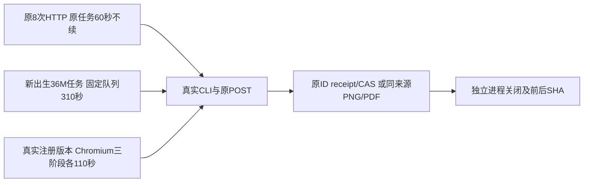

# T1252 公共 Native / 渲染链隔离验收工具

这是静态待审工具。源码候选尚未应用，未启动 Vitest、HTTP、PGlite、Rust 正文或 Chromium。先由 ROOT 与独立 reviewer 核本目录工具、绑定和 source candidate，窗口释放及精确准入后才能执行。



工具分别在三个 fresh Node 子进程执行原 native 用例、新出生 native 用例和新增 render 用例。每个子进程使用单独 APP/DB/media/auth/TMP 根，默认 PGlite 是该测试创建并关闭的隔离库；清除正式凭据与 PG 地址，HOME/CODEX_HOME 保留原值。缺实际 fixture BASEURL 时，只能发现自有根中明确不存在的 connection/access 文件，不接触用户默认连接。两个新用例仍是协议/文件 source fixture，不代签官方模型、App、Windows 或真实平台。

来源是 `public-slow-candidate/PUBLIC_SOURCE_CANDIDATE_BINDING.json` 的已独评候选。`copy-source.cjs` 只把相对 import 指向精确绑定的原消费者，并将原 native case 60000、fixture timer 60000、两个有限观察10000在新副本规范为派生预算。23处 UTF16 变换严格逆构回候选；原8 HTTP、断言、账本/CAS/权限和原 task 60000 毫秒不变。新 Task 在 enqueue 出生即冻结36000000毫秒，以原 executionTasks 行读出生、首次reserve前和最终deadline，不改公开DTO、不给历史任务续期。

实际 b88主锁测试二进制已由只读 `--list` 验证72名字、原journal exact名唯一、0退出/closed/group0/前后SHA同；工具在自有根复制新inode并命名为旧fixture接受的 `workbench-<hex>`，SHA必须同b88。此列表不代 ignored 正文。每个Rustfixture的严格cfg WAIT由本例完整body加120000ms自然done观察派生，不用旧90/120/180秒默认。原native8直接正常调用，不注入延迟；新native仅首HTTP在owned队列等310000ms，再转原POST/真实Rust，不伪响应。render实际SDK三个操作立即开始与110000ms私有delay并行，各仍在原120000ms独立stage内，两个格式分别累计330000ms，并检查有效像素、PDF文字、MIME、size、hash、原版本与权限。

预算由 `budget.cjs` 逐项计算：原8 HTTP 80.04M、新 native36M、render42M；各完整hook/启动/teardown余量另840000ms。collect240000ms，四个子进程各393f已实测完整生命周期2160000ms，入口校验240000ms、最终源/OS读取600000ms、额外120000ms，总outer170400000ms。正常结束即退出，不等满预算。observer均>=120秒、hook>=180秒、retry0。actual list必须精确三名字，无多例、缺例或skip；每个case真正跑一个body，其余filtered原恢复测试不计PASS。

工具只读绑定整个实际PNPM实现（包括workspace深层link目标）、backend/contract/mcp/frontend-server/ai-worker源与迁移、真实安装Chromium发布文件。缓存`.vite/.vite-temp/.cache`不当实现输入，测试的Vite cache和envDir始终在私有根；不读产品dotenv。最终 OS scan只对本nonce根引用保存PID和hash，未知归属不signal、不删除，非零留证；393f处理自身子进程组。原RED、标准116PASS和两bundle310s GREEN继续独立保留。

ROOT精确准入后使用固定Node运行（先按最新工具/绑定SHA填入，不沿用本目录旧版本）：

```bash
CREATOROS_T1252_PUBLIC_TOOL_REVIEWED=1 \
CREATOROS_T1252_PUBLIC_TOOL_SHA256='<ROOT已核launch SHA>' \
CREATOROS_T1252_PUBLIC_BINDING_SHA256='<ROOT已核binding SHA>' \
/opt/homebrew/Cellar/node/25.9.0_2/bin/node docs/verification/t1252/public-runtime-tool/launch.cjs
```

任何源变、工具变、case listing不符、正槽不足、child未close或本根Chromium仍未闭合均保原raw与非零，不重发任务、不补成功、不借helper代签公共调用。
