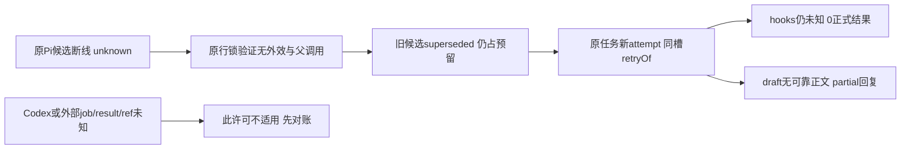

# T-1253 第二轮未知恢复实际证据

原三文件 25 例完整运行：**17 PASS / 8 FAIL / 0 SKIP，exit 1**。child 64,376ms；wrapper 65,372.220708ms。原 118 个 expect、res.destroy、模型回复和 25 个 body 均未校准。source `f63f0ae6…` 前后相同，stdout close、owned group 0，独占临时目录已清理。不是修复通过、官方账户模型或原生 App 验收。

11 个当时真实快照及完整 8 个错误见 [机器回执](HTTP_PERMISSION_OBSERVATION_SECOND_ACTUAL.json)；原日志见 [run.log](execution/observation-whole25-0e8ee87284ee067412fbd01ab4ea3141/run.log)。初始 9/46 的 8 红和两轮 25 的 17/8 均保留，不相加成新 coverage。

|逐项核验|hooks|draft|
|---|---|---|
|原冻结执行路线|Pi / version 1 / preference|Pi / version 1 / preference|
|原期限|continuous / maxCalls、maxTokens、deadlineMs、deadlineAt 均 null，未变|同左|
|恢复当第三 HTTP|原 task attempt 1→2；task.retryOf 指旧 child|同左|
|旧候选|unknown→superseded；原 attempt 1；job/result/ref/usage null|同左|
|新候选|started、attempt 2、retryOf 精确旧 child|同左|
|同槽约束|原 parent、operationKey、inputDigest、6889 reservedTokens、tokens 全相等|原 parent、operationKey、inputDigest、5324 reservedTokens、tokens 全相等|
|原预留|旧 superseded 的 6889 仍在，usage/totalTokens 仍 null|旧 superseded 的 5324 仍在，usage/totalTokens 仍 null|
|HTTP 顺序|根→旧子断线→原槽新子；共3，没有新根|根→旧子断线→原槽新子→带原 tool 回执的新根；共4|
|最终|execution unknown_result、父工具/new child unknown、无回执/usage、0 formal|execution/business partial、父 no_evidence/none、new child settled 5 token、唯一 conversation_reply partial|
|正式产品引用|0 formal|该回复 assetId/artifactId/knowledgeItemId 全 null|

第三 HTTP 不是凭“多一个请求”判断合法。实际许可链逐项匹配既有 [T-1022](../../features/t1022-nonblocking-agent-recovery.md:39)：只对无外部副作用的模型候选记 superseded，永久废弃旧不完整结果、保留原预留、重试带旧 ID。`persistent-task.service.ts:968,1004-1025` 在原 task 行锁内先验证全体 pending 父调用；`model-call-recovery.ts:73-78` 排除 Codex、asset 和已有 provider job/result/ref；`execution-chat-text-node.service.ts:241-283`、`execution-call-ledger.service.ts:83-101` 再核请求、同键摘要、parent、attempt、任务许可及预算。该代码约束是只读证据；本轮运行直接证明的仅上述两个 Pi case。

大白话：旧模型候选没形成任何外部结果，系统能沿原身份丢弃旧候选再生成；外部操作或 Codex 原 turn 的未知结果仍必须先对账，不能借这两例直接再发。

限制：本轮直接查询同 task calls 与 aiTaskResults，未额外查询全部 artifacts 或新 script.draft 任务数量，不能把正式结果引用 null 写成整库 0。报告中的用量合计按真实行与原 totals 公式推导，没有伪称本轮实际调用 ledger.inspect。后续严格候选必须新增真实 0作品/0稿件任务断言和同 ID、摘要、预留保护；当前旧失败不改、不提前签第三/第四 HTTP 验收通过。

新工具从入口冻结 23,220,000ms 外层，含两 child 各 2,160,000ms 的 helper 生命周期额外槽，正 body 15,300,000ms 不缩短。第一轮工具原回执与其理论预算缺口均保留，第二轮不回签第一轮。
