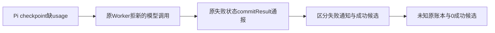

# T1253 组合候选首次独评

候选当前需修 CP001，未准入运行。两UNKNOWN/429/continuous的静态方向合规，不等于实际25例已绿。

当前ports候选把所有commitResult都要求0，但原Worker拒绝检查点后会发送unknown_result失败状态通报。原fixture把任意通报当成功文本，先push undefined，再由候选service拒绝；这会使新增0文本与0port断言失败。需严格区分失败通知和succeeded候选，不改生产、不伪造usage，也不删未知/0新模型/0正式结果保护。原失败通知事实和语义须完整保留，未知调用账本和检查点不得变化。

inspect是原settlement服务，仅锁与读原task/calls；新HTTP时刻和最后账本读取没有reserve、初始化预算或写SQL。原Pi重试许可按原frozen engine/payload/parent/hash/key/retryOf/attempt/fence/预留证明；正式产品0与完整partial尾串仍待实际执行。

精确三candidate、原源码、SPEC、actual第二观察及消费者SHA见JSON。此次没有apply、编译、测试、PG、外网或模型执行。
