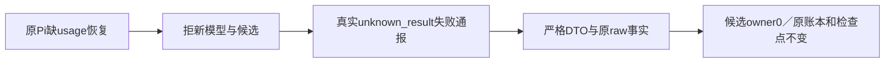

# T1253 组合候选 V3 窄独评

精确 hooks9f9505、draftbdc395、ports17de16b8 静态通过；**FR-USAGE正式澄清前不可运行**，未签types或测试。

CP001已闭合：fixture先严格解析成功/失败，非成功保唯一原raw通知和准确code，不push undefined、不调用候选owner。成功分支的原失败注入和正式候选全原断言保；缺usage=false仍保正例，额外failureReports0。失败通报不是成功采纳或模型重发。

两UNKNOWN保持原res.destroy/回复，沿原task和真实attempt/fence/retryOf核许可，旧superseded预留及null usage不归零；inspect仅锁与读，不改budget/call。三429、continuous/null、直接产品0、v1 partial与完整尾串保持严格语义。

需root/route正式record FR-USAGE、源窗口释放及新工具精确准入后，完整25与原9/46实际运行。原17/8及所有历史保留；新产品0和后半账本断言尚未实际达到。此评审没有apply、types、build、test、网络、PG或模型执行。
