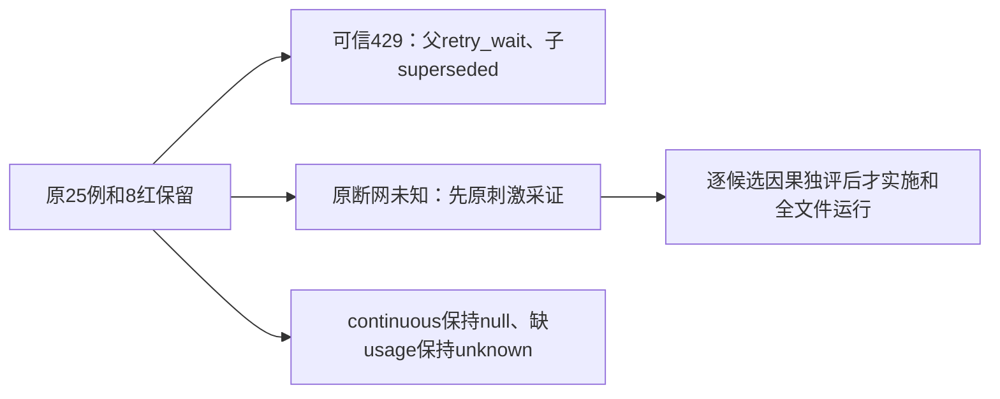

# T1253 独立规格首评

当前规格未发现阻断。评审人实际读取三原测试、八个只读消费者及原9文件46例收据，逐SHA与候选binding核对一致。原38通过/8失败、三文件25原例全部保留；本报告不证明修复后已通过，也不替主会话record/start。

429是可信可恢复失败：原durable消费者会把子调用记为superseded，父保持retry_wait；401/400继续拒绝。缺usage的Pi检查点在reserve之前停止，原null token不能变0，resume不能偷偷再次调用或提交。continuous本来没有deadline，不能用SQL补有限期限；有限180秒来源只引用另一已批准真实generic路径。

未知两族仍需先保旧res.destroy及原期望完整采证。原第三HTTP身份、父子回执和正式tool/partial数据此前未捕获，规格明确禁止把推导补成事实；只有确定并非原unknown重发，后续新的写前ACK刺激才可按精确diff单独审查。当前没有签该刺激或更改任何终态集合。

严格首评packet为 `spec-review-initial.json`，完整来源为 `INDEPENDENT_INITIAL_REVIEW_BINDING.json`。模型标识工具未提供，记录unknown/inherited，不自报型号。评审人未启动服务、Worker、PG、官方模型或App。
