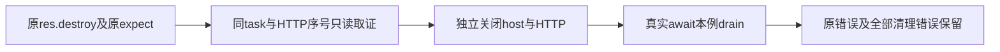

# T1253 原未知刺激观察候选窄审

新 hooks fb2dfb54 / draft ba8f2a34 仅通过观察候选审查。旧700649/285283未执行候选保留，两处作用域与错误覆盖问题已关闭。

实际逐SHA核对原源与候选，原expect表达式AST完整相同（hooks70/draft48），原case定义未增删。独立capability case恢复原await；循环draining在try/finally共享作用域。catch保原body失败，清理全成功原throw仍透传；清理失败才聚合原body原因和所有实际拒绝。

未知模式日志记录真实HTTP序号/阶段/root工具身份和message角色，原destroy刺激未改；只读取原task/call/parent/usage/budget/lease及正式产物。无凭据、headers或providerMetadata输出，不写SQL生成未知状态。没有由本review执行用例或改产品。

第三HTTP的真实身份及是否重发尚须整文件原25体实际取证。这里不签运行工具、构建、cleanup或功能通过；parent须另独评执行工具再运行。
