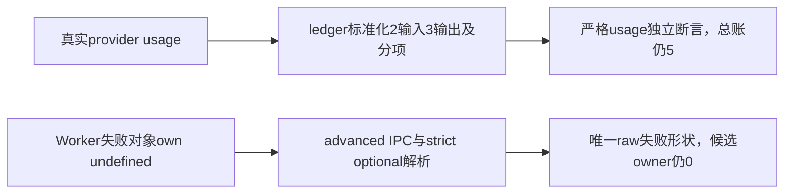

# T1253 V4 两处严格回执形状独复

结论：私有候选通过；没有执行或预签通过。原实际25项23通过2失败、46项44通过2失败均保留。

两处只是按已测真实消费者收紧预期。draft费用/同ID/旧未知预留与完整partial链不变；ports缺usage仍不得新增供应商调用或正式候选。26/27来源及原日志SHA逐项核对无漂移。正文运行与全局Gate由后续精确工具/ROOT另准入。
