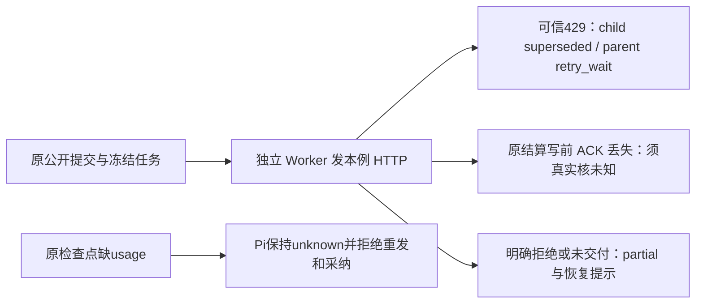

# T-1253：闭合原 Worker 夹具的可信回执、partial 与未知恢复验收

状态：候选，待独立 SPEC 评审；未 start、未实施、未新增测试执行。依据用户对 T-1246 全部功能验收及集中修复的授权，处理末批原 9 文件 46 例中的 8 个真实失败。本任务不改变执行引擎、公开契约或产品生产逻辑。

## 真实问题与范围

原 source 完整运行 `worker-nine-f01a9beb4c293b63a659c3ebbb45e323`：9 文件 6 PASS / 3 FAIL，46 例 38 PASS / 8 FAIL / 0 SKIP，child exit 1、137814ms，wrapper 138838ms。3035 输入 source `ddbd5024891648e40612b8304194890d8ff17537c2e371051b0155c1d757a651` 前后一致、stdout close、owned group 0、本轮隔离目录清理完成。原日志、原源码 SHA、失败完整栈及首轮全部失败封存，不补拍历史 PASS。

|原文件与失败族|实际失败及可证明的消费者因果|当前证据边界|
|---|---|---|
|`chat-hooks-worker.test.ts`：reject429、reject429drop（2）|父 retry_wait 断言已过；child 实际 superseded，旧断言要求 rejected。durable-generation-model.ts 在真实 retryable 非协议拒绝时 settle superseded；chat-text-node-worker.ts 已用 findGenerationFailure 保可信实例/cause。|未见 hooks 生产丢失可信 retry_wait；不修 classifier，也不把真实未知改可重试。后续显式恢复与 4 HTTP/原 token 断言因提前失败尚未在本轮到达。|
|同文件：crashUnknownChild（1）|最终父 unknown_result 断言已过，实际 HTTP 3 对旧期望 2；旧刺激为 res.destroy，无法等同“已收到合法供应商结果但原 settle ACK 丢失”。|原日志无完整 HTTP 消息和父子 ledger trace；不得猜第三请求身份、task/call ID 或完整事件顺序。 必须先只加观察保旧刺激/期望跑完整原文件采证；若第三请求重发的是无可信恢复授权的原 unknown 调用，属生产阻断，不能换刺激把它遮掉。|
|同文件：crashDeadline（1）|原 chat.submit 冻结 continuous，夹具对 nullable deadlineAt 做 Date.parse，now() 最终 Invalid time value。|源码消费者与实际栈可定位；该轮没有证明有限 deadline 到期，也不把 continuous 原任务 SQL 改成 finite。|
|`chat-script-draft-worker.test.ts`：unauthorized（1）|原任务 partial、无稿件子任务/作品断言已过，最后流在原“候选已准备好”后附真实 partial 恢复提示；旧最后纯文本 equality 拒绝提示。|已有真实实际流完整差异；该轮无正式 resultData、原 tool resultText trace，不伪造已采证据。|
|同文件：reject429（1）|父 retry_wait 已过，child 实际 superseded 对旧 rejected，消费者同上述文本节点。|恢复后续断言未达到，不借邻族绿代签。|
|同文件：crashUnknownChild（1）|旧 res.destroy 刺激在原恢复后实际 partial，旧期望 unknown_result。文本节点 unknown 会请 host complete，整稿 prepare/commit 可以形成明确 no_evidence/none 回执和 partial；这不是已证明的真实 ACK 丢失。|原日志缺正式 tool 结果/HTTP 完整事件，不能把 partial 任意改 unknown 或直接放宽终态。|
|`execution-worker-call-ports.integration.test.ts`：missing usage=true（1）|原 checkpoint 已明确 requires_reconciliation、spentTokens null；Pi credential 没有 native engine。worker-runtime.ts 在任何 reserve/commit 前拒绝 CHECKPOINT_REQUIRES_RECONCILIATION，实际 resume 返回 unknown_result，旧断言要求 completed。|不能填 0 token、伪补 usage、改 checkpoint ready 或把本轮 Pi 冒为 native 只读恢复。|

大白话：模型明确拒绝、模型结果未知、以及“聊天结束但没有可用稿件”是三种不同事实。测试应由真实端口制造相应事实，再核同一个任务如何恢复；不能用断网假装已写结果，也不能把不明 token 当作成功账单。

## 精确写集与生产冻结

只允许以下三个现有原测试文件，且只校准上述 8 个失败族及必要的本例观察/清理：

1. `backend/src/integration/chat-hooks-worker.test.ts`
2. `backend/src/integration/chat-script-draft-worker.test.ts`
3. `backend/src/modules/execution/execution-worker-call-ports.integration.test.ts`

不改 backend/worker/contract 生产源码、数据库 schema、公开 DTO、引擎/供应商、retry policy、global classifier、usage/accounting、checkpoint owner、模型调用上限和 semantic boundary。不改原 fixture source/model 字符串以造“好结果”。发现生产缺陷或无法从真实消费者合法构造相应刺激时，保 UNKNOWN/FAIL 并追加精确生产范围 SPEC 独评，不能在三测试写集里绕过去。

## FR-1253（实施前每份候选须独立核因果）

- **FR-1253-FACT**：增加仅本 case 的实际 HTTP 序号/根或子请求形状、原 submission executionTaskId、原 task budget/deadline/lease、父子 operationKey/status/attempt/token/receipt 是否存在，以及必要 tool.resultText/formal resultData 的脱敏观察。不从其它 ledger/夹具全文补模型消息。观察变量正确位于 try/finally 共同作用域；日志错误不得被吞掉。所有 ACK 注入与停止仅同本 submission ID，真实 draining/HTTP/host 清理不可跳过；清理失败保原错误，不靠过滤 spy 冒全部结束。
- **FR-1253-429**：仅三个明确 429 原 case 的 child 预期按原实际可信 superseded 校准，401/400 保 rejected。保持父 retry_wait、原 task/call/operationKey/parent/retryOf、显式恢复、4 HTTP、原 usage/token 与无重复正式产物；不得绕过协议拒绝或 unknown 保护。
- **FR-1253-UNKNOWN**：两原 crashUnknownChild 不直接放宽旧请求次数或改 unknown 为 partial。先完整记录旧 res.destroy 实际事件及 host complete/正式回执；候选可以在同原合法供应商回复后、同原 task settle 写入前制造确认丢失，禁止先实际成功写库再自称丢失前未写、禁止只因断网把供应商重发当对账。保持旧同 ID、父子归属、原预算、未知拒重发/拒正式候选保护；真实父 unknown、child started/null receipt 或其它可信保护状态必须按实际消费者独审，不能提前签 GREEN 或自报 arbitrary status。
- **FR-1253-CONTINUOUS**：crashDeadline 保原真实 continuous/null deadline，核原剩余 lease 同 ID 恢复，不再 Date.parse(null)、SQL 续期或伪造 finite。有限期限 coverage 只引用 T-1251 新合法 generic enqueue 从出生冻结180秒、真实 HTTP 后到期整链，不把它冒为 hooks/chat.submit 有限入口；本族原成功恢复/权限/取消 guard 全留。若需要新增 hooks-specific finite fixture，应先精确补 SPEC 而非自由添加入口。
- **FR-1253-PARTIAL**：unauthorized 保原 partial 与 0稿件子任务/0作品/0正式候选，额外核原真实 tool error、正式 conversation_reply/completeness、版本1、assistant metadata 与恢复文案；保原流“候选已准备好”前缀，准确核附加 partial 提示，而非删流断言或用泛 contains 替代全串。其余合法成功流原 equality 不变。
- **FR-1253-USAGE**：缺 usage=true 保原1 HTTP、原调用/检查点 revision/消息、null token、requires_reconciliation 与同 task 新 lease 的安全事实；实际 Pi resume 必须 unknown、不能再次 start/reserve/commit/provider，0正式产物。缺 usage=false 保原 completed 与公共候选采纳/正式结果全原断言，不能删除/跳过正例；缺 usage=true 的旧 completed 下游预期明确保历史并迁移到当前安全分支，不能以删除所有下游或 null→0 洗绿。native readonly 恢复属于另合同，不在该 Pi case 切引擎。

## AC-1253（完整当场证据）

- **AC-1253-RED**：引用已发生的原9/46中8红；所有修复后新失败也独立封存。原 case/body 分母不减少，完整三个原文件共25例（hooks14/draft8/ports3）先当场执行，再重跑原9文件46例；若原 case 声明实际变化，列原25与新增具体名称，不冒重复为新增 coverage。
- **AC-1253-CONTRACT**：逐族记录原 task/call/预算/HTTP 可证事件及缺失项；三 429 真 superseded 和 trusted retry_wait、合法 partial、无 usage unknown 分开，绝不假造到期/结果/成功 usage。每份窄 candidate 先 root+独立 reviewer 核真实消费者和完整 diff，获准才 apply；不能借旧 review/SHA 签新刺激。
- **AC-1253-ISOLATION**：仅本任务 fresh 临时目录与临时 PGlite，不读取真实.env、用户库/激活或原生App。环境删 native/PG URL/model key，原 owned preload 明确拒55422及其它无归属PG；负路先于网络，SQL/CLI0。所有实际 source/tool/SPEC/candidate bindings 与前后 SHA、子 stdout close、owned process group0、目录清理/保留状态入回执。shared worker dist 独占窗口，不能与打包/其它 build 竞争。
- **AC-1253-BUDGET**：正 test/hook/request/有限观察最少180s，保原 case540s、原180s/300s业务预算及 continuous/null。独立总外层从入口覆盖完整原文件/case 串行、file/each hooks、build、启动、source绑定和 TERM/KILL/清理余量，不用 min 缩正预算，不续原期限、不自动重发或retry测试。
- **AC-1253-GATE**：proper backend/worker tsc、相关完整三文件与原9文件、boundary/orphan/完整 timeout inventory 和已有公开>30s链证据按任务依赖真实执行/报告。T-1246其它首轮与全局真实未闭失败不得因本任务变绿消失；标准 frontend 首轮4错误、App用户不授权及官方模型逐功能未验明确范围。全局 Gate 非零保非零，不签全系统/安装App通过。

## DEC-1253（候选，待正式记录）

本轮真实8红需要窄 fixture/合同验收修正，优先维持原生产可信回执与未知防重发边界。用户已有 T-1246 全部验收和集中修复授权；此次仅三原测试文件，不引入产品方向/架构或新供应商选择。任何真实生产缺陷、需要新增公共入口或新增写集都先复评，不把失败偷偷变 accepted-risk。
