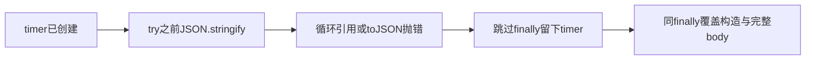

# T1254 请求候选首轮窄独复

38e7/32a4需要窄修CC001，未运行候选。两归档1600余成员元数据与全部regular文件hash直接核验；当前源码/补丁/根资源字节无漂移，原8测试完整保留。

该缺口有实际控制流证据，不拿纸面演示称真实TDD红。修订须保原错误并证明fetch0/timer0；15新增预算case与原完整测试不削弱。原请求数值/出生单deadline/分段预算方向正确，真实loopback、两root安装build与交付图和公共host验收仍需精确工具另准。
