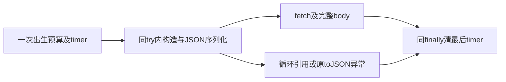

# T1254 CC001 私有候选复核

0f95b034绑定的fe2393bb/fed3d3b0窄修通过，CC001在候选控制流中关闭；没有执行新测试或应用生产。六项candidate/diff真实SHA均相符。

原8完整测试和v1的15预算/清理case全部保持，新例验证序列化异常不发请求、不留timer且保原Error同实例。两适配根必须用相同请求修改bytes，仍分别原锁真实构建。当前通过只候选，不签TDD红/实际GREEN、工具、包或App。原v1初审76270563与完整fbfc保留，未来工具fresh绑定v2后另准。
