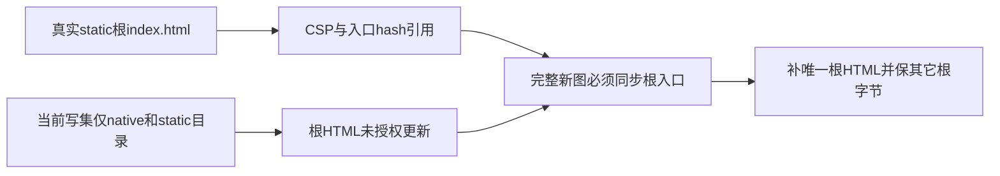

# T1254 独立规格首评

当前20df合同有一个必要消费者缺口REV-001，正式packet交ROOT reviewctl裁决。没有执行安装、构建、请求或浏览器。21个真实归档成员与两原压缩块SHA一致，两套适配源确有差异，分别原锁重建的方向可实施。

FR-OUTPUT要求HTML/import/CSS图完整且本地，AC-DELIVERY要求新源码、manifest与图一致；但真实static入口在doocs-md/index.html，写集族4仅列native/与static/。更新完整hash构建需要同步这一入口，原CSP亦位于此文件。最小约束是闭合唯一根HTML路径和图消费者，必要外置文件仍限static内exact清单；其它根assets/favicon/bridge不借此自动改动。

请求同一出生monotonic budget、原错误/JSON/FormData/body及无retry边界明确；native当前上传先走host.importMedia，static connect-src none，因此模块loopback不能冒宿主上传通过。真实源/图/生成名单仍须后续工具和候选双审，本次不准BUILD/复制。

原22/2红、提取symlink首失败和四历史类型错误保留，App未授权及49官方模型未验不因本task通过而关闭。模型工具无法确认则记录unknown/inherited。未发布的先前draft已原字节保存，不能当正式PASS轮次。
