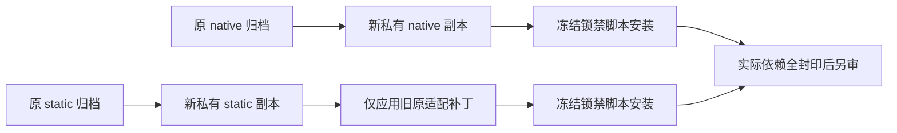

# T1254 两份原源冻结锁安装工具独立审查

结论：PASS_TOOL_TWO_ORIGINAL_SOURCE_FROZEN_INSTALL_ONLY，无新增发现。ROOT 需对精确工具另行准入；审查人未安装、联网或构建。

工具 SHA ea91ed2a、封印 a8b3d486、prepare 5bc0fb1a。实际逐 SHA 读取 1,656 来源与 461 实现共 63,262,651 字节，无漂移；source/tool digest 重算一致。两份来源分别为原 native 819 与 static 798 个普通文件，不混根，原静态三个开发辅助 symlink 仅在受控新副本恢复到内部已存在目标。

实际 PNPM 12.6 help 证明了全部参数，包括冻结锁、禁生命周期脚本、禁 pnpmfile、空 auth 配置文件、store/state、300 秒网络请求、并发 4 和输出选项。未知默认重试没有被假称关闭，受本次安装完整绝对预算约束。

入口 17,460,000 ms 包含准备 1,800,000、原静态补丁 180,000、两安装各 3,600,000、三次子生命周期各 2,160,000 和后验 1,800,000。下一子进程启动前核完整当前及未来槽，失败或取消不继续。HOME/CODEX_HOME 保原，子沙箱禁原 HOME 读写，配置与缓存全为新自有路径。

原 fetch、锁、来源字节和权限逐项守门，依赖安装后全封实际文件与内部链接。后续预算源码应用、测试、构建和产物复制均未获本次通过；安装失败也保日志和部分依赖，不改原锁或扩访问洗绿。共享公共链和 App 不在此证据范围内。
