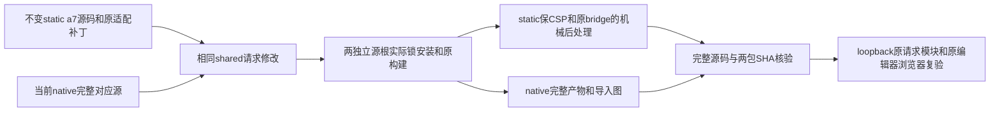

# T-1254：闭合Doocs两份真实请求预算并交付对应源码

状态：CONTRACT候选；仅本合同和只读库存已形成，待独立评审与正式record/start。用户已授权T1246整合、开发版打包、全功能验收与问题集中修复；本任务处理当场完整Gate两红，不增加图床、外网或App授权。

## 当场事实与目标

完整原超时Gate exit1，2746文件剩两条真实30秒网络abort，其他七组通过。证据 `docs/verification/t1246/round-2/unit/final-gates/timeout-1609ea867b99a9759ebfbb44e6547b21`。原22失败、当前2失败及全部历史源码/日志保持原样。

native对应源0cabb0…和不可变static a7源码9335e7…内shared fetch.ts完全相同(a46fe6…)；当前config.timeout??30000覆盖fetch和完整json/text。显式0实际即时abort，不是无限等待；动态formCustom不能假称穷尽所有用户值。当前native上传先走host.importMedia，旧providers不参与；static CSP connect-src none。两旧云端分支仍是交付政策缺口，不能扩大扫描豁免，也不能用helper慢请求代签当前host上传链。

只读库存 `/tmp/t1254-readonly/DOOCS_CONTRACT_INVENTORY.json`、`BUILD_INPUT_COMPARISON.json` 与 `STATIC_SOURCE_PATCH_CHECK.json` 必须归档和逐SHA核验。两根bootstrap/App/storage/coreexports/vite适配不同；不能用native根生成static冒称行为不变。固定a7 archive不改，不以新产物覆写历史构建PASS。

大白话：编辑器保留原本的本地操作和安全限制，只修过早掐断的共享请求，并让两份交付包各自带上确实对应的源码和校验依据。

## FR-1254：预算与原边界

- **FR-BUDGET**：同一修改字节应用到两根shared fetch.ts。undefined/null默认120000ms；有限非负数字0及小于120000ms取120000ms；合法更长有限值保持。负数、NaN、Infinity及非number不构造即时timer，确定性回到120000ms并明确单元断言；这仅是请求类型/范围校验，不做语义或创作选择。超过单个宿主timer的合法更长预算分段计时，以单一出生monotonic deadline计算剩余，不因tick续期；finally清最后timer。定时间隔不是执行上限。无持久任务上下文的该模块只监督独立请求，不增加或冒称持久任务期限、caller cancel或外部恢复许可。
- **FR-REQUEST**：原method、headers、body/FormData boundary、credentials、text/plain JSON纠错、空响应拒绝、HTTP状态与错误投影不变；原自身AbortController覆盖fetch及完整body读取，finally无成功/失败遗留timer，单调用只发原一次请求，无retry/newmodel/新供应商或全局fetch改写。SEMANTIC_BOUNDARY_ALLOW: 仅校验请求预算数值、时间与清理，不做创作选择。
- **FR-SOURCE**：native从当前0cabb归档独立owned根提取；static从固定a7归档加原creatoros.patch提取。完整锁和实际原workspace入口保留，非shared预算/测试及归档构建后处理输入的其它原适配字节不改。安装必须绑定原锁/真实Node/pnpm/完整实际工具实现；不能以CreatorOS已有依赖冒上游工具链。提取不跟随未核符号链接，完整清单明确归档symlink和未实体化开发辅助项，不称它们已构建。旧来源/许可/上游commit保持。
- **FR-OUTPUT**：两原构建真实发生，完整产物和import/CSS/HTML图校验后从owned目录整套交付；新hash文件与旧删除逐文件清单留证。不能手改两压缩块并沿用旧build证明。static原CSP全部值、connect-src none、本地base/bridge保留，Vite inline脚本如需外置仅机械原字节外置，后处理进入对应源与补丁，所有HTML src/href、JS imports、CSS URL保持存在且本地；不得放开CSP换取通过。
- **FR-PROVENANCE**：native修后完整对应源及其served副本字节相同，实际patch及副本相同；static新增修后完整源码与对应patch，固定a7压缩包不动。manifest新增精确Doocs static全文件/hash/provenance，native原395清单按实际全文件重新生成。descriptor/current SHA只指当场新构建/核验收据，历史T1053/T1062附件不改。新增静态校验由精确脚本负责，既有native校验显式调用它；其它三编辑器的验证不改、不跳过。

## 精确写集与复制前确认

允许下列确定的生产/交付族。每份实际候选仍需ROOT和独立reviewer读取完整diff、原消费者与SHA后才应用，CONTRACT通过不等于任意候选获批：

1. 两owned对应源根中的 `packages/shared/src/utils/fetch.ts`、`fetch.test.ts` 与专用确定性static后处理/图核验源脚本；其它原源只打包不改。
2. `reference-editors/doocs-md/native/native-source.tar.gz`、`NATIVE_PATCHES_FROM_T1049.diff`、`native-delivery.json`、`SHA256.json`、`README.md`、`VERIFY.md`；原附件构建日志仅新收据追加，旧附件不改。
3. `frontend/public/reference-editors/sources/doocs-md/native-source.tar.gz`、`native-patches.diff`；新增 `request-budget-static-source.tar.gz`、`request-budget-static-patches.diff`。
4. `frontend/public/reference-editors/doocs-md/native/` 和 `static/` 两套构建的完整生成文件族。原文件清单/原SHA及拟新增/删除精确路径在私有build后形成 `DELIVERY_EXACT_FILE_MANIFEST.json` 并独复；未有该精确清单不准复制生产目录。不得扩大到其它编辑器、CSP策略或未知source。构建失败不能拿机械替换compressed块代签。
5. `reference-editors/manifest.json` 仅Doocs native既有字段更新与Doocs static具体校验字段；`frontend/scripts/verify-native-editors.mjs` 仅接精确Doocs static校验，新增 `frontend/scripts/verify-doocs-static.mjs`、`frontend/scripts/build-doocs-request-budget.mjs` 为专用双owned源构建/校验工具。构建工具本身不得读取真实.env/用户配置、启动App或改其它产品依赖。
6. `docs/verification/t1254/` 真实原FAIL、新工具绑定、独审、安装/build/types/tests/图/provenance及浏览器截图；BACKLOG、模块/DEC/context/review/events按既有流程记录。原扫描规则与十处动画冻结豁免、其它产品生产源码不在写集。

## AC-1254：当场验收

- **AC-RED**：保持原完整22与2FAIL、源码归档、提取首次拒symlink失败。运行原shared fetch完整测试，新增前真实验证原30秒早断，以本owned loopback/raw完整记录；不补历史PASS。新正test/hook/请求观察至少180s，原更长预算保持、retry0。
- **AC-REQUEST**：同实际修后模块owned loopback，真实body超过30秒后完整到达；实际120秒abort；更长预算真实保持；默认/0/短/更长/非法/超timer边界用原消费者与相应测试覆盖，method/JSON/FormData/HTTP/空响应/单请求/finally保留。fake timers仅说明数值边界，不能冒真实慢请求。当前宿主上传路径与此旧模块区别明确。
- **AC-DELIVERY**：实际两根原锁安装/两真实build，所有产物导入/HTML/CSS本地归属、CSP、native manifest/source/patch与static新增精确manifest一致。native归档与served副本、patch副本相同；固定a7/hash不动；原完整shared tests和相应proper types/原verify实际执行，静态新增consumer实际校验故障负例，不只重写manifest洗绿。
- **AC-PUBLIC**：原native编辑器在隔离真实浏览器的公开加载/编辑/host媒体和source下载/hash链复验，真实PNG/trace。不能启用云图床、真实平台凭据或外网来造慢请求，不能签App通过。用户已明确不授权App自动化，App验收保持未完成。
- **AC-GATES**：完整原超时verify八组、boundary、orphan与其它任务原实际失败全部如实记录；新2失败必须真实消除，禁止豁免/scanner排除/删合法任务。完整原门通过不代签frontend原4类型错误、缺offset媒体、49官方模型或总T1246验收。
- **AC-OWNER-BUDGET**：每份工具执行前封实际源码/锁/Node/pnpm/安装实现/两archive/产物graph/manifest，独立总外层从入口覆盖两install、两build/验证、全部test/body/hook/启动/进程树TERM/KILL/日志与清理；正执行至少120s，保更长预算。阶段顺序不能靠小外层掐断，大预算timer需分段；任何取消/剩余不足/身份漂移不得启动下一阶段。所有stdout close、owned group0、before/after SHA、清理/保留状态必须当场回执。private源/build无需共享worker dist，最终复制与打包封存窗口不得并发写。

## DEC-1254

既有用户授权支持闭合这两真实请求缺口。选择两原适配根分别重建并保CSP/bridge，优先交付可证明对应源与实际完整图；不改变编辑器功能方向、内容归属、服务地址或外部能力。当前仍候选待独评，无BUILD执行准入；获正式PASS/start后各候选仍双审。
