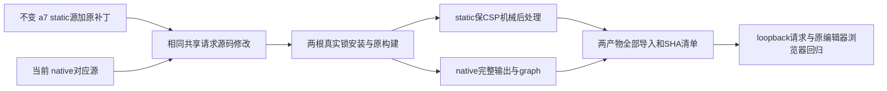

# T1254 CONTRACT 私有候选：两种交付保持各自原适配，共用同一请求预算修补

本文件只供 ROOT 与独立审查人选择精确合同。没有修改正式 SPEC、产品源码、历史归档、产物、manifest；没有安装依赖、构建、测试、网络或 App 操作。

当前两份 `fetch.ts` 字节一致，SHA 为 a46fe6b6f34941d7b28868e966b6bc412a9b3704d78f4da50c94b19b2539485d。默认与显式 0/短值应给独立请求至少 120000ms，合法更长值原样保留；计时仍覆盖 fetch 与完整 json/text 响应体，并在 finally 清理。method/header/body/FormData、JSON纠错、HTTP/空响应错误、单次请求均保留。该模块没有原持久任务上下文或公开 caller signal，不增加或假称持久任务监督、外部取消 API；验证自身真实 AbortController 的取消和 finally。NaN/Infinity 及超出宿主 timer 可表示范围的输入在当前配置没有运行边界，应在最终合同明确处理，不能用 Math.max 让 NaN 或 timer 溢出重新变成即时掐断。

## 同源边界与尚未证成的重建

实际 native 对应源含两 Vite 配置、两 web entry、所有 workspace 的源码导出和锁文件。但 native 与固定 static 源的 bootstrap、App、storage、core exports、vite 配置不同；二者锁文件与共享 fetch 相同。直接以 native archive 生成 static 会引入原宿主适配变更，不能作为本请求预算修复的无条件替代。BUILD_INPUT_COMPARISON.json 逐 SHA 保留这些差异。

建议最小方案使用两份自有临时源码根：native 基于当前对应源归档；static 基于不可变 a7 固定归档加当前 doocs-md-creatoros.patch。只把同一份 fetch.ts 预算修改及同一测试修改应用到两根，核修改后共同源码 SHA 相等；各自原适配其余字节不变。两根仍属于同一上游与同一共享请求源码的可核对分支，不能宣称整个源码根相同。

真实 static patch check exit 0，证据 STATIC_SOURCE_PATCH_CHECK.json；第一保守提取器遇到开发技能 symlink 停止的真实失败保留 STATIC_SOURCE_EXTRACT_FIRST_REJECTED.json。第二根只提取 regular files、明确列未实体化 symlink，不能冒称全归档安装或运行通过。完整 dependencies 安装、两入口真实 build、静态全部 import graph 仍待实施与实际回执。

## 最小一致性交付写集候选

1. 对应源根中 `packages/shared/src/utils/fetch.ts` 与 `fetch.test.ts`。native 既有 `scripts/build-native.mjs` / `scripts/verify-native-build.mjs`、`apps/web/vite.native.config.ts`、原 Vite 配置作为真实构建输入；static 原 `apps/web/vite.config.ts` 使用原 CREATOROS_EMBED=1，workspace exports 指向 src，无假造额外 package build。完整现锁安装必须真实发生，不能用当前 CreatorOS 的依赖替代上游不同 pnpm12.6/Vite8/Vitest5 锁。
2. `reference-editors/doocs-md/native/native-source.tar.gz` 及相同公开副本 `frontend/public/reference-editors/sources/doocs-md/native-source.tar.gz`：包含实际修后完整 native 对应源。`reference-editors/doocs-md/native/NATIVE_PATCHES_FROM_T1049.diff` 及公开 `native-patches.diff` 记录实际新修改。原 provenance 的上游 commit、license、宿主所有权保持；历史构建证明保留，当前交付 descriptor 只引用当场新收据。
3. 新 static 修后完整对应源码归档与补丁，例如 `frontend/public/reference-editors/sources/doocs-md/request-budget-static-source.tar.gz` / `request-budget-static-patches.diff`。不可覆盖或改写 `doocs-md-a7c17fc4cda92e3c13aa7e24f06615cfa4219b31.tar.gz` 和历史 SHA。新归档必须包含实际静态基线、补丁、锁、构建/后处理输入与来源说明，不以旧归档宣称新 bundle 对应源。
4. 两套完整机械构建输出：`frontend/public/reference-editors/doocs-md/native/**` 与 `frontend/public/reference-editors/doocs-md/static/**` 及受影响 `index.html`/资源引用。从 owned output 整套复制，旧 hash chunk 通过输出文件集 diff 有依据地替换，禁止只改两压缩块。native graph、SHA256.json、相对 import/CSS URL/许可证都由实际产物生成与校验。
5. 静态后处理必须进入修后对应源/工具归档：现静态 index.html 有 CSP `connect-src 'none'`、仅 self scripts；归档源 index.html 无该 CSP 且有 inline scripts。不能直接复制 Vite index 而放开权限或让脚本被 CSP 拒绝。需要确定性外置真实 inline scripts、保原 CSP 完整值、local asset base、既有消息 bridge；逐全部 output import/HTML src/href/CSS URL 验存在与本地归属，拒绝非本地导入。该机械后处理及验证工具属于明确新增待评范围，不是已有成功证据。
6. `reference-editors/manifest.json` 只更新 Doocs 原生 hash 清单及相应源/patch SHA，新增 Doocs static 的完整文件集/hash 与修后对应源/patch provenance。`frontend/scripts/verify-native-editors.mjs` 若承担这一 static 校验，明确仅补 Doocs static 分支，其他原生三编辑器的原验证保持；或者增加独立精确 static consumer并纳 Gate。`reference-editors/doocs-md/native/SHA256.json` 和 `native-delivery.json` 当前交付字段按当场输出更新，T1053/T1062 原历史附件不改写。`frontend/scripts/build-reference-editors.mjs` 当前只 native，不声称它已支持 static；建议新自有双源码构建工具归档，保原生产入口默认语义。

## 实际验证要求

原 shared fetch tests 整文件保留、新增默认/0/短/更长配置的 timer 与 finally 边界，正执行预算至少180s、retry0。受控 loopback 实际导入修后模块：请求头立即收到、body 延后超过30s仍完整；真实120s到期 abort、较长配置保持、method/JSON/FormData/HTTP错误/空响应与单请求数量。只能签同实际请求模块的 loopback 链，不把它叫现宿主图床上传公共链，也不新增外网权限。超时原 scanner 八组全跑、不添加静态豁免。

另对既有原 native 编辑器做隔离真实浏览器公共操作与资源/source下载/hash回归。原 host.importMedia 绕过旧云端模块的事实保持，不用真实平台云端来伪造慢链。原生 App 仍因用户未授权而未验。

所有执行工具须绑定源包/新源码/patch/锁/Node/实际安装工具实现、两产物完整图与 manifest；独立外层覆盖两根 install、两串行 build/type/verify、测试完整最长 body/hook/排队与所有 helper 生命周期、报告和清理。精确预算必须在工具形成后按实际完整消费者逐项审，不在本草案预签任意总数字。

