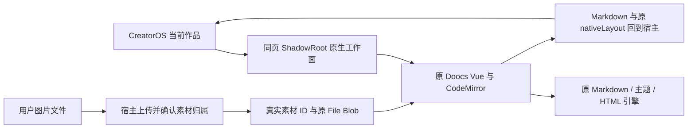

# T-1254 当前请求预算与两份真实源码交付

当前归档、patch和完整文件摘要以 manifest/native-delivery.json 的 T1254 字段及 V15 当场证据为准。两根均使用各自原锁和 pnpm 12.6.0 实际安装、原类型检查与原构建；原请求每根24测试、真实31秒／120秒／130秒和清理断言通过。静态保原CSP和消息bridge；native上传仍由宿主负责。浏览器公开链路由独立后续验收提供；App自动化因用户暂不授权保持未完成。下文全部旧T1053/T1062附件仅作为历史保留。

复现工具 `frontend/scripts/build-doocs-request-budget.mjs` 要求HOME外两自有源码根、原锁安装完整库存、Node非系统dyld递归闭包与精确审查回执。先 `--prepare` 形成完整binding；经独立与ROOT审核后才可 `--execute --binding ... --binding-sha256 ... --review ...`，不会安装依赖、复制生产或读取真实用户配置。当前static后处理入口随源码位于 `scripts/creatoros-request-budget-static-delivery.mjs`。

---

# T-1062 当前原生候选

当前source与输出以本次candidate及校验清单为准，真实原命令记录见 VERIFY.md/VERIFICATION.md。宿主18、浏览器视觉、试听与安装尚未执行。

## 原T-1053说明（历史保留）

# Doocs/md 的 CreatorOS 原生组件

原始仓库为 https://github.com/doocs/md ，固定源码提交为 `a7c17fc4cda92e3c13aa7e24f06615cfa4219b31`，原代码许可为 WTFPL。此归档包含完整源码、原锁文件、CreatorOS 原生适配和构建/夹具脚本。原固定来源及历史独立页版本由 CreatorOS 保留；本归档无需读取旧临时工作目录。

用户在 CreatorOS 页面内编辑正文、看公众号预览、调排版和 CSS。真实工作面仍是原 Vue `EditorPanel`、CodeMirror、`PreviewPanel`、`RightSlider`、CSS 编辑器、表格/公式对话框和原 Markdown/HTML 引擎。应用负责正式稿、账号/作品/版本归属、精确素材和 CAS 保存。



## 复建与验证

需要满足原 package.json 的 Node 和 pnpm 版本。解压后在源码根运行：

```bash
pnpm install --frozen-lockfile
node scripts/build-native.mjs
node scripts/verify-native-build.mjs
node scripts/verify-native-dom.mjs
node scripts/verify-native-dom.mjs --without-process
node scripts/verify-native-image-variants.mjs
pnpm --filter @md/web exec vitest run src/native-lease.test.ts
```

原生配置显式设为 production，并在构建期定义 process.env.NODE_ENV 为 production；浏览器无需 process 兼容对象。构建验证解析实际 JS AST，检查未替换宏为 0；无 process 的实际 ESM 夹具从导入至销毁覆盖原合同。

原生配置显式指向本归档的 `packages/core/src` 与 `packages/shared/src`，不读取旧 `/tmp/t1049` 源码。若复用已有依赖而跳过安装生命周期，先执行 `pnpm --filter @md/web exec wxt prepare`。本轮实际在 Node 25.9.0、相同锁文件/已有依赖缓存下，对两个不同目录独立构建并逐字节核对；不联网重新安装。可再次使用 `node scripts/verify-native-rebuild.mjs <源码目录1> <源码目录2>` 比较完整源和每个产物。

产物在 `apps/web/dist-native/`。将完整目录放到 `/reference-editors/doocs-md/native/`，先把 `native.css` 放入实例 ShadowRoot，再从 `native.js` 加载 `mount`。入口/依赖块/样式引用均是这个目录的本地构建。对应完整源码下载路径为 `/reference-editors/sources/doocs-md/native-source.tar.gz`。

## 宿主接口

`mount(container, options)` 返回 Promise；container 和 portalContainer 必须位于同一 ShadowRoot。options 包含 owner `{accountId,outputId,sourceVersionId}`、theme `{mode,tokens,fontFamily,fontSize,density}`、portalContainer、signal、onChanged、onError 和 importMedia。tokens 是 CreatorOS 的 `--creatoros-*` CSS 变量，颜色直接使用真实 hex 值。importMedia 接收原 File，宿主先注册素材，返回 `{mediaId:'creatoros-asset:<assetId>:<assetFileId>'}`；原生再注册原 Blob 并插入正文。

handle 返回 `request(operation,payload?,{requestId?,signal?}?)`、`update({theme?,disabled?})`、`dispose()`。request 支持：

| 操作 | 输入 | 返回 |
| --- | --- | --- |
| load | `{document:{title,markdown,layout?},assets?:[{assetId,assetFileId,blob}]}` | `{markdown,layout}` |
| asset | `{assetId,assetFileId,blob}` | `{mediaId}` |
| insert-media | 同 asset | 注册素材并插入精确图片引用，返回 `{mediaId}` |
| snapshot | 空 | `{markdown,layout}` |
| export-html | 空 | `{html,bindings:[{key:'assetId:assetFileId',url}]}` |

onChanged 报告 `{markdown,layout}`。内存存储只服务当前实例，不另建正式稿/素材数据库；draft sessionStorage、稳定段落标记、CAS 与资源 ZIP 继续由宿主原合同负责。换 UI theme 不修改稿件版式。同作品 load 保留已核验图片；卸载撤销 Blob URL，串行 lease 确保旧实例关闭后新实例取得写权。

## 本次实际验证边界

构建和全 Web 源类型检查通过；原生 lease 的两个 Vitest 测试通过；Node+jsdom 使用实际 dist-native ESM 完成原组件挂载和宿主合同断言。夹具使用真实 Markdown/HTML 引擎与原 File 身份，图片内容是明确的非像素夹具。ResizeObserver、Range 几何与 scrollIntoView 由夹具模拟；execCommand 返回 false，不能当作 Clipboard 成功。没有运行浏览器自动化。

图片使用惰性 DOM 解析，合法引号、换行、属性中的大于号均保留；img/picture/source 与 SVG image 的未知外链局部占位，精确素材、已注册 Blob 和明确 image MIME 的安全内嵌图继续显示。实际夹具检查了预览与 HTML 导出、原 Markdown 不变及 SVG 其它向量层保留。

真实浏览器的亮暗像素/布局/焦点/层级、图片像素、资源 ZIP 人工质量、系统 Clipboard、远程 MathJax/PlantUML 和复杂图表仍待验。原数学/图表引擎的远程依赖继承上游行为，未在本次夹具中联网验证。DOM 夹具只证明其实际断言，不能代替这些项目。

`native-build-graph.json` 列出实际编译源码和依赖，`licenses/` 包含随 npm 包提供的许可证文件，`LICENSE` 是原项目 WTFPL 许可。两个实际编译 npm 包没有随包许可证文件（measury、qiniu-js），其声明许可保留在构建依赖记录中，不虚构原版权文本。
