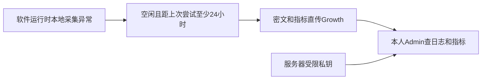

# T1255实际交付状态

功能源码已完成本地整合，源码提交9e9acd99e与6888f47fe；当前Creator主线正式SPEC评审c0a209d6390d，owned source依同范围冻结，不把旧private receipt代签当前主线。后台/前端/contract及实际持久任务/visual/HTTP回归、浏览器保存刷新/撤回/离线桥接、原Rust异常加密均已当场验证；fullNext构建真实PASS。正式c01bada2原钥匙找到并只读HTTP验证，无私值回显/复制/修改。

共享main源码已CAS整合48path，保他人改动。Growth主线T229已CAS整合41path；由于真实生产c545377/0071而本地含T188，另准备生产日志独立候选与同0075兼容回滚，不能将原growth-feature.patch当可直接上线包。

未完成：本候选安装包、本机安装启动/Windows安装、已部署Growth真实回执、服务器正式钥匙配置与实际服务器解密、17362936917真人UAT。已有全局Creator reconcile/timeout和Growth旧lint/冻结测试失败真实保留，未签全绿。当前freeze仅为可审查源码，不创建tag、Release、不push、不部署。

