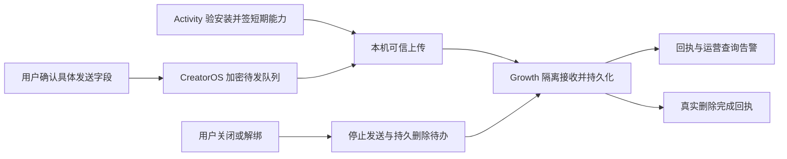

# T-1255 日志诊断与创作数据上报完整落地

## 用户要求与来源

2026-10-12 用户核对上报完成度后明确要求：“那不行啊 这个 feature 你要落地的”。本任务完整恢复 diagnostics 来源 T-1024；主线 T-1024 已被另一个额度排障任务占用，保留原来源记录，不篡改历史 ID 或 PASS。

范围继承 [原实施 SPEC](t1024-reporting-implementation.md) 和 [原字段/数据归属](t1017-diagnostics-creator-reporting.md)。原三方规格评审不冒充当前代码、跨仓往返或生产上线证据。此次授权支持 CreatorOS/Growth 可逆实现与隔离集成准备；Activity 当前维护锁要求 [本轮限定修改说明](t1255-activity-change-approval.md) 的专项确认，确认前仅只读。生产启用与正式发行在具体交付结果就绪后核对既有授权。

## 完整交付与边界

接通 CreatorOS 本机持久加密队列、Activity 专用短期 capability、Growth 按产品/渠道/安装/scope/账号别名隔离接收与回执、运营查询/告警、撤销及云端删除回执。补齐设置页真实最近发送/接收时间、积压/错误/撤销状态。账号/作品/粉丝字段仍守原白名单与可信来源；未知显示 unavailable，真实零显示 0。逐用途逐账号明确授权后自动发送，旧 consentVersion=1 只代表本机准备，不能自动升级为云端授权。

原始日志、stack、正文、素材、Cookie、账号原始 ID 和提示词不自动发送。网络失败不阻断启动、保存、生成、采集、渲染、导出和发布；只由可信本机 adapter 出站，Worker 不持有上传凭据。目的地址固定可信 origin；请求完整预算至少 120 秒，取消和重试不新增业务采集任务。

大白话：用户开启后，电脑把最小故障信息和选中账号的数据可靠送到 Growth；后台能按参考编号查到，关闭后停止发送并确认云端删除。

## 路由与独立复核

入口为已有 BUILD 功能恢复；先只读盘点三仓现有候选、共享 fixture、契约与历史评审，精确确定缺口、写集及独占资源。合同、IA、数据归属或实现范围变化先记录 DEC 和独立复核，不沿旧 PASS 任意扩展。UI 工作加载项目 oil-ui-pro，保留现有组件/tokens；原版授权与账号组隔离共同生效。

## 验收

1. 当场记录当前 uploadAvailable=false 和无远端发送的红证据；测试只用隔离数据库、受控安装和虚构无内容事件，不读取或发送真实用户日志。
2. 三仓共享 fixture 字节/hash一致，Activity 真实 HTTP 签发到 Growth 真实 HTTP 验签/持久化，再以相同参考编号在运营查询读回；模拟函数不能代替该完整链。
3. 未授权零出站、账号 A/B/错组/跨渠道隔离、白名单及非法字段、能力过期/撤销/错误 scope、幂等、部分回执、断网/重启恢复、在途撤销/迟到快照和删除终态均覆盖公共链。
4. 原始错误事件各真实入口可入队，关键业务不因发送失败受阻；所有故障族的实际覆盖逐项列出，不把单个 dispatch 错误算全故障覆盖。
5. 设置页和 Growth 运营后台实际浏览器操作及截图，双端安装包实测按真实可用环境记录；缺少真机或未上线明确待验，不补拍 PASS。
6. 三仓适用单元、合同、类型、boundary、orphan、timeout、sync/reconcile 真实运行，既有范围外失败保留并登记。只有完整交付和必要验收闭合后才由 taskctl 完成任务。

## 当前事实

- CreatorOS 已有 reporting-local、consent UI、迁移和采集回调；`uploadAvailable=false`。
- Growth/Activity 当前生产及隔离候选尚待本轮只读核验。
- 本任务尚未推进生产修改，未部署或发包。
