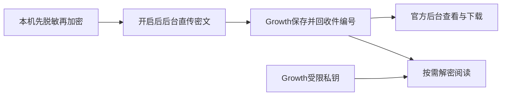

# T-1255 加密日志直接上传 Growth 并集中解密

## 用户确认与范围

2026-10-12 用户要求功能完整落地，随后明确：“这和activity没什么关系吧。直接上传就行了呀，上传上去我自己统一在这个growth端去解密就可以了呀。”本任务因此改为现有加密日志直接上传 Growth，不再接入 Activity，不用结构化指标代替完整日志。旧方案封存 `docs/verification/t1255/original-activity-reporting-proposal.md`；此前 Activity 限定许可不使用，Activity 未修改。

账号/作品/粉丝共享保持现有状态，本任务只落实用户指定的日志传输路径，不上传业务数据库。旧 consentVersion=1 只授权本机结构化准备，不能自动扩为完整日志发送。现有设置页显示完整日志用途、接收方与30天云端保留期，用户主动开启后自动上传；原脱敏、加密格式、公钥不变。

## 结果与归属

CreatorOS 将 Rust 宿主提供的 `CREATOROS_LOG_DIR` 下 `sidecar-YYYY-MM-DD[-N].log.enc` 完整密文帧快照，通过 HTTPS 直传 `https://growth.aitongban.cloud/api/v2/client-logs`。Growth持久保存密文，回收件编号；官方安全管理员在后台筛选、下载密文、按需解密阅读。客户端只带公钥；Growth从服务器受限文件配置私钥，不把私钥放客户端或代码。缺少对应钥匙仍可收件/下载，诚实显示暂不能解密。隔离测试用一次性钥匙与虚构日志；不读/传真实日志或真实私钥。

## 服务合同

- 设置新增 `settings.logReporting.get/set`。状态：consentVersion=2、enabled、随机installationAlias(UUID)、changedAt、lastUploadedAt、lastReceiptId、pendingCount、lastErrorCode、uploadAvailable；开关默认关闭，不改已有账号授权。告知上传脱敏后完整加密运行日志，Growth可解密，可能含异常详情与运行上下文，30天保留；关闭取消在途、停止后续发送，不等于删掉已收日志。
- 本机只读可信日志目录的普通受管文件，拒symlink/路径逃逸/任意UI路径；单文件10MiB、最多64份。按CRLOG完整header和frame边界取稳定前缀，半截末帧留下一次，不解密或改原文件。sessionId=SHA256(header)，snapshotId=SHA256(snapshot)。启动/开启立即扫描、每5分钟唤醒；一个在途请求，失败指数退避最多1小时。相同SHA不重传，回执后持久记录；断网/重启/丢回执仍以原SHA幂等重试。单次完整请求预算120秒、关停abort，无业务任务重发或原期限续期。上报自身只写受限状态，不能递归制造日志。
- `POST /api/v2/client-logs`：Content-Type=application/octet-stream，body原密文，最多10MiB。请求头：X-Installation-Alias(UUID)、X-Log-Session-Id(64hex)、X-Log-Sha256(64hex)、X-App-Version(1—64版本ASCII字符)、X-Os-Name(macos/windows/linux)、X-Log-Date(YYYY-MM-DD)。无激活码、Cookie、账号ID、路径或私钥。客户端HTTPS固定origin且禁止redirect；仅注入隔离loopback adapter可用HTTP。
- Growth依据实际stream字节限额、CRLOG v1、1—8recipient、完整frame、header/session/SHA/date核验。仅收件写权限，无客户端读/解密权限；安装别名只帮助定位，不声称其经过许可认证。成功200/201 exact JSON：schemaVersion=encrypted-log-receipt-v1、receiptId、installationAlias、sessionId、sha256、byteLength、receivedAt、status(stored/duplicate/superseded)。superseded仅对已存更长密文的合法前缀快照；superseded仍回传此次请求SHA/byteLength并返稳定收件ID，客户端核全身份/字节后记确认。格式422、过大413、同session非前缀冲突409、限流429+Retry-After；失败留待发。
- Growth新client_logs模块，installationAlias+sessionId唯一，数据库事务协调并发；每session只保最新更长前缀密文，重复不累计。只写匿名接收独立按peer IP、安装与全局限量：每IP每小时120个新快照、安装每日100MiB、全局每日1GiB，字节额度按每个新快照完整入站字节扣减（不只增长量），UTC日窗口；每IP小时额度按UTC小时计；完全重复/已覆盖不消耗新增快照额度，所有请求在读取body前原子计数：每可信IP每分钟12次、全局每分钟120次，重复和非法请求同样计入；直接复用Growth现有TrustedProxyClientIpResolver，未配置可信代理只用peer IP，不信任任意X-Forwarded-For。IP以单向hash落限量桶，bucket时间用服务端UTC、扣额按数据库事务和唯一bucket键串行，拒绝重试不能丢计数。限额只是延迟日志发送，不影响产品主功能。云端30天清理；不改本机原30天/64份/10MiB轮转。
- 官方 `GET /api/admin/client-logs` 按installationAlias/appVersion/dateFrom/dateTo分页，limit≤100；`GET /api/admin/client-logs/{id}/ciphertext`下载、`GET /api/admin/client-logs/{id}/text`解密。仅现有admin_security会话，读/解密留审计，private,no-store；明文只在响应和阅读内存、不落副本。私钥配置 `CREATOROS_LOG_DECRYPT_KEY_FILE` 是服务器路径；错key、坏header明确失败，损坏尾帧显示已解前缀及截断状态，text返回exact JSON {receiptId,sha256,lines:string[],truncated:boolean}，不执行日志HTML/命令。CRLOG字节/算法以frontend/src-tauri/src/logging.rs为唯一原格式依据：6字节magic、u8收件人数、每recipient 96B(key_id4B/eph_pub32B/nonce12B/wrapped48B)，X25519→HKDF-SHA256(info=creatoros-log-v1|+key_id)→AES-256-GCM包32B sessionkey；frame为u32LE长度+AEAD密文，nonce=u64LE序号+4零字节，AAD=u64LE序号；私钥文件为CLI同格式standard-base64 32B raw。页面使用现有Shell/组件，正常/空/加载/失败/刷新/返回/长行/390宽都可用。

## 精确写集与路由

CreatorOS：contract/src/operations/settings.ts、cli-policy.ts、workspace-operation-scope.ts；新增backend/src/modules/settings/encrypted-log-reporting.ts及test，settings/index.ts/settings.transport.ts、backend/src/schema/settings.ts；新增frontend/src/server/feedback/encrypted-log-upload.server.ts及test，persistence-client.ts仅装配启动清理；新增frontend/src/features/settings/encrypted-log-reporting-card.tsx及test，settings-interactive-region.tsx挂载。DDL沿当前SETTINGS_DDL真实消费者增量，不覆盖历史迁移，另按当前lineage门核需要的精确新迁移。

Growth：新增server/modules/client_logs/{__init__,models,service,crypto}.py、transport/http/client_logs.py；composition/application.py窄装配、当前model registry与workers/runtime.py清理；新增接当前head的迁移（编号盘点后绑定）；新增专项tests；新增frontend/src/app/admin/pages/ClientLogsPage.jsx、clientLogsApi.js及test，现有routeContract/routes/导航窄接入。配置只在.env示例/交付说明声明，不写真实.env。两仓SPEC/DEC/BACKLOG/验证工件及流程绑定按实际记录。

入口为合同修订独评，通过后BUILD；UI使用项目oil-ui-pro存量方向精修。Activity、AI/模型执行、用户数据库、真实密钥、旧遥测候选均不在生产写集。并行写用真实独立owned workspace，主会话串行集成；共享合同、迁移序列/DB schema/测试端口独占，不覆盖他人脏改。原T1255和Growth历史T187旧评审不代签新合同。

## 验收与完成条件

1. 当场RED→GREEN：未授权零请求、ciphertext接收缺口、幂等/增长/重放/半截帧、坏SHA/过大stream/symlink、配额、断网/重启/关闭取消。测试使用隔离库/一次性钥匙，不改真实用户对象。
2. 实际Rust creatoros-logdec encrypt生成密文，CreatorOS实际HTTP发送→Growth真实持久化→官方查询/下载SHA一致→Growth解密文本逐行一致。跨语言fixture真实发生，不能只用两个同源helper代签。
3. 设置保存刷新和发送结果、后台查看下载解密/390宽，实际浏览器操作与截图。私钥未配置如实不可用，生产钥匙配置在具体交付时核授权。
4. 两仓适用test/contract/types/build/boundary/orphan/timeout/sync/reconcile当场运行，保范围外失败。Growth旧流程漂移先按技能update修正后验证。
5. 完成须安装端与已部署Growth真实回执，并用当前正式公钥key_id=c01bada2加密的无真实用户内容夹具在Growth服务器实际解密成功；缺匹配正式钥匙不能签统一解密完成。未部署或双端真机缺失保持待验；本地HTTP绿只证明该范围。accepted-risk须用户明确决定。

当前为待独评合同；仅文档/只读盘点，无生产修改/真实上传/私钥配置/部署/发包。
