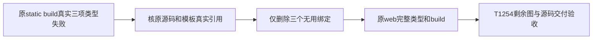

# T-1256：修复Doocs静态原适配源码的三处无用绑定编译失败

## 当场事实与授权

用户已授权T1246集中修复、合并、开发包与AI自动验收，并再次要求“继续”。T1254 V13 nonce907bb885eb0fd4f595b8d1f2b70fc29b真实运行：两根24例全部通过、两组31/120/130秒真实请求通过、两shared types通过、native原build与原verify通过；static原build资源编译完成后vue-tsc出现三项TS6133，完整build exit1/16981ms/closed/group0。原V13 wrapper exit1/1153972ms，新段10成功+第11失败；完整69原文件由ROOT逐SHA绑定，证据`docs/verification/t1254/ROOT_V13_ACTUAL_STATIC_BUILD_UNUSED_BINDINGS_FAILURE.json` SHA f1a69dc144ec8f112645d45dded4cf8073bf05c478e6d081440e8820a85f8e69。

对应已应用原static a7+旧creatoros.patch的`apps/web/src/components/editor/EditorPanel.vue` SHA a076d986b80fc88a7416e305d125690d0c626c11cf43c4ba6cda1ccfc133046c。65行showAIToolbox、68行isMobile和75行showEditor仅声明，无后续引用；真实template670行直接读取viewMode，必须保留。文件全文、原归档/原补丁对应字节与调用者由独立审查核对。本任务不能把partial dist当完整build通过，也不更改原T1254历史SOURCE/exit/缺失回执。

大白话：原静态适配已不使用这三个变量，但声明留下来让编译器拒绝构建。只清理这些无用声明，保留现有界面和操作，再跑原完整构建。

## FR-1256：精确范围

- FR-CLEANUP：仅从`const { isDark, showAIToolbox } = storeToRefs(uiStore)`删无用showAIToolbox绑定，保isDark；从第二storeToRefs(uiStore)解构删无用isMobile，保enableImageReupload/viewMode；删无用`const showEditor = computed(() => viewMode.value !== preview)`整条声明。不删store初始化、剩余读取、watch、handler、template、样式、UI控件或任何操作。若发现其它编译错误/新必要变化，先如实登记，不自动扩写集。
- FR-ORIGIN：仅已验证owned static源根的这一个文件，按独立候选完整diff/前后SHA/原mode0664和inode/UID核后应用。native根不改；fetch/test/Graph维持V13已审SHA。原a7归档/旧creatoros.patch与历史收据保持。新修后static source archive和对应combined patch准确含该清理；T1254 exact交付清单须显式列它的源改动及该原build重试来源。
- FR-NO-POLICY-CHANGE：不改tsconfig/noUnusedLocals、原type-check/build命令或断言；不隐藏TS错误，不新增编译忽略，不扩timeout扫描豁免，不改CSP/bridge、路由、数据或模型行为。不新增页面或视觉改造。
- FR-CONTINUE：V13此前完整通过结果保原出处；从static原build及其后原步骤继续，不重拍两旧RED或重复合法慢请求。续段保原V12 UTC上限2026-10-13T10:50:47.959Z，并保V13既有UTC上限和新段单出生完整预算中更早者，clock回退/期限耗尽/完整future不足拒绝下一步，原持久任务不续期。源码/工具/实际动态库闭包和所有历史前序真实exit在新的封印中逐SHA双审，旧两wrapper失败永久保留。

## AC-1256：验收

- AC-RED：直接保当场V13原build三项TS6133/完整非零日志和关闭凭证；不能把它冒T1254请求红测，不能补历史通过。
- AC-TYPES：独立完整diff确认仅三处声明删除且script剩余、template/style逐字不变。实际原web `vue-tsc --build --force`在原build中执行并退出0，不只shared types或helpers。
- AC-BUILD：原static `pnpm --filter @md/web run build`完整退出0，原resource/compile两部分及日志/owned group0/源前后闭合；如果再次失败保持新真实失败再诊断，不改原期望。
- AC-DELIVERY：相应整图/两根归档与patch实际复现、原scanner及T1254全部后续步骤通过后，exact交付列表ROOT+独审供复制。T1256局部编译通过不代签T1254/T1246、49官方模型、新包、浏览器或App。

## 写集与DEC-1256

允许owned static唯一EditorPanel.vue三声明清理、该改动的候选/真实类型构建/图/provenance/独审证据`docs/verification/t1256/`、相应T1254新源archive/combined patch/exact delivery记录和正常BACKLOG/DEC/context/events。实际生产复制仍受T1254精确生成文件清单双审；不改变原T1254 SPEC字节或绕其冻结列表，通过本独立根因任务显式增加唯一对应源清理。除此不改产品。

既有用户集中修复和“继续”授权覆盖这个当场构建问题的最小编译清理，不涉及方向/架构/数据归属或新发布/系统权限。当前CONTRACT候选，独立审核通过并taskctl start、精确候选双审后才能改owned源。App仍按用户暂不授权保留未验。
