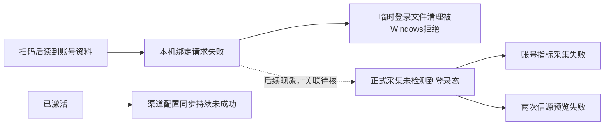

# T-1258 用户2026-10-12运行日志异常分析

四份附件完整解密，157个AES-GCM认证帧均通过，无截断或损坏。日志覆盖北京时间20:48:13—23:00:00，四段运行，中间有间隔；这不是全天连续记录。路径显示Windows运行环境，堆栈引用runtime-images/1.1.0-461f89527244，不能用当前源码的实现或本机版本代签该用户安装版。

最主要的问题是抖音扫码后的绑定流程失败：已能读取平台账号身份，两轮仍失败，后续正式采集找不到登录态。另一独立问题是已激活后的渠道配置同步一直未成功。29条DISPATCH_FAILED不等于29个独立根因。

## 异常及影响

| 北京时间 | 现象 | 证据与判断 |
|---|---|---|
|20:50:57、20:52:28|两次扫码绑定请求失败|文件-1第24—31、41—48行：先读取到相同真实账号资料，随后清理临时profile的Default/Account Web Data失败，Windows EPERM/unlink，ingestion.douyin.login最终DISPATCH_FAILED。说明问题发生在扫码后本机绑定流程，无法仅凭日志判定账号登记还是登录态搬移先失败。|
|20:53:29、20:59:05、20:59:52|正式登录态不可用|文件-2第23—34、46—47行：scheduled.self.metrics原任务明确failed，DouyinNotLoggedInError；两次intelligence.sources.previewProfile同错误。前一阶段扫码登录不代表正式账号目录登录态已保存。这些可能与绑定失败同链，但缺逐请求关联不能断言全部同因。|
|20:48:45起，21:38:25仍失败|渠道配置同步未成功|文件-1第18—23行、文件-2第36—40行、文件-3第21—25行：1条refresh failed/CLIENT_CONFIG_INVALID及15条config_sync retryable/unexpected_failure日志。跨三次已激活运行持续出现，未见同步成功。日志行数不是网络请求次数。不能分辨响应JSON、响应头、签名或缓存版本具体哪项无效，也没有证据认定502或余额不足。可能影响配置/受管凭据更新，不能推断所有AI能力停用。|
|20:48:41—21:37:49|24次账号上下文缺失|项目列表、抖音状态、定位页各8次AccountRequiredError。含刚启动尚未选号场景，也出现在扫码失败后及重启后。有账号记录出现，但请求上下文未带选中账号；不说明数据库无账号、账号丢失或跨组泄漏。|
|20:55:36|一次定位资料读取拒绝|文件-2第45行：positioning.profile.get / OwnershipError。20:55:25定位生成已ok，20:55:31聊天completed；生成候选不代表用户已采纳保存。当前transport对未存在正式profile也抛此错误，故这里只能确认读取失败，不能认定真的越权、保存丢失或账号错配。|

## 优先排查顺序

1. **扫码后的登录态落地**：Windows中Chromium未完全释放文件句柄是EPERM的合理候选，权限或安全软件也可能造成；需查原绑定错误、浏览器进程退出、账号登记及staging→正式目录搬移结果。当前源码的discardStaging会在失败路径记录清理异常，故清理错误可能是次生现象，不能把它直接写成唯一根因。不要指导用户删正式登录目录或重复新建账号。
2. **渠道配置同步**：查该安装版与Growth的真实请求回执、响应验证失败分支，保留HTTP状态及关联编号。附件缺这些细节，不能准确定位服务端或客户端哪一方。
3. **账号选择与正式定位读取**：再核启动时选择状态、绑定后上下文刷新、定位是否采纳保存。上述两类错误都存在合法空态解释，需要UI与持久状态证据才能确认缺陷。

## 正常及未知

- 初次20:48:26 CLIENT_CONFIG_LICENSE_UNAVAILABLE发生在licensed=false/activation-only，随后20:48:33已经licensed=true/status=active；这条是激活前的保护性阻断，不代表持续激活失败。
- 四次运行均SIDECAR_STARTUP_VERIFIED。前三次退出均由壳发起优雅停机、数据库安全落盘、exit code=0，没有崩溃证据；第四段日志结束未记录退出，状态未知。
- 20:55:25定位生成ok，用时27.451秒；20:55:31聊天completed，用时41.593秒。无此轮模型调用失败证据，正式保存与采纳未知。
- 9条scheduled.intelligence.sync标记succeeded，candidateCount=0、usage=null。只能确认任务记录成功，不能断言实际采到了作品、网络采集已恢复或数据完整。
- 没有可确认的渲染、导出、发布、内存耗尽或数据损坏异常；这些操作也没有足够记录证明成功。末尾23:00后及运行间隔没有覆盖。

## 证据处理与验收

原附件未改动。本机已有开发者密钥仅在内存使用，没有回显、复制或写入报告。原解密CLI二进制缺失，采用已安装Python cryptography，逐字段核对Rust logging.rs协议后执行X25519/HKDF-SHA256/AES-256-GCM解密与认证。明文仅存本机0700临时目录，文件0600；本报告不包含昵称、平台secUid或用户绝对目录。

- 文件完整性：FILE_INTEGRITY.json，四份24,836B，157帧，全部认证通过。
- 统计：29条DISPATCH_FAILED，其中AccountRequiredError24、login2、preview2、profile1；另有1个正式采集任务failed。堆栈多行不重复计异常事件。
- 本任务为只读支持诊断，无生产代码/合同/页面/依赖/业务数据变化；产品实现TDD/frontend/contract/e2e/boundary/orphan与重大任务全局reconcile不适用。本报告不声明任何修复已实施或安装版验收通过。
