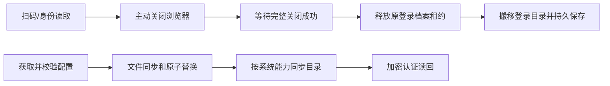

# T-1259 原因核查与当前源码修复

用户确认当前版本称1.12，1.11是之前版本。修复依据当前源码中的可复现缺陷；不把日志runtime-images/1.1.0-461f89527244目录名当成用户当前壳版本。仓库当前frontend/tauri/Cargo均1.2.0；用户口述版本未强行归一为1.1.2或1.2.0。

代码历史交叉核对：目录fsync逻辑来自8d837393c（2026-07-29）；close事件直接释放逻辑来自79c2343c2（2026-09-07），两处一直存在于修复前的当前源码，不根据旧目录名推断已修复。修复提交d1957e465。

## 已确认并修复

**Windows配置保存失败**：EncryptedClientConfigStore.save在临时文件写入/fsync/rename后，无条件用只读目录句柄执行fsync。Windows libuv将fsync委托FlushFileBuffers，后者要求GENERIC_WRITE，只读目录句柄不满足。这个兼容缺陷会把已经写盘的配置判失败；安全校验失败后的隔离状态保存也可能因此再抛普通磁盘异常，让原CLIENT_CONFIG_INVALID变成unexpected_failure。修复仅在Windows省去不适用的目录fsync，保留文件同步、原子替换及认证回读，POSIX仍同步目录且传播失败。依据[libuv固定版本源码](https://raw.githubusercontent.com/libuv/libuv/v1.51.0/src/win/fs.c)及[Microsoft FlushFileBuffers说明](https://learn.microsoft.com/en-us/windows/win32/api/fileapi/nf-fileapi-flushfilebuffers)。

**浏览器停止前释放档案竞态**：guardedLaunch原监听close事件直接释放实际宿主租约和本进程队列，早于主动close Promise完整返回。事件可同步或异步提前发生，后续目录搬移/新浏览器就可能与未完成退出重叠。修复在调用原close前同步设置activeClose，在原close完成后才释放；失败保留原占用与重试能力；独立外部关闭事件仍正常释放。

## 证据与影响边界

- guard-red.txt：3例同步/异步早到事件、关闭失败均实际提前调用onStopped。
- config-red-4.txt：真实密文store经公共refresh，模拟Windows目录fsync拒绝，实际EPERM使正常配置无法完成。config-red.txt/-2/-3为mock未命中的测试夹具调试失败，不计缺陷RED。
- guard-green.txt：4文件31例PASS；shutdown-green.txt：5例PASS。覆盖停止/释放失败、取消、迟到启动、队列、共享只读会话。
- frontend-green-2.txt：5文件64例PASS；包括公共refresh 200/304/无效响应隔离，真实文件同步/POSIX目录同步错误继续拒绝，以及真实临时Chromium停止→真实隔离PGlite宿主租约释放→目录搬移→重开Cookie读回。未连抖音或真实用户档案。原frontend-green.txt为主动中止的未验收运行，说明见frontend-wallclock-interrupted.md。
- backend-green.txt：2文件47例PASS；原抖音绑定服务与宿主档案租约回归。以上共147例PASS。
- frontend-types.txt：tsc --noEmit --incremental false exit0。worker-types.txt及frontend-types-final.txt也exit0。完整reconcile实际exit1、26ERROR，见下面精确归属。
- boundary.txt：无新增违规，既有5条保留；orphan.txt：0错误/100既有警告。
- timeout-policy.txt：完整verify实际exit1，静态22条均在本任务写集外，原公共链聚焦5+20+37+68+27及Node5例通过；timeout-disposition.json关联已登记T1250/T1204，不签全局PASS。未改生产执行上限、原deadline或取消归属。

日志中的两次EPERM与上述竞态一致，但附件没记录完整绑定原始异常，不能证明它是该用户唯一根因；Windows权限/安全软件等仍可能。配置存储缺陷能解释普通失败，但最初CLIENT_CONFIG_INVALID对应哪个响应/签名/缓存分支，附件仍不足以确定。24次AccountRequiredError和一次profile OwnershipError存在正常未选号/未保存解释，未为隐藏日志修改其校验。

当前源码修复不等于已交付用户安装包。本机平台为macOS，Windows目录sync为隔离故障模拟；未签Windows原生文件锁、该用户正式扫码/配置恢复或当前安装包替换。用户业务数据、原加密附件与私钥未修改，任务未自动重发。

防复发：LED-062/063已登记至教训账本与reconcile.config.json；实际执行led-062.txt 18例、led-063.txt 35例均PASS。全局reconcile首轮在这两条新守卫登记前已启动，不能冒称该轮包含它们，专项守卫的实际回执单独保留。

## 全局失败精确归属

完整reconcile已结束：exit1，26ERROR/0WARNING。25条与T1238原完整reconcile-final回执逐字一致，包含看板超限、旧审核链、LED052/018/058/057/053；由T1204/T1171/T1250等既有任务承接。另新见T1255绑定动态生成PROJECT导致审核hash过期，已登记T1260，不伪造原审核或声称已消除。具体第一次漂移发生在哪次同步尚未证明。

因本任务触及浏览器守卫，另外实测复核LED018：其两个Vitest文件155例PASS，Cargo段实际失败为构建资源sidecar.tar.gz不存在（不是本次源码改动）。初轮诊断把Vitest参数误传Cargo，原输出保留且不计Cargo缺陷红；正确复测见led-018-diagnosis-2.txt。

以上明确保留为其它已有任务的控制面/构建/协议欠项；本任务聚焦Gate已通过，无新增业务接口或权限放宽，不把此源码修复写成全局/安装包发布完成。

最后强化真实Chromium证据：onStopped仅记录physicalClosed，完整关闭后独立断言stoppedPhases=[true]，避免回调中断言异常被guard捕获后重试遮盖早释放。native-profile-final.txt实际1PASS，独立复核无blocker/major；该测试修订随收尾提交，不冒称旧提交已含新断言。
