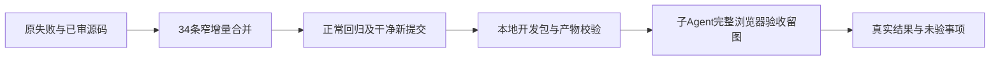

# 开发包修复源码整合

用户已授权合并完成会话、集中修复测试发现的问题并重新打开发包。本次34条已独立审查的源/测试增量合入隔离打包树，包含Codex结构化输出适配、设置首载布局、失败诊断、协议验收前置、公开聊天定位，以及另会话的Codex临时会话边界。具体原源SHA、审核、应用前后与原失败在相邻回执；这次合入不代表新包或全功能已经通过。

R维持108条迁移与425接口，Main的新增观测迁移109/428及其库存测试属于另一已记录源码范围。本次没有覆盖原R旧审核、原任务状态或用户安装版。LED-062/063只合入已提交d1957e465的两个独立教训增量。T1246继续负责整体交付，新独立期限观测与完整浏览器工具在私有目录中准备，未经审查不得执行。App原生验收按用户拒绝授权保留未完成；原六个遗失素材用例按用户确认跳过，原失败保留。

正常回归、干净新HEAD打包、实际包校验和170/103/7/Pi1/Doocs2全量公共链复验仍待执行。最新Pi真实聊天已到同任务读回，但执行准备失败CHAT_WORKER_INPUT_UNAVAILABLE，目标能力配置红测尚未证明，不自动重发原任务。

