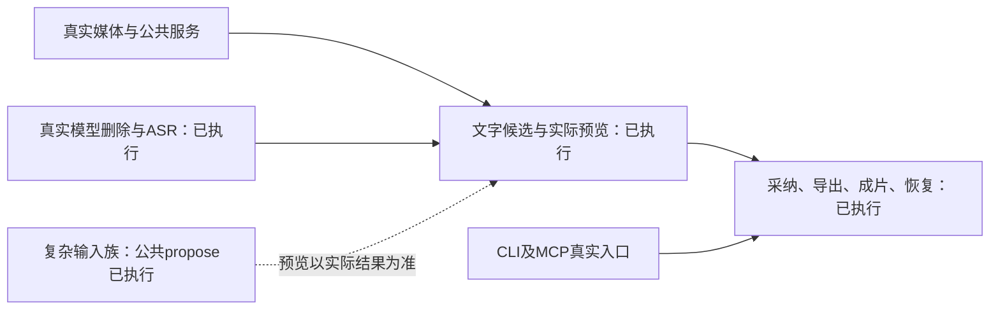

# T1274 当前验收库存

2026-10-14 初次只读盘点，随后按真实回执持续更新。对应 [SPEC](../../features/t1274-chatcut-editing-redesign.md) 的 AC-1274-01～08。初次核验 HEAD 为 `f131f3344`，核心集成为 `b6f133456`，播放栏修复为 `a76563099`；后续各目录记录自己的实际运行身份。各证据来自其实际执行时的共享工作区，不能自动签为单一 HEAD 的整仓全量回执。

当前可以确认：真实开发服务的基本文字剪辑、预览、采纳、MP4、成片登记、历史恢复和 CLI/MCP 公共入口已有成功证据。真实自然语言删除、[重排加复制](model-reorder-clone/REPORT.md)候选预览/采纳/刷新，以及真实 ASR 23 词公共采纳已取得回执；粗剪原模型任务为 unknown_result，未改写；[新独立真实粗剪](../t1283/rough-public-new/REPORT.md)已完成模型建议、原声自然播放确认门、采纳及刷新，不能冒充原任务恢复或人类听感签字。最终全局 reconcile 已结束为 29 errors（归属 T1204），不签全局 PASS。公共丰富三族在T1282修复后已真实native preview/音视频MP4解码通过，deleteB采纳revision5→6及同业务幂等通过；原effect_pass_groups FAIL保留。[最后代表族走查](final-gap-walkthrough/REPORT.md)已验证UI批量诊断、受控音频404安全预览采纳、原生Chrome200%和发送准备中新dirty；真实CAS409保稿与原恢复锁定FAIL均保留；[T1285同原请求恢复](../t1285/public-cas-recovery/REPORT.md)已真实通过双空回执→正式rev6核对→解除等待、全文和候选保留、丢弃后可编辑，save/apply/propose均0。仅闭合这一原请求代表路径。

## 证据口径

- **真实公共/UI**：真实隔离服务、数据库、HTTP、浏览器/原生操作与文件输出；合成媒体仍标明来源，不等于真实语义或真人转写质量。
- **真实内核＋夹具端口**：确实运行浏览器编码、FFmpeg/HyperFrames等，但资产/任务/持久化部分是测试端口，不能称完整公开旅程。
- **fixture/组件**：纯引擎、合同、组件或受控故障注入测试已运行；证明对应机械边界，不冒充真实模型、ASR、GPU或完整UI。
- **未验/准备**：只有代码、脚本、缓存或旧版本报告，缺本轮目标链实际结果。这里不把准备或历史 PASS 提升为当前 PASS。
- 下表“尚缺”均指原 SPEC 所要求的验收层级，不要求把所有纯解析排列组合重复做成昂贵UI旅程；应在适用公共链补齐必要代表族与边界后再判断闭合。

## AC-1274-01：时间轴与 Markdown 保真

| 输入族 | 已执行及层级 | 尚缺/边界 |
|---|---|---|
| 不改内容的 state→Markdown→propose no-op | `production-script-markdown.test.ts`完整 adapter fixture；`production-script.public.test.ts`真实DB/service/transport no-op，候选不写版本；[public-and-tool-host-final.txt](public-and-tool-host-final.txt)两文件7 PASS | 另有 [public-families/RESULT.json](public-families/RESULT.json) 真实 HTTP A-B-A/多轨完整scene no-op与完整DTO零写；不把先前fixture端口称真实媒体入口 |
| 跨素材A-B-A、gap、段内silence、多轨 | 完整 adapter fixture，精确保原；[engine-definition-final.txt](engine-definition-final.txt)两文件36 PASS，包含引擎与工具定义 | A-B-A/0.5秒gap/多轨与独立声音已过真实HTTP12族；真实ASR段内silence见下行。[三族真实预览](public-families/PREVIEW_RESULT.json)：T1282后deleteB/cloneA/freshB均60帧@24fps真实音视频MP4，正式DTO仍revision5；彩条合成输入不代签口播语义 |
| 词删除、重复局部ID、真实词时间 | adapter fixture覆盖复合ID、词删除、保留间隔、两侧clone与参数；48000 timebase、rate=2、非格点降级 | [SPEECH_READONLY_RESULT](public-families/SPEECH_READONLY_RESULT.json)：真实23词ASR→公共propose，首词删除按1/16000精确映射43200原生ticks；[真实词候选预览](speech-word-preview/REPORT.md)实际196帧@25fps/7.84秒及完整解码，正式DTO零写；未采纳该词候选 |
| 非30fps与精确源timebase | [browser-closure/result.json](browser-closure/result.json)：源1/12288、3秒；候选及导出48帧@24fps，PTS/逐帧与旧内核严格相同；fixture另覆盖真实rate | 实际媒体为一个合成彩条/音频输入，不推广全部fps/rate族；无需为本次单输入假称有理数帧率均已实测 |

## AC-1274-02：纠错、诊断与不丢轨

| 输入族 | 已执行及层级 | 尚缺/边界 |
|---|---|---|
| 同素材唯一误编号纠正、重复句不猜、重复local ID | adapter fixture已执行；重复文本/无法局部分离时保原 | 真实ASR公共propose已证唯一“今天”误编号自动纠正、真实重复“保”无法唯一恢复时保原无apply；仅重复local ID跨素材仍为fixture覆盖 |
| 批量错误、行号、未知语法 | adapter/contract fixture；public错stamp返回`script_input`、错误数组与行号且不建版本 | [public-families/RESULT](public-families/RESULT.json)真实公共批量diagnostics（11条）、行号和零写已证；[final-gap-walkthrough](final-gap-walkthrough/REPORT.md)真实UI显示8条行号诊断，输入完整保留、正式DTO不变；原生200%下7条诊断末项可滚动到达 |
| 缺marker、缺body/scope、错scene、源漂移 | adapter fixture明确恢复可信元数据或拒绝，不推断删除；public旧target/revision漂移拒绝 | 公共HTTP已证缺marker恢复、缺body/scope、错scene/stamp/library拒绝；完整DTO零写，原错误不被吞掉 |
| 新别名/非法轨道、不支持元素遗漏、相邻损坏cN | adapter fixture保轨/保护集合；public合同保留unknown旧元素 | 真实公共新未知alias/批量错误保原已证；UI批量错误显示已有最后走查8条诊断与零写证据 |

## AC-1274-03：自然语言、预览、采纳与dirty冻结

| 输入族 | 已执行及层级 | 尚缺/边界 |
|---|---|---|
| 删除候选、实际预览、采纳才新版本、刷新一致 | [e2e-closure.txt](e2e-closure.txt)1 PASS/39.6s；高级Markdown删首片，revision3→4；[walkthrough/REPORT.md](walkthrough/REPORT.md)独立普通控件删除，真实播放0→0.313193秒，revision6→7、切脚本返回保持 | 两条都没有调用模型 |
| 重复候选实际预览 | [walkthrough/recheck/REPORT.md](walkthrough/recheck/REPORT.md)：重复唯一片段、实际播放至0.864851秒、duration4.086712，最终丢弃且正式版本仍7 | 该早期重复候选未采纳；后续[真实模型B–A–B](model-reorder-clone/REPORT.md)同时完成重排/复制、5秒120帧预览和采纳2→3，原ID/源区间/其他字段严格保持 |
| 自然语言删除/重排/复制、真实工具调用 | [model-acceptance/RESULT.json](model-acceptance/RESULT.json)：真实模型一次提交，execution-task-a9afe880-d5af-4569-a538-4038b6d7fe33，冻结revision3→采纳4，主轨保留1片且overlay不变 | 删除与[重排加复制](model-reorder-clone/RESULT.json)分别有一次真实模型；后者真实script_markdown→markdown_timeline，预览5秒/120帧、采纳2→3、刷新及非目标字段完整不变。SSE取体编码局限均用原消息公开JSON与UI核对；不把机械候选代签模型 |
| 手工dirty先保存、发送中新dirty不发旧稿、旧候选冲突留输入 | host/panel组件注入已运行，见[frontend-receipt-final.txt](frontend-receipt-final.txt)、[preview-missing-metadata-green.txt](preview-missing-metadata-green.txt)、[workspace-layout-final-tests.txt](workspace-layout-final-tests.txt) | [最后走查](final-gap-walkthrough/REPORT.md)普通原生改名第一次prepare真实save5→6，get返回窗口第二次dirty阻止chat POST（尝试0，保险未命中），原话/新dirty保留；代表元数据dirty与发送准备窗口，不冒模型执行中/全部片段编辑竞争。真实旧候选CAS409保稿及原锁定FAIL保留；[T1285原profile普通刷新后的真实恢复](../t1285/public-cas-recovery/REPORT.md)已证双空回执与当前rev6核对后解锁、全文/候选保留至丢弃，零save/apply/propose |

## AC-1274-04：丰富工程与安全降级

| 输入族 | 已执行及层级 | 尚缺/边界 |
|---|---|---|
| update/clone/fresh媒体、音量/裁切/效果/动画/unknown继承 | adapter fixture完整机械断言；public候选/apply保留字幕、其他scene、unknown层 | 真实公共12族propose及[T1282后三族native preview](public-families/PREVIEW_RESULT.json)PASS，全部原scene丰富字段保留；[deleteB采纳](public-families/APPLY_RESULT.json)5→6及同业务幂等、完整scene/非目标scene/nativeSources/mediaRefs读回PASS；[原FAIL](public-families/PREVIEW_FAILURE_SUMMARY.json)保留 |
| 不支持类型、重叠/缺probe、非目标图层省略 | adapter保护集合与public no-op/采纳回读已执行；明确image无video probe可操作 | 核验范围为对应fixture，并非每种原生type均有真实媒体样例 |
| 原样未改的可选缺失媒体，有安全输出 | 原生真实旧export→新preview四族：有图缺overlay、缺主视频+纯色、缺主视频+文字、缺上传音频；各12帧RGB完全相等。见[内核比较](../../../reference-editors/opencut-classic/native/verification/t1274-preserved-missing-media/candidate-vs-old-decode.json) | 另有[最后走查](final-gap-walkthrough/REPORT.md)：浏览器对现有B音轨真实blob路径受控注入404，警告可见、原生候选播放/完整解码、公共采纳3→4保完整图层/来源。后端文件实际存在；不扩大为真实文件丢失或全部404/410族 |
| 无安全画面的transparent/blur | 原生fixture拒绝两族；不是把已有合法输出任意升级成失败 | 不扩展为所有媒体损坏族已验 |
| 缺metadata下401/403/500/取消不冒充404、非当前scene不乱读 | [preview-missing-metadata-red.txt](preview-missing-metadata-red.txt)真实组件RED3FAIL→[green](preview-missing-metadata-green.txt)五文件58 PASS | 401/403/500/取消仍为组件负向注入；受控可选音频404的真实警告分支已由最后走查补齐 |

## AC-1274-05：幂等、未知回执与归属

| 输入族 | 已执行及层级 | 尚缺/边界 |
|---|---|---|
| CLI/MCP read→propose零写→apply→receipt/current/history | [cli-mcp/REPORT.md](cli-mcp/REPORT.md)、[RESULT.json](cli-mcp/RESULT.json)：40次真实HTTP；CLI正式版本2→3，真实MCP SDK/stdio版本3→4；最终history4；原走查作品完整对象不变 | 本轮源码开发服务，非安装包/模型/ASR |
| 原入口幂等键重放；换gateway key同业务requestId | 两条公共链返回原revision3/4，各requestId只一条历史，不多版本；是后端业务回执证据 | 不能把顺序重放等同并发请求/主动丢失ACK所有族 |
| 错组读取 | CLI与MCP真实404，未泄露他组对象 | 跨组/卸载期间晚响应回写仍主要为组件族 |
| backend保存后native同步失败、未知ACK恢复、CAS前进解除原锁 | host组件原request/body重用、失败保候选、零写确认、重复ripple保护；[frontend-receipt-final.txt](frontend-receipt-final.txt)等 | [final-ui-states/RESULT](final-ui-states/RESULT.json)真实浏览器截断ACK后点“核对原采纳结果”：requestId164e0280-a831-4466-a08d-ce34477a77b4，仅apply1次，revision3→4；不推广到全部晚响应族；最后走查原真实CAS409/receipt=null锁定FAIL保留；[T1285](../t1285/public-cas-recovery/RESULT.json)沿同原profile、原request完成receipt.get→editor.get rev6→receipt.get，双200/null后解除等待，旧候选保留至手工丢弃、全文可继续编辑，正式DTO及source201零写；未验证恢复后再次刷新仍保候选 |
| 镜像dirty、跨组/卸载旧响应、本地弹层与在途限制 | [led047-current.txt](led047-current.txt)8文件174 PASS；host/dock组件保同实例；T1069真实切页返回未保存稿 | 单项机械边界可计已测，但不把174计数当全是T1274或全是真实UI |

## AC-1274-06：旧功能可达可完成

| 输入族 | 已执行及层级 | 尚缺/边界 |
|---|---|---|
| 素材库导入、本地双素材导入、切页保dirty、保存刷新 | closure真实素材库加入；[legacy-t1069-current.txt](legacy-t1069-current.txt)1 PASS/1.3min，现存固定SHA原片、双文件导入、同Core保稿、保存刷新和MP4 | 本轮已具公共/UI证据，不再列为全无证据 |
| 原片probe与冻结文件 | closure真实source任务succeeded；1/12288、36864 ticks，源SHA `ab4ebe8c8bf6cd9d0a5ee9b00bf03d4af613b36f53cd6ecb090df18a607c47aa` | 合成源不含可评价口播语义 |
| 转写采纳、停顿听审、粗剪采用 | [transcript-rough-public-current.txt](transcript-rough-public-current.txt)2文件13 PASS/3 SKIP；ASR/模型端口为fixture，3个真实PG双父锁族因无PG跳过 | [speech-acceptance/precise/result](speech-acceptance/precise/result.json)真实ASR succeeded、23词并公开采纳至revision3；来源系统合成语音。粗剪原task977未知状态完整保留；[新独立作品粗剪](../t1283/rough-public-new/REPORT.md)真模型task128 succeeded，只删停顿0.96秒；真实试听取消/自然结束/双确认门、采纳3→4与刷新、全非目标字段及原721/task977完整不变均已证。humanListeningSigned=false，不把机械确认代签人类听感 |
| 手工编辑/撤销重做 | 普通转录删片已独立UI采纳；native命令/undo、手工文字草稿组件已执行；T1069真实原生导入/加入时间轴/工程名修改 | [final-ui-states/RESULT](final-ui-states/RESULT.json)已真实原生split/undo及保存，resize4→5片→undo4且未保存；按钮焦点Meta+Z无效需点击时间轴空白回root的限制保留，非全部键盘族通过 |
| 真实预览、v3当前场景MP4 | closure实际Blob播放与MP4；48@24视频2秒，完整AAC PCM/PTS/帧hash与旧83b内核一致 | AAC容器2.089796旧机制仍见T1277，不冒用户accepted-risk或称容器恰2秒 |
| 采用作品成片、历史恢复 | closure UI采用成片，公开`primaryAssetId=asset-8a2fadb0-122`；UI恢复原revision3为新revision6、主轨两片，成片asset仍不变 | 当前已有完整基本链；历史恢复断言主要为片数/新revision/成片引用，不冒称所有rich字段/旧格式恢复已UI逐字段验证 |
| v1/v2/legacy旧工程读写、恢复、渲染 | [public-legacy-current.txt](public-legacy-current.txt)3文件29 PASS：editor service/DB兼容与恢复；`production-rough-render.real.test.ts`真实v2 HyperFrames/FFmpeg输出、颜色/声音顺序核验 | [真实V1/V2公共渲染](legacy-public-render/)已完成提交→持久任务→确认→MP4全流解码，两者48帧/2秒RGB与PCM完全一致；[T1281输入族](../t1281/public-families/REPORT.md)覆盖竖源contain、1920×1080、有声/无声及非整数时长；[T1284旧字幕复验](../t1284/public-legacy-caption/REPORT.md)恢复原声且48帧与原失败画面逐字节相同。旧历史同文件成功基线仍不可复跑，不将本轮新样例冒充历史基线 |

## AC-1274-07：响应式、状态与独立走查

| 输入族 | 已执行及层级 | 尚缺/边界 |
|---|---|---|
| 正常/候选：1366×900、1280×800、1024×800、390×844 | [browser-closure](browser-closure/result.json)实际同旅程四视口截图与无全页横溢出；独立recheck看过四视口和390候选；素材/转录→画面→时间轴流程实际操作 | 无横溢出仅一项指标；不代签所有内部面板与全部状态 |
| 390播放栏Fit/时间/播放/全屏 | [原生toolbar证据](../../../reference-editors/opencut-classic/native/verification/t1274-toolbar-fit/verification-summary.json)真实Chromium 260/278/390/1000/1280宽，Fit、键盘、播放、时间编辑、全屏；最终宿主closure新图 | 原生专项自身`fullCreatorOSHost:false`，由最终host证据补实际布局，不能混为同一次测试 |
| 200%与键盘/焦点/单页弹层 | closure `documentElement.style.zoom='2'`，保存可见、Enter打开历史菜单、Esc返回焦点；独立走查Tab/Enter删除、Esc关闭历史dialog；候选返回焦点 | 早期closure仅CSS200%；[最后走查](final-gap-walkthrough/REPORT.md)另经Chrome设置UI实际选择原生200%，DPR2、CSS zoom1/visualScale1，正常、候选播放、滚动、Enter返回焦点均实证；两类证据分开。完整键盘全控件未穷举 |
| 空、加载、错误、长中文内容、权限状态 | 部分组件/早期空布局或故障图有证据，UI错误保稿组件已测 | [final-ui-states/RESULT](final-ui-states/RESULT.json)列出各最终真实截图/操作；长中文含159字工程名，最后走查补真实8条/7条诊断滚动；权限为固定错组真实404，加载/错误含受控故障条件。不推广所有长转录或全部权限族 |
| 新鲜前后与独立视觉/独立任务走查 | 独立走查W1/W2/W3已发现并独立复验；响应式前后图保留；[第三轮视觉](visual-final-round3.md)实际8.2/10 | 第三轮复用评审者历史上下文，报告已披露不满足最严格全新上下文要求；不能改成≥9或完整视觉Gate PASS。功能Fit修复另有证据；保留时间轴边界辨识与术语问题，不启动新美学范围 |

## AC-1274-08：来源、边界、构建与对账

| 输入族/Gate | 已执行及层级 | 尚缺/边界 |
|---|---|---|
| 参考原文件、源码、修改记录、补丁重建 | [REFERENCE_SOURCE_SHA256.json](REFERENCE_SOURCE_SHA256.json)；`chatcut-script-core/README.md`；原生toolbar末轮86测试/380断言、715源码、patch F0、七产物一致 | 是来源/可重建性与内核测试，不是安装App验收 |
| 单写者、AI只候选、跨组边界 | public no-op/propose零版本、CLI/MCP真实候选零写与归属404；[boundary-closure.txt](boundary-closure.txt)0新增/旧5 | 真实模型删除候选链现已执行；既有5条不写成0违规 |
| 类型、合同、工具、prompt、布局 | frontend/backend类型最终日志；contract末轮2 PASS；engine/definitions36 PASS、public/tool-host7 PASS、prompt23 PASS、UI58 PASS、layout43 PASS等 | 来自不同轮次/当前共享工作区，不相加成一次全量或纯提交证据 |
| production build | [production-build-after-fixes.txt](production-build-after-fixes.txt)于2026-10-14 09:06 UTC exit0；覆盖T1281/T1282/T1284、候选播放器与词删预览最终源码，含Worker prebuild、Next生产编译/完整TypeScript/静态生成 | 当前共享工作区构建；65条Turbopack warning保留，不称纯提交验收或已安装/发布 |
| timeout / LED047 | [timeout-final.txt](timeout-final.txt)完整检查exit0、failures=[]及公共短预算回归；LED047174 PASS | 不是ASR/模型真实任务期限专项成功证据 |
| orphan / pmem / reconcile / complete | [orphan-closure.txt](orphan-closure.txt)0error/100warning；[pmem-closure.txt](pmem-closure.txt)sync；旧对账停止记录保留 | [reconcile-final.txt](reconcile-final.txt)最终29 errors / 0 warnings、DRIFT，T1204归属由主会话处理；**不签全局PASS、不代taskctl complete** |

## 当前必要剩余验收

1. **T1285原CAS恢复已补实证**：原request `79622981-9257-4545-a849-e0230a081b4a` 在同Chrome profile普通刷新后完成双空回执、正式rev6核对和UI解锁；全文保留，候选可丢弃，丢弃后普通输入可用，正式对象完整不变。原FAIL及首次恢复工具120秒耗尽记录保留；这一项不再列为待验，未推广其他竞争族或恢复后再次刷新。见[真实报告](../t1285/public-cas-recovery/REPORT.md)。
2. **三任务严格收尾回执与身份绑定**：按[CLOSURE_AUDIT](CLOSURE_AUDIT.md)准备各自v2 journey contract、frontend-validation报告、真实可见文案及安全无模型复验命令。`closure/`为待执行草案；watched_paths仍有共享dirty，当前不能绑定HEAD或taskctl complete。
3. **适用Gate和范围外失败归属**：已有build与单项门按各自实际运行身份引用；T1285最后实现的相关门与最终build/reconcile由主会话按实际新日志核对。全局reconcile29错误保留T1204归属，不签全局PASS、不直接改任务状态。

以下为已验证范围的限度，不自动新增验收门：原粗剪unknown完整保留但不否定新独立成功旅程；人类听感未签字，而SPEC所要求的试听确认机制已有实际证据；词删除真实预览已通过，无需把每个词再采纳一遍；旧历史文件无法复跑不等同旧格式合法公共输入未验。原生Chrome200%已有代表路径，故不再列为全无证据。视觉三轮6.5→7.7→8.2及末轮复用上下文的程序性限制继续披露，不抬分、不无限追加美学轮次；功能缺陷仍必须闭合。

[真实词删除预览](speech-word-preview/REPORT.md)由23词ASR真实词时间生成候选，8.2秒删0.36秒后实际196帧@25fps=7.84秒，正式rev3不变；AAC前导和尾部旧机制留T1277。候选播放器[槽位复验](preview-slot-fit/REPORT.md)1366/1024/390实际播放、控件完整可见、返回焦点与零写通过。

旧FAIL、SKIP、停止的对账和消失临时根均保留。本文件是库存，不能代替机器可校验回执或任务状态转换。
