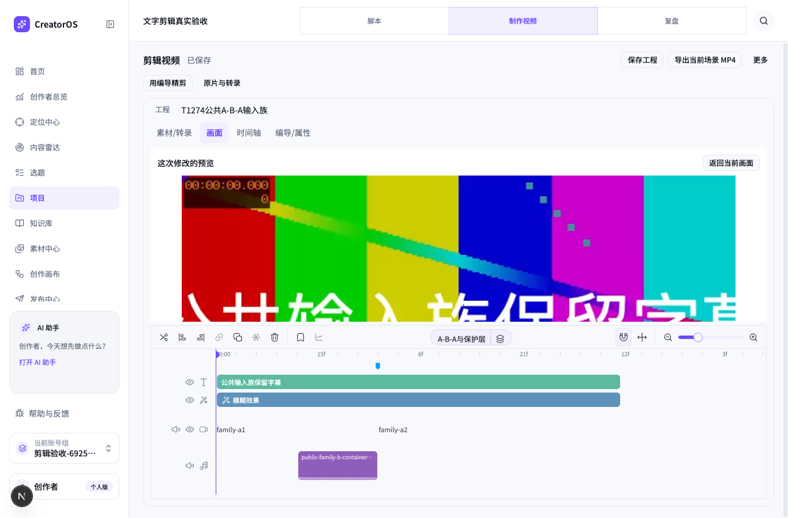
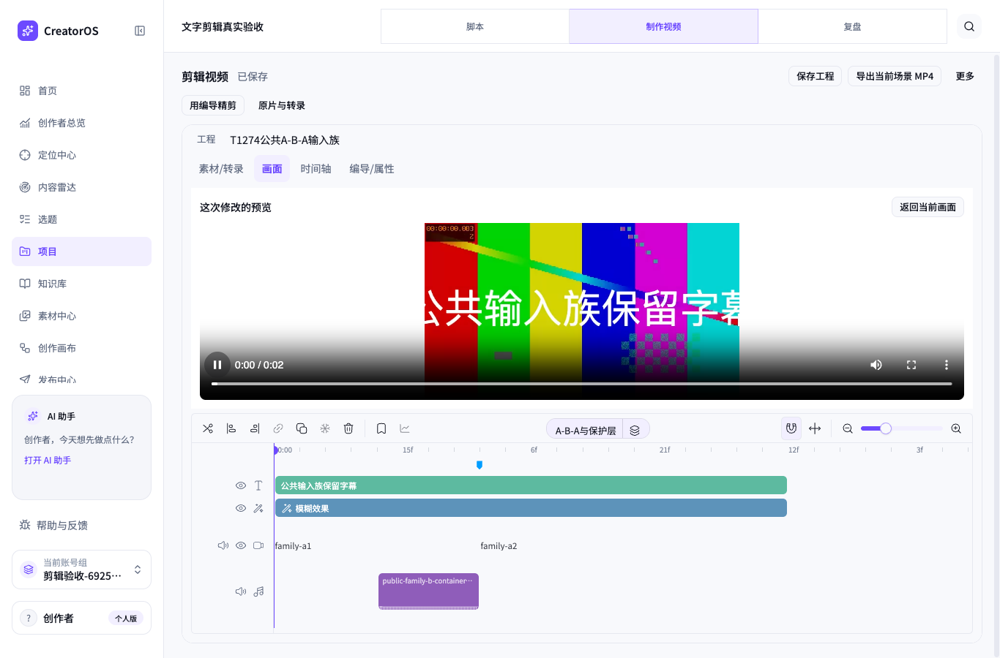

# T1274 候选播放器承载区域修复

2026-10-14，局部功能修复；使用 product-to-code-orchestrator、项目 oil-ui-pro 与 Playwright 指引。阶段写集已核：`orchestrator/context/T-1274.md` 包含本 panel、原相关测试及本证据目录。没有新视觉方向、控制面或服务契约变更。

真实 RED：在 1366×900，候选预览区域高 301.72px，但视频高 540px；视频下沿 844.80px 超出区域下沿 558.52px。初始看不到控制条/下半画面；滚动 298px 后控制条出现，上半画面和返回栏又被卷走，无法同时观看完整候选。390×844 原布局未复现截断。`before-1366.png`、`before-1366-scrolled.png`、`before-390.png` 均已实际查看，原 root 提供的丰富候选图也已查看。

| 状态 | 1366 视频高度 | 实际预览区域 | 观看结果 |
|---|---:|---:|---|
| 修正前 | 540px | 301.72px | 下半画面与控件需滚动，上半画面随后不可见 |
| 修正后 | 241.72px | 301.72px | 标题/返回、完整 contain 画面、控件同时在区域内 |

修改仅在 `production-script-markdown-panel.tsx`：有 portal slot 时 section 使用 h-full，播放器允许 min-h-0 / flex-1 收缩到标题后的实际剩余高度。保留 object-contain、原 Button/token/圆角、overflow-y-auto；没有 slot 时仍保持原 max-h-[60dvh] / shrink-0。播放/暂停、Blob 清理、警告、返回焦点、候选采纳均未改逻辑。未删文案，无新主题/组件/重排。

真实复验在原独占私有服务 3919 完成，普通 Chrome headless，未假称桌面 App、人工听审或浏览器原生 200%。共享工作区 HEAD 为 93c91c09ed71706f96c3db1927dbe5a87bdda24a，叠加本 panel CSS 修改；主代理同时做 T1281 服务工作，基线与复验间由主代理重启服务后再开新浏览器，未重用旧服务响应。

- 1366×900：video 1044×241.72；1024×800：862×191.72；390×844：236×149.25。三个播放器完整处于对应 slot，object-fit=contain，原生 controls=true，无需候选区域滚动才能找到下沿。
- 三个视口都普通点击浏览器原生视频播放钮，currentTime 实际推进；截图保留播放中的暂停图标和控制条，`after-1366.png`、`after-1024.png`、`after-390.png` 已逐张实际查看。
- 三个视口用 Enter 激活“返回当前画面”，播放器移除、焦点返回预览触发钮，“剪辑候选已预览，待采纳”和采纳按钮可用均保留。最后丢弃临时候选。
- 输入仅是读取现有 revision 6 的文字稿后移除主轨 60000 ticks gap，产生一项 update 候选；经真实 UI 生成与 native preview，没有模型或 ASR 调用，没有正式采纳。`output-94c2affe-201` 的完整公开 DTO 在基线读取、基线关闭、复验每个视口、最终关闭均保持 revision 6 且逐字段相同。dispatch 日志无 save/apply/render/upload/update。
- 原相关测试：`pnpm --dir frontend exec vitest run src/features/reference-editors/video-reference-workbench.test.tsx src/features/production/production-script-markdown-panel.test.tsx`，2 文件 31 项通过，耗时 3.34 秒。未加镜像 CSS 断言；原测试包括非 portal 显示、StrictMode Blob/焦点回返、未知采纳恢复等。`git diff --check` 通过。

本轮只是播放器适配实际区域的功能修复与主执行者看图自检，不是新一轮独立视觉打分。非 portal 样式保持原值并由原组件测试覆盖，未另造真实非 portal 页面。没有改 native 轨道、候选媒体内容或正式工程；没有代签 T1281、T1282、全局 Gate 或整个产品 PASS。基线与复验 trace 保存，两个浏览器均正常关闭，已告知主代理可释放 3919。

