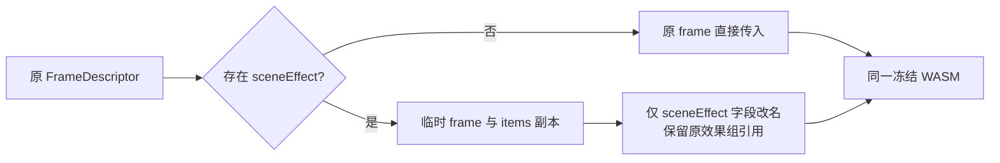

# T-1282 场景效果真实 WASM 协议验证

原生场景效果并未损坏。冻结 opencut-wasm 0.2.10 的 sceneEffect 要求字段 effect_pass_groups，而内部 FrameDescriptor 使用 effectPassGroups。仅在 WasmCompositor.render 调用边界创建临时描述符；原图层仍沿既有 camelCase 协议，无场景效果时传入原 frame 对象。



## 当场证据

先修改测试，保持生产入口未改：实际 WasmCompositor.render 导入与真实 GPU 执行。无效果和 layer blur 两项通过；scene 空/单组/多组及两种混排五项均复现原 missing field effect_pass_groups。五个依赖像素比较因无场景输出失败，不能另算五种产品缺陷。原 RED JSON 和原始像素保留在 red/。

修后同一探针七项渲染与五项像素关系全部通过。每一帧深冻结并比较完整 JSON；透传观察器只记录送入真实 renderFrame 的对象，继续调用真实 WASM，没有替换 GPU。无 scene 保留 frame 身份；layer 保留对象身份；scene 保留效果组与 shader/uniforms 原引用及顺序。每个桥输出逐像素等于同参数、合法 ABI 的真实 WASM 输出。

单组 scene blur 与 layer blur 像素相同且不同于原图；多组输出不同于单组。混排真实保留 mask、opacity=0.63、multiply、旋转/翻转和位置。调整 scene 与 overlay 顺序得到不同像素，证明顺序可观察。动态动画内容由上游算入 layer transform；本次原 layer 对象完整直传，公共动画/音轨视频由主会话验收，不能由此静态探针代签。

## 复验

在当前冻结依赖和展开源存在的本机运行：

```sh
bun docs/verification/t1282/native-protocol/build.mjs
node docs/verification/t1282/native-protocol/run.cjs rerun
```

脚本依赖 /tmp/creatoros-t1274-preview-isolated 内真实源和冻结依赖，浏览器使用现有 @playwright/test。执行窗口 120 秒；服务使用独立临时端口，不启动 Next/DB，不访问共享工程。run.cjs 失败会返回非零。

源归档、标准补丁与全回归证据见 reference-editors/opencut-classic/native/verification/t1282-scene-effect-protocol/。原 86 测试 / 380 断言、类型与 AST 通过；715 源文件经标准 patch --fuzz=0 复原并逐字节一致。归档独立重建七产物与展开源及双发布目录一致。只改 wasm-compositor.ts 和两份归档说明元数据；测试在归档外，源文件数仍为 715。复用原冻结依赖，无新安装或跨平台复现声明。

WASM 版本 0.2.10 与内嵌二进制 SHA e7720e0d3fc46e06fd8aa10aa2c1a29121722e3c1b1d909945ed72a35581ec67 不变。

## 验收边界

本任务原真实公共失败仍保留在 docs/verification/t1274/public-families/PREVIEW_FAILURE_SUMMARY.json 及 trace。此份报告只确认真实渲染桥、原生回归和源码重建；三候选公开 preview→MP4、thumbnail 与原工程 revision5 不变由主会话继续验证。没有删除效果、改夹具、改音轨、代签模型或安装验收。
