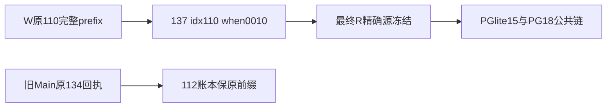

# T1278 canonical111 固定库存与最终R公共运行夹具候选

已交四测试最小候选、完整111 journal/SQL receipts与读取最终R源码的公共运行脚本。**NOT-RUN**：本次只生成与解析语法，没有Vitest/typecheck/PGlite/PG/public factory证据，不能签RED/GREEN。R/Main源码、Git/control写0；models/userDB/Activity/funds0。Root融合完成后独审并串行apply/TDD，frontend属于T1286须独立recheck。

## 固定111与准确绑定

R基线HEAD `f74fdf8c069d097be8f3bd4f38ff7c992dc85f7e` /MERGE_HEAD `0b0913635c2910fdf488ee3b47dc95acd5d619b0`；与root_route_wiring_design协调，其49份保R2候选不做111校准，原convergence.test已stage0且逐字节等R HEAD才使用。其余三测试取准确stage2，不从Main109覆盖。

canonical111 = W `03d60d39c899c08f15c6cebee3d2516079c45a74` 原110完整entries +137 **idx110/when1791043200010**。所有原110 SQL字节不变，137与Main0134同d9ffc。提供完整canonical-journal111.json、sql-inventory111.json、ordered-receipts111.json；严禁动态last、删negative或放宽任意新map。

|库存|精确SHA256|
|---|---|
|111完整journal原bytes|`d72d1f1b459d5d35695ac6671d49bf8959551d09ebe647972163f82a4dea69eb`|
|111 ordered receipts JSON.stringify同序compact，无换行|`78c9c4af5305a709cd9fdab6367cd9e3a0b0dd6dacd51b97470e20b6b2d585af`|
|保存receipt文件，含末尾换行|`a33b8d8c0af2eeb6c3dde25eebb91e308934aaa7abb125f2724b44eced9ae4bc`|
|137原SQL|`d9ffc8a011672cc985015d3f6cafcb693be8b77f33b5f04d6906d25939f80494`|

receipt对象字段精确为 hash、created_at，按111 journal顺序。fresh/旧W→111；**旧Main109因原134/when0007历史回执保留→实际112**，不能删原receipt或把它伪称111。

## 四测试最小变化

- legacy-source：原104和owner负族不动；合法suffix6→7，明确0010、idx110与137 SHA。
- legacy-scheduled：原105/作业冻结/运行/会员并发断言不动，仅严格when列表追加0010。
- migration-convergence.test：保R2全部旧history/prefix/列/未知hash负例，追加纯完整111 journal+全部ordered SQL receipt固定SHA哨兵。
- frontend legacy-frozen-source-read：原producer/Worker/104账本/input/owner/stop/replay/hash全断言保持；current固定111与完整journal/ledger SHA，109=0136不动、110明确137；不塞v2假metadata。

01-fixed111-tests.candidate.diff SHA `996963567b583107b1d03b270758d54b63d22bdd8a30717df6cbac0d6838265c`。四候选在candidate/原路径，精确before/after SHA在BINDING.json。若Root融合后的base变化，应先重核具体变化，不能整文件覆盖真实新语义。

## 最终R实际公共运行准备（未执行）

public-final-r.mts保原已审15族全部success/negative，仅将生产imports指向精确最终R。frozen-migration-sql只复制原owned旧Main109/W110 SQL/meta，没有任何生产/用户DB或业务源码。成功族仍查真实账本、原prefix/app/catalog以及第二次真实公共open；失败族仍查实际拒绝后ledger/catalog/app字节不变，unknownhash/wrongwhen/brokenprefix、错误column/constraint/index/view/type、已记账缺表等全部保留。

另外准备PG真实同owned URL双createRuntimeDb并发三项：fresh、旧Main109、旧W110，两个public opener均成功并dispose后核真实结果，再二次open。PGlite原15，PG原15+并发3=18；不能用并行helper或PGlite双文件实例冒充真实PG。

Root融合与独审后依次：

1. freeze-final-r-binding.py：只在R已完整固定111/全部SQL摘要与已审bridge源45a81…相同时冻结RUN_BINDING。拒冲突marker/错SQL/未审新source；R源若合法变化需Root独审后精确重新绑定，不删除检查。
2. run-final-r-pglite.NOT-RUN.py：clean env、owned docs dataDir，原15族createDb读R。
3. run-final-r-owned-pg.NOT-RUN.py：复用原严格T1246 marker/nonce/PID出生/UID/真实服务器identity/DBregistry，docs owned tmp新PG，仅本轮loopback，18族createRuntimeDb读R。原finally核原PID并停止/清socket/注册DB，不动其它在途。

所有脚本当前NOT-RUN。env不继承DATABASE_URL/PG/用户配置或密钥，HOME/TMPDIR均owned。原最低两分钟与更长完整outer保留。绑定R代码/SQL/dependency SHA，执行前再比对；harness使用实际R已装依赖port，不新安装，不从ctx猜库，不连用户DB，不调用model/Activity/funds。

## 诚实证据

PURE_PARSE_RESULT只有四测试和harness TS AST parse0，Python AST仅语法，不能代typecheck/tests/DB门。生成器首次路径与已解析stage2错误保script/log snapshots，不代产品RED。旧migration-preflight-revision原PGlite/PG15族只证明原source45a81当场结果，不能代签最终R、追加并发或本次111 fixtures。Root须现场取得真实红绿、失败与闭合回执。
