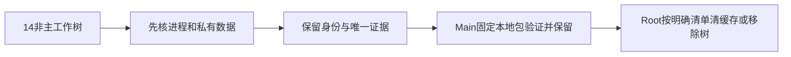

# T1290 清理前只读盘点

注册 Creator 工作树共15个，含 Main；本次清理对象为其余14个。初次盘点 Main `c9a8b6aa503a89356ce6aba34e79444166a54f57`，交付时 Main `30cd8f68e6d7c539b3bd01d4e90d5f695526f86b`；14个 HEAD 均已是 Main 祖先。没有检查、修改或清理其它 Growth 工作树。Main 当前固定包与所有保留证据不在工作树删除清单内。

本代理源/Git/控制面写入0，停止进程0，删除文件0，实际释放0。只写本目录。

## 体积与进程

`du -A -s -k` 测得14树逻辑 apparent 大小合计 **82.21985 GiB**；这是路径表观体积，不是 APFS 实际占用或可释放量，硬链接/克隆/压缩会改变实际释放。没有执行清理，不能记为已释放82GiB。

`ps` 仅采 executable/UID/PID，不采命令参数或环境；`lsof -nP` 正常 exit0，无stderr，在本次快照未发现14树的 cwd 或打开文件引用（0项）。这不证明之后不会开始使用，Root 删除前须重查；Main正在打包，不在本次非主引用结论内。symlink不跟随测量或删除外部目标。

| 工作树目录 | 逻辑GiB | 当前dirty概况 |
| --- | ---: | --- |
| codex-ephemeral-sessions | 2.698 | 干净 |
| codex-text-image | 2.756 | 干净 |
| daily-client-observability | 12.201 | 干净 |
| integrated-dev-acceptance | 15.903 | 干净 |
| integrated-frontend-unit | 2.795 | 干净 |
| integrated-unit-acceptance | 3.589 | 原证据4项，Main副本已核 |
| t1062-client-integration | 5.846 | 干净 |
| t1255-client-writer | 11.941 | 干净 |
| t1273-release-hardening | 8.854 | 干净 |
| t1274-markdown | 0.738 | 干净 |
| t1274-native-workspace | 0.748 | 干净 |
| unified-capability-models | 5.739 | W私有身份1项 |
| unified-editing-integration | 4.748 | 干净 |
| wechat-stats-evidence | 3.664 | 干净 |

## 私有数据与原六份dirty证据

唯一发现的真实本地身份是 W **`frontend/.creatoros/machine-id`，32字节**。只检查路径、存在性与stat，未读/未hash/未输出值。Root已表示将作私有备份；必须备份在Git外并确认可恢复后才可移除W。W根 `.creatoros` 不存在，不能拿错误路径的探针当身份缺失。

在14树中，排除依赖/编译缓存并排除受Git跟踪的模板后，未发现其它真实 `.env` 文件、可确认的用户业务库或用户媒体。此结论是限定结构盘点：不读取库内容或私有目录内容，不能证明没有藏在未知格式内的数据。两项未跟踪数据库为 `integrated-dev-acceptance/.codegraph/codegraph.db`（956391424字节）与 `t1062-client-integration/.codegraph/codegraph.db`（299425792字节）；Root已明确是本项目 `codegraph index --force` 的派生索引，已核CLI存在和忽略规则，列为可再生索引，未读库。

Main `docs/verification/t1290/root-inventory/integrated-unit-acceptance-dirty-preserved/` 中4文件、`t1255-client-writer-dirty-preserved/` 中2文件，现已逐一核对 **保留副本SHA = BINDING期望SHA = 原件当前SHA**。共6项全部匹配，原diff与BINDING也仍保留。详细路径和哈希见 `INVENTORY.json.originalDirtyEvidenceRetainedCopies`。移除原树不能连同Main这些副本一起删。

## 可再生清理候选

逐路径清单见 **`CLEANUP_ACTIONS.json.regenerableCandidates`**。其逻辑大小合计约 **63.984 GiB**，仍不是实际可释放量。包含依赖、`.next`、Rust `target`、原build生成的 `ai-worker/dist`、Tauri `sidecar/sidecar.tar.gz` 与生成文件、两份 `.codegraph`、Finder元数据。`ai-worker/scripts/build.mjs:7` 等明确生成dist，`frontend/scripts/desktop/build-sidecar.mjs:350/514` 明确生成sidecar包。所有源HEAD已可达Main；不需要为了删旧构建目录备份整套node_modules/target/sidecar大副本。用户最终本地包及其验收/清单由Main保留。

历史 `test-results`、`playwright-report`、图像和失败日志归下面证据保留；即使位于通常缓存目录，也没有被笼统批准删除。复制到证据目录的原生源码或数据库不凭文件名判为可再生。

## 每树ignored证据：哪些Main已有，哪些先备份

`EVIDENCE_RETENTION.json` 给出每个实际目录、其本树 `ignoredEntries`、文件SHA与Main同相对路径SHA。**只备份这些明确ignored条目，不整组复制其中node_modules/target缓存，也不覆盖Main同名但不同内容的文件。** 私有素材组未读/未hash，需Git外保留。Main仅有同名目录不等于证据已保留。

- **codex-ephemeral-sessions**：Main逐文件一致：`docs/verification/t1271`。无独有ignored证据待补。

- **daily-client-observability**：Main逐文件一致：`docs/verification/t1255`。必须先备份本树ignored项：`docs/features/t1021-cover-template-library`。

- **integrated-dev-acceptance**：必须先备份本树ignored项：`docs/verification/t1246`, `docs/verification/t1247`, `docs/verification/t1248`, `docs/verification/t1250`, `docs/verification/t1251`, `docs/verification/t1252`, `docs/verification/t1253`, `docs/verification/t1254`, `frontend/playwright-report`。

- **t1062-client-integration**：Main逐文件一致：`frontend/test-results`。必须先备份本树ignored项：`docs/verification/t1062`, `docs/verification/t1070`, `docs/verification/t1071`, `docs/verification/t1080`, `docs/verification/t1105`, `docs/verification/t1107`, `docs/verification/t1108`, `docs/verification/t1124`, `docs/verification/t1136`, `docs/verification/t1138`, `docs/verification/t1140`, `docs/verification/t1141`, `docs/verification/t1148`, `docs/verification/t1149`, `docs/verification/t1159`, `docs/verification/t1160`, `docs/verification/t1162`, `docs/verification/t1163`, `docs/verification/t1164`, `docs/verification/t1165`, `docs/verification/t1166`, `docs/verification/t1167`, `docs/verification/t1173`, `frontend/playwright-report`, `frontend/tests/visual/__artifacts__`。

- **t1255-client-writer**：Main逐文件一致：`docs/verification/t1217`, `docs/verification/t1229`。必须先备份本树ignored项：`frontend/playwright-report`, `frontend/test-results`, `frontend/tests/visual/__artifacts__`。

- **wechat-stats-evidence**：必须先备份本树ignored项：`docs/verification/t1110`。

需先保留的ignored证据共 **40组**；多数是唯一的小日志/失败图，`integrated-dev-acceptance/docs/verification/t1246` 的ignored证据约1975.83MiB且Main同路径1596项全缺，不能把它当旧缓存丢弃。全部实际条目在 `CLEANUP_ACTIONS.json.backupBeforeWholeTreeRemoval`。未分类条目在 `unclassifiedIgnoredKeepUntilBackup`，未获逐项确认前先保留/整体备份它们。空目录/DS_Store不构成独有测试证据。

## Main中的owned证据复制

额外只盘点Main `docs/verification/` 派生副本，发现5处，逻辑合计约1.25744GiB，见 `MAIN_OWNED_EVIDENCE_COPIES.json`。其中有canonical111 PGlite数据和迁移/安全原型源复制；本报告**不批准删除这些Main目录**。要先保留准确候选源/绑定/原始失败及后续真实结果，机械确认可再生，再按ownership/关闭证据处理复制DB；不能把原型源一起凭名字删。

已核原 `OWNED_PG_RESULT.json` 历史关闭记录：原PID86698不存在、TCP监听/Unix socket/lock/pid文件清空，node/postgres exit0。这只证明那次ownedPG已关闭，不代签其它复制DB的归属，也不代表Main新包已验收。

最终清理顺序由Root串行执行：先保私有身份及上述缺失/不同的证据；待固定包真实验证并保留后，重查进程，再按明确可再生清单清缓存/移除已保留工作树。此报告未执行其中任何删除或停止操作。
