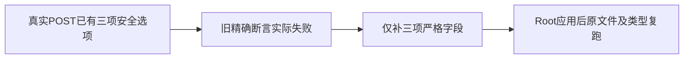

# T1286 第三轮 Copilot wire 精确断言复审

原第二轮 e988ff219888 findings为空；当前SPEC只追加原已准入Copilot测试的一条wire断言补充，原全文保持。本次未发现该补充范围的规格待修问题。当前SPEC、产品宪法、原回执、候选和实际红日志摘要见BINDINGS.json。

实际读取最终七文件日志：6文件通过、1文件失败，301PASS/1FAIL；唯一失败为原T715充值按钮精确fetch参数比对。日志真实收到同一 /api/v1/local/ai-credits/connect POST、空headers，另外包含cache:no-store、redirect:manual及AbortSignal。该FAIL定位的是请求选项失配；原URL、body、权限与native断言在候选保持，修后仍须真实复跑。这个回执是本轮已有真实失败，未在本审补拍TDD。

批准依据是正式MC-1278-OPEN：保原空POST/handshake/URL/no-store/manual，原signal对fetch/JSON/native真实race；原cycle3已审07候选就逐字具有这三个选项。本审对照实际helper相同fetch初始化，不以当前源码本身推定新授权。T1286仍只原三测试写集，此次只动Copilot其中一条断言，不改产品。

独立对整个候选文件逐字断言：candidate=原文件仅一次指定行替换。before SHA a6d241a25df375423122b9e21d706f1f11399c74ba6ba1afe317f3a5d8c9efa1；candidate SHA abbe2c64c4602def84dfdf2f960262bba8169461b02a738f11ba196ab6051bc0。新对象仍是完整精确toHaveBeenCalledWith对象，添加cache:no-store、redirect:manual与expect.any(AbortSignal)，没有objectContaining或任意signal占位。保POST、空headers、无body及全部其余字段穷尽；整个文件其它字节完全不变，用户额度URL、native打开断言、充值而非配置/无意义重试、原source/engine/unknown/stop/晚stop/归属及其它用例原样保留。

候选尚未应用或测试。Root record后串行应用，再真实复跑受影响原测试文件与frontend类型；不把原301PASS加本审当作302全绿，也不用旧111/432或81/518结果代签新源。保留旧实际FAIL、前两轮回执与所有未验边界，不伪造前置审查、类型或运行结果。全程仅此evidence目录写入，生产/control/网络/模型/付费/用户库/App调用0。
