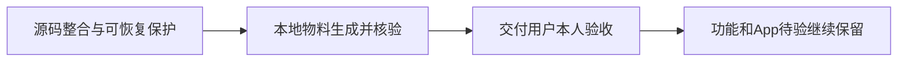

# T1290 物料交付与验收列归属第二轮复审

原SPEC未变化，初审142008f9fcc4 findings为空。本轮核明T1290是全worktree代码整合、可恢复保护、本地包生成及交付后清理任务。将本行验收列从“待验”精确校正为“—”符合原任务归属，不构成把UI或App验收洗为PASS；未发现本次拟议分类的待修问题。该结论不批准改变其它任务状态、门卫、产品、测试或既有功能验收标准。

原用户明确“本地打包，我来验收”，SPEC也明确用户自行验收、原生App暂不授权、真实模型/资金未验与旧失败保留。SPEC没有frontend-journey-contract或具体需本叶自动签署的UI旅程；此物料任务的交付要求是源码冻结、基础测试、固定打包入口、产物SHA/hdiutil和真实启动状态，而不是“真实启动必须PASS”。真实启动状态诚实为not-run可交用户验收。后续T1278/T1207/T1246等原任务仍保各自待验，不因本叶完成获得UI/App回执。

原taskctl.mjs实际第255–278行：验收“待验”就把evidence解释为frontend旅程报告路径并验证；“—”允许非旅程任务完成，但若本行文档链接含frontend-journey-contract则仍拒绝。因此这次只按SPEC事实校正本行元数据，未改判断规则或藏掉已存在的旅程合同。T1288此前因标签使文字evidence被当路径拒绝的真实exit1日志保留；本审不改T1288状态、不将失败改成功，也不推定其它所有nonUI任务一律可改标签。

独立读取交付回执：Main冻结30cd8f68e6d7c539b3bd01d4e90d5f695526f86b；四基础文件45PASS/exit0，固定package-local exit0；只读mount记录attach/codesign deep/detach均0、二进制与源码绑定成立，但nativeLaunch明确not-run。本审重新读取实际850565272字节DMG，SHA b6d276adc5f8f91ea9be6e20197af1018c994d17b3ac13fcb5175d87c75f4f24等交付报告。没有重跑打包、hdiutil、签名或真实App，读取原实际证据不冒独立执行。

独立Git只读检查保护清单所有原非主HEAD均为冻结Main祖先、旧目录已不在；四fallback recovery refs仍精确指向保存snapshot，原普通remove与managed queued未完成事实分别保留。不读取或输出private machine-id；保护清单与原dirty/trace备份摘要绑定，不宣称逐字再验全部2GB私有备份。原工具queued不能称已成功archive，Git fallback恢复路径不伪造工具回执。

全局reconcile原32ERROR在T1292继续待准确归因，不能凭本报告称均为旧欠债/无产品风险或全功能全绿。正式taskctl complete的evidence必须明确本叶物料交付边界及原失败未验，不能使用“全部验收完成”。保留最新验收包与数据/原激活，T1290的“—”只表示该行不适用frontend旅程校验。

当前只建议改BACKLOG T1290一个验收单元格，状态转换仍由Root经taskctl真实记录。本审没有控面或生产写入、没有补拍UI、没有将“我来验收”解读为已验收PASS。
