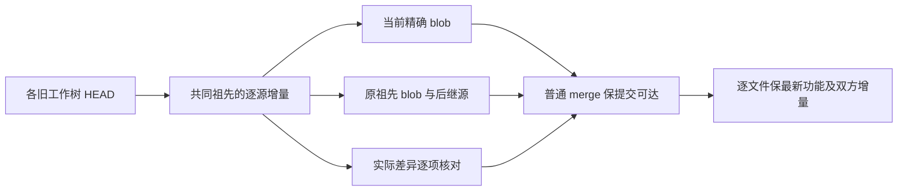

# T1290 其它 Creator 工作树普通合并的源码保留依据

本目录只读核对各 HEAD 相对 R 共同祖先的源码增量。生产源码/Git 写入为 0；未运行测试、编译、服务或模型，状态为 NOT-RUN。源码已保留的判断来自准确 blob、历史同路径 blob、当前源差异和受控临时文件中的三方合并原型，不能代替运行验收。

捕获基线为 R HEAD `f74fdf8c069d097be8f3bd4f38ff7c992dc85f7e`，正在普通合并 Main `0b0913635c2910fdf488ee3b47dc95acd5d619b0`；W 为 `03d60d39c899c08f15c6cebee3d2516079c45a74`。盘点过程中 Root 完成剩余五迁移冲突，最终只读复核 R 为 U0，HEAD/MERGE_HEAD 尚保持以上值。每份建议仍需以当前文件 SHA 核验，不能把捕获 working tree 说成已提交 HEAD。

`SOURCE_AUDIT.json` 保存每个变更路径的 base/branch/RHEAD/Main0b/W03d blob、当前 R SHA256、精确祖先 blob commit；`MERGE_PROBES.json` 保存原型输入/输出 SHA 和真实 exit code。`source-diff-review/` 是源码差异证据，不是生产补丁。`RESOLUTION_GUIDANCE.json` 给出逐文件建议与绑定。

| 工作树 HEAD | 相对 R mergeBase 的源增量 | 结果与普通 merge 指引 |
| --- | ---: | --- |
| codex-ephemeral-sessions `196321a0…` | 5 | 2 当前精确，app-server 三方结果即当前；两测试保完整旧用例并已有新增 usage、native 图/恢复/预算族。保当前源。 |
| codex-text-image `5dfd1c70…` | 213 | 137 当前精确，72 有 Main0b/W/R/祖先旧 blob 证明，4 特殊路径已核：worker-runtime、intelligence bridge、两 settings 区域均是当前扩展/替换旧全局 engine 的后继。保当前 v2 与新版 UI。 |
| daily-client-observability `90f3a6f4…` | 288 | 204 当前精确，78 原 blob/后继证明，6 特殊路径见下表；日志合同/采集/宿主已有，当前还合并发行硬化与逐 call 路由。 |
| t1255-client-writer `f54f184d…` | 285 | 188 当前精确，78 原 blob/后继证明，19 特殊路径见下表。现有观测和上传功能完整保留，并增加作用域、离线信号、停止上传等修复。 |
| t1273-release-hardening `c98e7a95…` | 31 | 28 当前精确，package/lib.rs/lock 三份仅后继新增或有意加强。保当前签名与释放边界，不倒灌旧壳。 |
| t1274-markdown `949ec229…` | 14 | 11 当前精确，3 精确祖先 blob 后继；script-core 与 Markdown 公共处理保留，当前更晚 source 已继承，不覆盖新写作上下文。 |
| t1274-native-workspace `19a1d87c…` | 401 | 392 当前精确，9 是原 RHEAD 相同 blob、当前已由准入 T1289 九 payload 后继替代。保当前三处 native graph/产物/metadata 一致及 latest715，不能拷回原旧包。 |
| integrated-dev-acceptance `64ca6add…`、两 unit `533224f3…`、t1062 `a091de27…`、wechat `a3bc947d…` | 0 | 已是 R HEAD 祖先。unit 树的未提交证据由原 inventory 单独保护；这里不覆盖或清理。 |

重要的 Git 事实：196 与 5df 在捕获时 **不是** R/W03d 的 Git 祖先，不能写成“已经自动合并了这些提交”。业务源存在准确等价/后继证据与提交可达性是两件事。Root 普通 merge 各真实 HEAD 保留提交谱系；出现代码冲突按逐文件当前 SHA、完整双方功能处理。禁止以 `strategy ours` 或整树 checkout 替代源码融合。

35 条初步未找到精确祖先 blob 的记录覆盖 27 个路径。六条三方原型 output 逐字节等于当前 R（app-server、两份 operation-scope、两份 settings-interactive、release lock）；29 条真实三方冲突逐源复核后的保留依据如下。没有识别出需要追加、尚未保留的独有业务实现；这个结论仅限捕获的 tracked source delta，不推断用户数据/秘密或未提交其他树证据已被保护。

| 路径族 | 保留当前源的具体依据（当前行号） |
| --- | --- |
| `ai-worker/src/execution/codex-app-server.ts` | 原受控 bundle/MCP/session 仍在 12/41/70；新增 image namespace 验证、notification media，凭据环境不继承 API Key，CLI 探针两分钟。三方结果等于当前。 |
| `codex-acp-policy.test.ts`、`codex-native-turn.test.ts` | branch-to-current 差异为旧用例保留后新增真实 total usage/native 图与恢复/原预算中断用例；import 扩展不删断言。 |
| `ai-worker/src/execution/worker-runtime.ts`、`backend/src/modules/intelligence/intelligence-generation-bridge.ts` | 原通用 structured 路径保留，Worker 51/141 专用 rewrite producer，348 隔离异常观察；bridge 51–61 以真实模式/owner 冻结，原合法 structured 输入不改写。不能恢复旧 global-engine 选择。 |
| `frontend/src/features/settings/settings-model-region.tsx` | 当前 16 routing / 17真实连接测试 / 36六能力来源，23保 Manual、37真实 credit center、39备份。旧全局 Codex 整页隐藏由正式六能力 UI 取代；不可整文件取旧版。 |
| `frontend/src/features/settings/settings-interactive-region.tsx` | 231/247实际设置来源一次消费、367日志卡、384真实 skills workspace key；旧模型区接口仍装配，响应式后继保留。 |
| `contract/src/cli-policy.ts`、`contract/src/index.ts`、`contract/src/workspace-operation-scope.ts` | 精确 diff 无 branch 删除行，只有新 modelRouting/Markdown/写作上下文端点导出与 scope 追加。日志原合同全保；实际 union432 交原合同测试。 |
| `backend/src/modules/execution/persistent-task.service.ts` | 88注册 typed observer，109/113及各已提交结果后观察；原 attempt/settlement 的直接 callback 已有后继队列/排水，398原 replay 身份清理完整，431真实父归属/期限/lease。不能恢复旧全局偏好根覆盖。 |
| `frontend/src/server/persistence-client.ts` | 2088 `workReviewAiFor(tx)` 仍同事务，1347/1355 collector/observer，5957/5967真实 owner/spec，7471–7481本 call readonly recovery。原日志 host/暂停/停止与7771被动 connectivity保留；差异中的旧全局 model resolver 已由最新 frozen owner/mode 替换。 |
| `backend/src/modules/observability/collector.ts` 与原测试 | pending 清理仍进行，新增 scopeModules/consentVersion=2 的原生记录与内部诊断限制；原族保留，测试新增24行。 |
| `contract/src/observability.ts`、`frontend/src/app/api/v1/local/observability/route.ts` 与原测试 | 原 exception schema/可信本地入口不删，追加 closed connectivity 信号；不向 Growth 作为异常/指标。 |
| `frontend/src/lib/observability-client.ts` 与原测试、`frontend/src/server/observability-host.server.ts` 与原测试 | 原异常事件与日轮保留，追加单在途/卸载取消/离线不领取与按原排期恢复；原测试保留。 |
| `frontend/src/server/feedback/encrypted-log-upload.server.ts` 与原测试 | 原受控 Growth transport/限速泵仍在；响应结束、非2xx及大响应显式停止泵，原请求 signal 与新 transfer signal 同取消，新增真实429后无孤儿字节测试。不能回退旧上传泵。 |
| `frontend/src/features/settings/encrypted-log-reporting-card.tsx` | 唯一差异是保存未确认时的诚实文案；原读回/归属/pending intact。 |
| `frontend/scripts/desktop/package.mjs` | c98差异无删除行，只新增 local DMG layout env；37/386真实 sidecar 签名保持。普通 merge 保既有 release check/sign 与新个人包布局。 |
| `frontend/src-tauri/src/lib.rs` | 当前20 release_integrity、1346/1967/4748验签、1847 extraction integrity；原native日志会话/异常/安全env与13/3046/3270/3411 expected-exit、2884/3103 app-version并存。不要以旧 observability 分支壳覆盖发行硬化，也不要以旧release壳删采集。 |
| `pnpm-lock.yaml` | c98->current只有 undici7.27.2 追加，三方结果即当前，保当前 lock。 |

原型没有运行目标模块：`git merge-file -p` 仅在本目录临时文件中对当前/base/branch 三个输入做文本合并；exit1 是真实文本冲突，不是产品 RED，exit0 相同也不是业务 PASS。所有原型临时目录已在 finally 自动删除，无数据库或监听资源。

后续 Root 普通 merge 任一 HEAD 后，应核对这些源码 current SHA；若其实际后续合并出现未在本表的真正新代码，保留新 delta 并明确复核，不按整个旧树取舍。本报告不替代最终公共链/本地包实测或清理前未提交证据保留。

最终逐源复核共1237分支记录、737不同路径。捕获后唯一源码漂移是 `backend/src/migration-convergence.test.ts`（三分支记录同一路径）：Root 已串行接入 canonical111 固定库存，当前244行真实新增111哨兵，SHA256 `1f7635f0047dcc7a8c8fd6cd6a1de8d7f21c7718dd3c7d4bdecce5690ea8e95d`。保该正式后继，不回写原110夹具；其它736路径捕获/交付SHA一致。此新增仍未由本代理执行，不记PASS。
