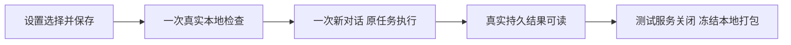

# 模型设置、Codex聊天与视频CSP本轮收口

本轮代码已并入main：6f75509fc715045035559d622c3fc9ffd932e16f、d2691bc6ed5a938adc516f211e80fa611374d673。完成T1294和T1295独立审核、真实验收登记；交付包及安装结果另见后续PACKAGE_DELIVERY.md。

模型设置合并图片入口、默认官方且保留已明确保存的选择、密钥集中、常驻充值入口；移除向量消费者以及助手画布和重复检查横条。Codex修复实际冷启动/准入错误边界和进程关闭屏障，只对精确账户读取内部错误同连接再读一次；仍核真实认证，不重发旧任务。

CSP仅增加wasm-unsafe-eval，仍禁止JS unsafe-eval。系统Chrome的真实Metal路径验证WASM、原生预览/导出、V1/V2/V3公共制作/采用/下载；导出文件实际解码有画面、音轨，V3公开下载与原生文件SHA相同。

| 验证 | 实际结果 |
|---|---|
|账户读取原factory测试|实际RED 12失败/17通过，修复GREEN 29通过；独立实施审29通过|
|相关Worker回归|6文件161通过，retry0|
|正常标准构建完整浏览器|prepared-c9038acd34aa82d8：10通过，唯一新实聊成功|
|taskctl严格重新执行|prepared-452d6bee379c9f48：10通过/0失败/0跳过/0flaky，3.1分钟；唯一新实聊2.5分钟后原任务成功|
|本地打包基础检查|4文件45通过|
|类型、timeout、边界、CodeGraph|本轮相关检查通过；边界仍5条原有违规，无新增；索引实际exit0|
|完整全局对账|真实exit1，29ERROR/0WARN，均属T1292原32项，无新增门身份；不是全项目全绿|

两轮最新完整浏览器各只提交一次新聊天，retry/resume均0。严格轮AI任务ai-task-0d8b025b-9364-40e2-ac13-b2500fc06e8a，执行任务execution-task-e7f103fe-d3aa-4135-be10-959fe144c0eb；status=succeeded/errorCode=null。4187源文件和11普通bundle前后全部相同，HTTP/persistence/Next关闭ACK完整，runner/test/shutdown exit0。

证据入口：[浏览器报告](browser/runs/prepared-c9038acd34aa82d8/REPORT.md)、[严格轮来源与终态](browser/runs/prepared-452d6bee379c9f48/ROOT_COMPLETION_BINDING.json)、[实施独审](account-read-implementation-review/REPORT.md)、[全局旧债比较](GLOBAL_RECONCILE_COMPARISON_FINAL.json)、[视频验收](../t1295/FRONTEND_VALIDATION.md)。原始失败、原用户“你好”、32次诊断中的5个原FAIL及软件GPU黑片FAIL均保留；没有把它们重跑改写成成功。

限制：上游account/read/-32603具体根因未唯一确定，有限恢复不保证所有环境永久可用。开发页Next dev 1 Issue及ResourceGrantsPanel组作用域日志保留。原生App自动化用户暂不授权，Windows未验证；本轮不调用真实付费模型、不充值、不部署Growth。缺失旧素材按用户决定跳过。全局旧债仍归T1292，不能以本任务已验收声称全应用所有功能通过。Root额外只读状态探针在验收关闭窗口返回HTTP502，未取得状态，不据此推断在途故障；正式完整用例真实终态及关闭回执另保。
