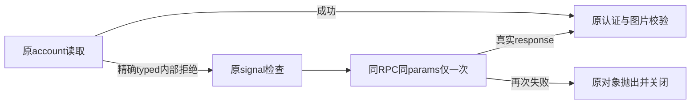

# T1294 第三轮account/read有限恢复实施独立审查

结论：本次Root正式factory九行修改未见待修finding；独立执行原codex-account-precheck.test.ts实际29PASS、exit0。它是完整原factory入口的stub回归，不调用真实CLI/网络/模型，不能代签后续正常bundle/fresh全10或App。候选诊断observer是本审作者先前编写，**本次生产factory与29fixture原候选作者为`/root/asr_owner_closure_audit`；Root独立复核、正式应用、执行RED/GREEN并集成**，没有用作者诊断试验自签生产实现。

## 精确实现与状态边界

只在account/read处新增同params的try/catch。第一次实际typed CodexHostError、code=CODEX_RPC_REJECTED、rpcMethod=account/read、rpcCode=-32603四项全部匹配才进入。先signal.throwIfAborted，再在同rpc/request实例上同一个accountParams对象读取一次；无循环、递归、backoff或第三次。第一次成功仍一次读取，其他方法/机器码/数字/缺字段/非typed不重读。

没有创建新的AbortController/timeout/deadline；构造RPC时原signal仍相同，取消时原RPC关闭/pending拒绝机制继续生效。额外读前检查已取消/已到期的原signal；每个request仍沿原默认120000ms，读成功/失败都不续原持久任务期限。测试直接覆盖首次错误时原signal已取消且只读一次；不把fixture当所有真实取消时序的公共链验收，既有真实RPC/Worker取消链仍须保。

第二次成功只使用第二次真实response，走原record/认证状态/图片provider capability/真实default image modality校验，不用第一次失败、缓存或空默认制造ready。第二次未登录→unauthenticated；第二次失败原对象抛出，原catch关闭RPC，未吞错。helper仍原两个受控app-server（第一收MCP并close、第二认证），不重跑initialize/config/MCP、不换源/模型、不显式刷新token。不增加thread/start/turn/start或付费请求。原imageGeneration分支的free/非chatgpt/能力缺失/不支持image等拒绝均保，配置/MCP/危险feature在account/read之前拒绝。

external-chat-worker-run.ts及账本/host ports/readonly恢复未因本改动改变。对既有started/unknown调用，该helper最多多一次非付费账户读取，之后仍原同thread/turn只读恢复，不重新reserve或发送prompt/turn。新的clean reserved最终错误仍由已审precheck ACK边界处理；本报告没有扩大签原历史maincatch所有行为。

## 回归证据边界

29个fixture通过原createControlledCodexSession记录二个真实逻辑会话的构造、同signal/params、版本/路径/权限、原配置/MCP、正常close、精确正负族、第二异常对象、取消及认证/图片能力。node:module/fs/execFile及RPC均被明确stub，没有假装运行真实二进制。Root所保RED和本审GREEN来源不同，未补拍前置RED。

之前零turn32观察的5个原FAIL永远保留，5次第二RPC返回成功只是有限可恢复样例，未读其账号体、不能单独说明已认证。本次factory单测才核第二body完整认证/能力决策；后续正式普通bundle与真实同四ID聊天仍由Root实跑。

## 官方同版本调查的有限发现

官方rust-v0.159.3 annotated tag对象8e46774a94a745ffdf676bd7a8aa36466bbd4f99，peeled commit01fc69f4026735edfdf6789820549727a4867b11。相同版本真实get_account在request_processors/account_processor/workspace_routing.rs:157-168，将InvalidAccount映射invalid_request(-32600)，将Routing错误统一映射internal_error(-32603)；error_code.rs证实数字。该Routing集合包含配置要求、账户代际改变、发现401/网络错误、缺/重复workspace、URL/backend冲突以及15秒discovery timeout等。**-32603不能唯一指向登录、token、keychain或临时网络，也不能保证每种原因都会恢复。** 当前修复只做一次非付费原读取且仍核第二真值，不把通用内部码当成功/越权。

公开源细节与SHA另保worker-rpc-tap/upstream-account-read；本审不读用户raw account/config/error.message/data，不依据固定码臆测哪一个Routing分支命中。生产并未改上游二进制的15秒内部观察值，也不把本地120000ms预算说成上游所有内层都相同。

全部源码/SPEC/宪法与独立日志hash见BINDING.json。只写此证据目录，正式source/dist/control改动0；本次实施审无新增真实CLI/模型/协议调用。
