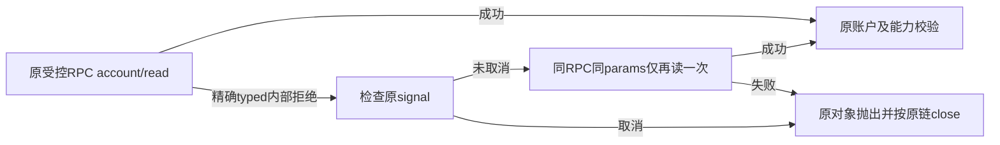

# T1294 account/read 一次有限恢复候选

仅在本目录准备可审源码/测试，尚未应用、未执行 Vitest、未启动 Codex CLI/网络/模型。Root 第三轮独评通过后先应用 `01_TEST.patch` 实跑 RED，再应用 `02_SOURCE.patch` 实跑 GREEN。本目录任何静态结果均不充当 RED/GREEN 或真实协议验收。

生产唯一写集为 `ai-worker/src/execution/codex-app-server.ts` 中原 `account/read` 一处。新增测试唯一为 `ai-worker/src/execution/codex-account-precheck.test.ts`。镜像为完整最终文件，两个 patch 分离，避免先应用生产破坏真实 RED。



唯一恢复条件为实际 `error instanceof CodexHostError`，同时 `code=CODEX_RPC_REJECTED`、`rpcMethod=account/read`、`rpcCode=-32603`。第一次成功只读一次；匹配后先 `signal.throwIfAborted()`，同一个 rpc、同一 `accountParams` 对象（`refreshToken:false`）再读一次，第二个错误直接原样抛出。无循环、新会话、thread/turn、缓存、登录刷新、配置检查重跑、新定时器或新期限。两次均沿原 request 默认 120000ms 和外层原 signal；原 factory 只保留两个受控会话与原关闭路径。

新增测试通过原 `createControlledCodexSession`，不导出生产测试 helper。仅 stub 协议类、`createRequire` 锁定 artifact 定位、fs 校验与 `execFile --version`：元数据和 stdout 明确为原锁定 `0.159.3`，协议类保留真实 `CodexHostError` 构造器。测试记录会话、RPC顺序、params对象身份、原signal、CLI禁用MCP/工具参数、版本/文件检查与close，不执行真实子进程。

静态计数预计 **29 cases**（须由 Root 真实 discovery/run 确认）：首次成功、精确恢复、第二次普通或同精确错误原对象、9类不匹配错误、取消、真实未登录/无需认证、图片能力成功、3账户拒绝、2能力拒绝、模型拒绝及6原配置边界。保原配置、MCP名称变化、工具/搜索禁用、notification media、图片 namespace、账户/套餐、capabilities/default image model 校验。文本原合同是未登录返回 `authenticated:false/loginStatus:unauthenticated`，图片原合同则 `CODEX_LOGIN_REQUIRED`；测试精确保留这个区别，不把文本 factory 改成额外抛错。

Root 审核后推荐先红、后绿分别运行同一命令（本轮未运行）：

```bash
pnpm -C ai-worker exec vitest run src/execution/codex-account-precheck.test.ts --retry=0 --maxWorkers=1 --testTimeout=180000 --hookTimeout=180000
```

再按 SPEC 跑相关 Worker/状态公共链、类型、timeout/boundary、正常 worker build 及新的普通 bundle 真实聊天验收。不得重发原 unknown；真实零turn 32轮诊断由另一个执行者负责，本候选不代签其结论。

本轮静态检查：两份候选 `typescript.transpileModule` 语法 diagnostics=[]。随后按原 ai-worker tsconfig、内存替换候选的受影响文件静态 typecheck 为 exit0、diagnostics=[]，`strict=true/noUncheckedIndexedAccess=true/noEmit=true`；只补入本地已锁 node 类型目录作正常解析，不执行候选。脚本 `static-typecheck.cjs` 和结果 `STATIC_TYPECHECK.json` 可复核。首次自建 CompilerHost cwd 错误导致 node 类型未解析且暴露 Mock 默认泛型不可调用，真实失败保留在 `STATIC_TYPECHECK_INITIAL_FAIL.json`；已修正 cwd/typeRoots 及明确 Mock 函数签名，未把该静态失败叫作 TDD RED。

当前生产/测试原字节与 binding 对照保持；正式应用、独评、RED/GREEN、完整类型/build/真实聊天仍由 Root 串行处理。
