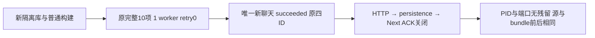

# T1294 普通构建 fresh 完整验收

本轮实际执行 `node docs/verification/t1294/run-journey.cjs`，完整 **10 PASS / 0 FAIL / 0 SKIP / 0 flaky**，1 worker、retry0，耗时76.450秒。runner、Playwright 与关闭子进程均自然 exit0。只创建一次全新本地 Codex 对话，没有重发旧任务。

## 来源与构建绑定

Main HEAD `d2691bc6ed5a938adc516f211e80fa611374d673`。执行原正式 `frontend/tests/e2e/t1294-model-settings-and-codex-chat.spec.ts`，SHA256 `5d2a2641c0b0f368e3bef796dab15eb319924c8e4d69dc24dd18d11d56f39d9b`；runner SHA256 `1f1c315b9b5bd0c3010683947f992f0cffcc63732f9ad105b9cac4665a7df1e7`。普通标准构建，无诊断 tap。

- execution-worker：`bc110a9ff2b84551299d771e2b45c0ed9e87cefee8a69871a4f561e33febd82f`
- codex-status-worker：`fad676c12723a49b444f74c1dd5f1d663eb4d4bb3ba52717dd3869c531df97d5`

binding在启动时生成，末尾逐个复核4187源文件和11个bundle全部一致，HEAD与正式test/runner字节也一致。该结论是前后快照一致，未声称持续锁定ignored dist。`NORMAL_BUNDLE_OBSERVATIONS.json` 中05:06:23采样实际发生在05:05:59退出之后，已保留原误标签并更正为post-run-observation，不能视为在途采样。

## 真实操作结果

| 原测试 | 结果 |
|---|---|
|T1294 fresh默认官方，设置无向量/独立图片理解与数据服务分类，充值常驻|PASS / retry0|
|T1294 已保存混合图片与自配选择重开保留，主动改图片同次CAS只统一vision/image|PASS / retry0|
|T1294 实际CAS冲突不覆盖其它窗口保存，原草稿与失败提示保留|PASS / retry0|
|T1294 RedFox在模型页实际保存/掩码/重开/删除，旧深链仍可达且零查询费用|PASS / retry0|
|T1294 旧向量测试明确停用，真实资料创建/修订/搜索保原文与组隔离|PASS / retry0|
|T1294 常驻充值按钮走原空body受控POST，缺官方配置诚实失败且零资金新操作|PASS / retry0|
|T1294 唯一新本地Codex对话：设置检查一次→直接发送→四ID同任务完成并可读，unknown不重发|PASS / retry0|
|T1294 设置与助手 desktop 可读可操作且无画布/检查横条|PASS / retry0|
|T1294 设置与助手 narrow 可读可操作且无画布/检查横条|PASS / retry0|
|T1294 设置与助手 CSS640x450/DSF2等效200% 可读可操作且无画布/检查横条|PASS / retry0|

唯一新对话按原UI从官方切Codex并保存后即时发送，终态`succeeded`、errorCode=null，1次UI提交、1个chat POST、1份200回执且四ID完全一致，legacy engines GET0，retry/resume均未调用。原测试验证真实execution owner/group、accountId=null、后端持久assistant与原source绑定、非空正文，并与可见正文一致。实际完成截图清楚显示“连接正常”。没有借平台账号摘要绕过account-null 428。

- groupId: `grp-b2a58019-256`
- conversationId: `ai-conv-b2a58019-288`
- sourceMessageId: `ai-msg-b2a58019-289`
- aiTaskId: `ai-task-dad2d192-5d85-4e00-bb52-b2339749287e`
- executionTaskId: `execution-task-fbad045f-2883-4cf6-82b1-9daba969b67f`

## 实际图与资源闭合

已实际查看默认模型页、完成聊天与200%等效小视口三张原图。默认模型页四个来源均为官方，显示“未修改”；图片为单入口，AI额度卡可见。聊天完成图无画布按钮/检查横条，显示“连接正常”。200%等效viewport原几何CSS640×450、deviceScaleFactor=2、zoom=1、scrollWidth=640，对应PNG1280×900；保留原四控件几何断言。28个PNG文件含附件重复，共13组不同字节，详见SCREENSHOT_BINDING.json。

owned服务PID8689/port52121，原HTTP关闭→persistence关闭→Next关闭三个ACK齐全，server-exit code0。末尾ps验证8689/8701均不存在，lsof验证52121无监听；Playwright自然退出、owned上下文完成teardown，未再另开浏览器。runner保留本轮owned数据供审计；用户安装App未停止，用户数据未接触。

## 证据限制

聊天与小视口原图左下仍有Next dev“1 Issue”，未隐藏或删badge。已有next.log明确记录ResourceGrantsPanel的“请先进入此账号组，再查看共享资源。”，安全栈位于resource-grants-panel.tsx:22:128 / :34:5；另有ingestion.douyin.status的AccountRequiredError。未展开badge，不能由相关日志认定唯一来源，也不能将选定10项通过写成浏览器console零异常或全应用全绿。见NEXT_DEV_ISSUE_OBSERVATION.json。

本次一次成功不证明间歇故障永久消失，不改写既有失败、32trial中的5个原FAIL，也不签真实资金或安装App全部功能。没有为了补证重开聊天、服务或读取用户DB。

机器结果：FINAL_RESULT.json；逐项：FINAL_CASES.json；源/进程/端口：FINAL_RESOURCES_AND_SOURCE.json；原Playwright、截图、日志、三阶段ACK和任务ID均留在本run。正式源码、测试与控制面未由本agent修改。
