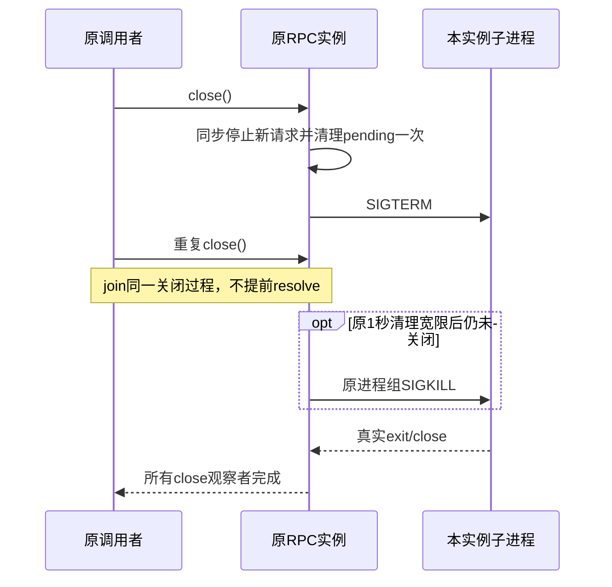

# T1294 close 生命周期范围判断与小设计审核

结论：**所述最小修复属于已审 round2 的既有范围落实，不需要仅为它开启 SPEC 第三轮。** 这是独立只读范围判断，不是实施审核通过、TDD或运行Gate；Root仍为唯一正式writer。若后续扩为RequestIO.stop/全局会话串行化、握手参数、重试或恢复协议变化，结论不适用，须先补准确SPEC再独审。

本次没有执行模型、浏览器、子进程fixture或服务，没有修改正式源码/测试/control。继承父代理模型，未切换，不猜型号。读取时间：2026-10-15T04:23:25.329072+00:00。

## 理由与实际缺口

1. 当前SPEC明确准入`ai-worker/src/execution/codex-app-server-protocol.ts`及原`codex-app-server.test.ts`。它也明确要求“正常关闭已取得的RPC/consumer，不让清理覆盖根因”，同时保取消、原执行预算与已启动/unknown语义。本修复不新增owner、public port、用户流程或权限；不是只因为文件在write_set就获准，而是直接落实已审的资源关闭要求。
2. 原方法已有`close():Promise<void>`；实际消费者在初始化失败、第一受控会话finally、第二会话失败及external finally均明确`await close()`。修复让这些已有await在真实退出后才完成，是修复既有调用链完成语义，不是新增自动重试/重启/恢复能力。
3. 当前POSIX代码同步设closed并拒绝pending，发SIGTERM后仅登记1000ms unref清理定时器，随即resolve；重复close因closed直接return。源码已证明这些await不是退出屏障，并允许第一app-server还在退出时第二个启动。落实退出屏障修正这一确定实现缺口；不用改调用者或虚构新的产品承诺。
4. 没有证据证明该重叠造成当前CODEX_RPC_REJECTED。冷/暖相关性、tap下成功、生命周期缺口应分别保留；修复后Node fixture通过也只证明关闭语义。真实普通bundle首聊天验收仍另跑并保原失败，不能把本修复写成“RPC根因已确认”。

## 最小可评审设计

- 继续立即设closed、拒绝/清空pending和移除abort listener，不让等待退出期间新请求进入。另存单一在途关闭Promise；所有调用者join，不能让第二次close仅因closed而提前返回。若测试要求Promise对象身份相同，`close()`可直接返回保存的Promise，避免async包装生成不同对象；核心合同是同一个退出屏障和一次终止流程。
- 在发信号前安装退出/close监听，保已退出、spawn失败无PID及自然退出竞态。`closed`是逻辑IO状态，不能当成OS进程已退出的事实；不能只以“SIGTERM调用成功”或辅助kill进程结束为完成。
- 子进程exit与stdio完全close是两个事实，不能把exitCode已赋值自动等同所有管道已关闭。共享关闭Promise须以选定的真实生命周期后置条件兑现，并覆盖已经在fail/abort路径开始关闭的实例。监听须独立于fail的`if(closed)return`门，避免漏完成或递归等待自己。
- 保POSIX既有detached进程组目标与1000ms SIGKILL清理宽限，不把它变成RPC/模型/任务的正执行超时，不缩120000ms请求预算或持久deadline。释放timer/listener，不留重复kill流程。进程组兜底不能在尚需清理的后代仍持有管道时仅因父exit便被过早取消；至少不能把等待close卡住的情形误报完成。不要因此扩成RequestIO强杀协议重设计。
- 关闭失败/退出未确认不能伪装“已关闭”。保持原异常/取消优先，不让finally清理错误覆盖原CodexHostError或GenerationFailure；原调用点已有`Promise.allSettled`等保护则保留，不能顺手改变原业务结算。若发现必须改变其它生产调用者才能满足这一点，先准确报告，不静默扩写。
- Windows现分支等的是taskkill辅助进程，不等原child close；如果本次只验证POSIX，应明确Windows未验，不签全平台进程树关闭。若同一私有close方法顺带join原child生命周期，仍不得更改Windows权限、工具参数、RequestIO.stop或引入新owner；两平台的实际测试证据分开。

## 必需的无模型测试与诚实边界

全部在原已准入`codex-app-server.test.ts`使用唯一owned Node假进程及本轮独占目录，shell:false、不调用Codex或真实turn；fixture独立清理其PID，不依赖被测close自证成功。

1. ready后由fixture控制延迟响应SIGTERM。调用close后确认Promise仍pending；允许退出后await完成，并以真实PID不存在/实际child close事件证明后置条件，不能只spy kill。
2. 忽略SIGTERM：原1秒清理宽限触发SIGKILL，await须等实际退出；原请求预算仍>=120000ms。延迟或一秒清理是fixture/清理事件，不冒模型请求执行上限。
3. 两次/并发close：等待同一真实退出，终止和pending拒绝只做一次，早到/晚到观察者都不能提前完成；自然退出、已在fail/abort关闭中再次close都覆盖。
4. fake child不要仅依赖stdout协议声明“已退出”；由父fixture独立观察真实PID/exit/close。测试finally对本fixture做兜底关闭，异常日志不输出环境/帧/凭据；没有运行的族记NOT-RUN。
5. 不因本局部测试通过声称RequestIO.stop已清detached孙进程，也不证明登录/握手参数或RPC拒绝根因。状态探针自身有意同时持有text/image session的原行为不改；不新加全局锁或盲重试。

建议Root在本任务实施证据中写清“落实原RPC close完成语义”，保存Node真实RED→GREEN、旧协议测试/取消/unknown回归、timeout/边界结果，再用普通bundle做新独立公共链验收。**这不要求新第三轮SPEC；如果实现越出以上边界，则应回到准确范围补充。**

## 读取字节绑定

|路径|SHA256|
|---|---|
|`docs/features/t1294-model-settings-and-codex-chat-acceptance.md`|`8566bd08588a0a58935cc96309b713dc076cde52277471c62607e61d5af40afd`|
|`docs/产品定位.md`|`86bc2c8add6a01ebf5b2ecf9de05d448770ca14a4e0bdbbf376fffc6387e3800`|
|`docs/verification/t1294/spec-review-round2/packet.json`|`51a9d7fe6e7b1f9ffd170001ff4515647d82f18069f9d6f16b4b8c8f46d45baf`|
|`docs/verification/t1294/spec-review-round2/SOURCE_BINDING.json`|`2c941faf39eb98bd7de56eaf1de670cca755282865b799e8304a29924a2b7b93`|
|`docs/verification/t1294/worker-rpc-tap/CLOSE_LIFECYCLE_REVIEW.md`|`02012a918787cbe1059d1681bd9df5ef2b76668593dfb041631b0a905ad78c67`|
|`ai-worker/src/execution/codex-app-server-protocol.ts`|`9cbc438bf97444108f58a4483e52ddb07fb6b6d2fcd16887a5b6577bbeda348e`|
|`ai-worker/src/execution/codex-app-server.ts`|`af38c7ede2f8c5a056a384f1d2e8a2433a0b7df7a53da125472c99134ce4105a`|
|`ai-worker/src/execution/external-chat-worker-run.ts`|`8344d96bf0425a9df03ebff4161b9adfc1b388ac4ee8482d3c5c8053505df6c1`|
|`ai-worker/src/execution/codex-app-server.test.ts`|`2d1ce63b5e5a4fc8b16b394a3d27340b544fbffae48fdef6c4f99853799e681e`|
