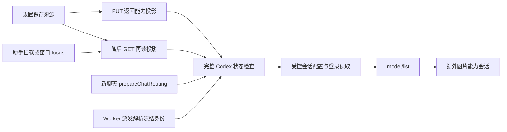

# T1294 Codex 安装版只读诊断

> 10月15日续核：用户已明确全部任务在“月明水清深”组，公开列表精确唯一匹配 `grp_legacy_acct-ae1a8346-9`。以下“待组”是先前阶段保留，已由本次实际回读解除。原 source 已证实等于“你好”，正文不落证据；原执行任务真实状态 blocked/waiting_user、CODEX_RPC_REJECTED，非持续执行。详见文末续核与逐份 `*.live-sanitized.json`。

当前结论：**反复预检有确定源码原因；截图中原“你好”任务的实际失败原因尚未取得。** 安装版 CLI 已连通，访问已开启，公开组列表有 5 个组；Root 正向用户确认失败对话所属组。未选组、未跨组读任务，未将截图里的“恢复中”当成模型仍在运行的证据。

本报告对应 `SOURCE_BINDING.json` 中 Main 当前源字节。只写本目录；生产/测试/控制/Git 写入均为 0，用户 DB/凭据文件/连接文件读取为 0；未调用真实模型或旧任务重发。

## 已有真实证据

- 安装版 `creatoros --version/help/status/access status` 均成功；CLI 0.1.0、contract 0.4.0、installed PID 57691，connected/enabled=true。见 `CLI_DISCOVERY.json` 与 `PUBLIC_CONNECTION_RECHECK.json`。
- 已动态发现 operations，并描述 `execution.tasks.list`、`ai.tasks.list`、`workbench.tasks.inspect/events`、`workbench.modelCalls.summary` 的只读 schema。见 `READONLY_DESCRIPTORS.json`。这些业务接口尚未调用，因此没有原 taskId、Worker/流/账本终态的证据。
- 公开 operation 没有独立 Codex/runtime/engine 诊断 operation。不能绕过公开 CLI 直连 `/api/chat/engines` 或读用户库补洞。

## 重复检查的真实调用链

1. `settings.service.ts` 的 `routingResource` 每次执行 `readModelRoutingProjection`；`getModelRouting` 与 `putModelRouting` 都调用它。`assistant-engine.ts` 的 writeModelRouting 保存后再 GET 回读。两者都在 `persistence-client.ts:5791` 进入 `captureSelectedModelSnapshot`，只要任一来源是 Codex 即 `localCodexStatus.read`，没有结果缓存。
2. `assistant-engine.ts` 窗口 focus 会 force GET；旧引擎 hook 每次挂载走 `/api/chat/engines`。v2 hook 虽不走旧端点，仍等 GET 投影，不能避免底层状态 Worker。
3. v2 新聊天 `prepareChatRouting` 再 capture；`resolveFrozenCredential` 的 `readSnapshot` 在真实派发前再 capture。因此设置检查不作为可复用观察证据。
4. `codex-status-entry.ts` 每次 resolveBundledCodex，然后受控会话内部两次 app-server 初始化/配置读取。认证成功后 model/list，再尝试另一套图片能力受控会话。文本检查结果也要等该可选图片阶段及清理完成。
5. `local-codex-status.service.ts` catch 不区分取消、期限、IPC/运行时故障，全部投成 unavailable/CODEX_STATUS_UNAVAILABLE。用户关闭、切组或取消观察不能因此污染共享可用性缓存。
6. 冷状态 IO 的外层是 readiness 120000 + execution 120000 + grace10000 = 250000ms；FIFO 会按原请求 deadline 累积更长。不能把 UI 10/30/120 秒观察上限代称完整执行预算，也不能为避等待截短内部合法链。

## 最小接入建议与约束

- 后端 local status service 增加分离的 `peek`/显式 `check`：普通模型元数据只 peek；设置实际选中 Codex或用户点击检查调用 check。check 按真实 user、runtimeVersion、宿主配置 generation 合并同一进行中的请求。组/账号仅是观察者归属，不把用户级来源改为组级。
- 缓存内容仅含 schema、runtimeVersion、真实 requested/default model ID、模态、能力结果、checkedAt、宿主 generation；不缓存 Token/登录资料、thread、prompt 或任务。scope key 不能来自 requestId。多个观察者各自取消/期限仅 detach 自己；最后没有观察者时才可取消属于本次显式探针的工作，取消结果不写“不可用”。旧 generation 晚回执不得覆盖新检查。
- 再次打开助手、GET/focus、来源保存后的回读不重新 fork。已明确的可恢复运行时错误可使原观察失效；不得因普通网络取消使所有用户或其它合法读者失效。
- **当前合同缺口必须正面处理**：Codex v2 identity 要求真实 `requestedModel`。`prepareSelectedModelRoute` 仅在 unverified 同时具备 identity 时可冻结 configured；无缓存且 `snapshot.codex=null` 现在会投 unavailable。不能把 null 改成假 ready，不能填写死默认 model。无观察证明的新根需在其原一次 admission 内做必要无模型握手、取得真实 ID 后原子冻结，再派发；旧 frozen 根只认原 ID，不能按当前默认重选。
- **重启语义**：现有设置只持久 choices/revision 与旧 engine，没有可信 probe proof 存储 owner。仅内存缓存不能声称跨重启保持“已核实”。若要求跨进程复用，需单独准入由宿主保存的无秘密观测记录及版本/用户/宿主校验；启动后可显示“上次核实/待本轮确认”，真实 Worker 仍握手、仍可拒绝失效权限。不得拿 localStorage UI 值签署后端可用。
- Worker 实际配置、登录、协议与能力检查保留。缓存不是永久就绪承诺；新任务按原冻结 ID 校验，unknown 原回合仅原 thread/turn 读取，不借缓存启动第二回合。

## 准确候选写集建议（不是准入或实际修改）

首批重复检查/取消闭环：

- `backend/src/modules/ai-runtime/local-codex-status.service.ts`：peek/check/cache/singleflight 与取消观察。
- `frontend/src/server/persistence-client.ts`：普通投影、根 admission、旧 root/frozen 派发各自明确目的；删除普通 GET 隐式 probe。
- `backend/src/modules/ai-runtime/capability-model-routing.ts`：诚实 unknown/unverified 与有真实 identity 的冻结规则；保持旧任务 own route/ID。
- `frontend/src/app/api/chat/engines/route.ts`：仅明确 settings check 意图进入 check；普通读取 peek，认证/归属/no-store 保留。
- `frontend/src/features/copilot/use-assistant-engine.ts`、`assistant-engine.ts`：复用读取、显式检查、无缓存状态允许走真实 admission，取消不显示 failed；保持晚回执与切组 fence。
- `frontend/src/features/settings/settings-model-region.tsx`：选择后/点击显式检查，不让普通详情挂载强制重测。
- `ai-worker/src/execution/codex-status-entry.ts`：如需文本不等待额外 image 检查，必须将能力检查目的显式化；不可删图片安全能力校验或凭文本成功签图片 ready。
- `contract/src/internal/local-codex-status.ts` 与相应公开引擎检查契约（若加目的/观测状态）需同步精确准入。跨重启持久观测另需明确 schema/repository/migration owner，不能暗塞旧字段；当前尚未建议新 DB 迁移。

测试沿现有公共链：`local-codex-status-handoff.public.test.ts`、`request-io.service.test.ts`、`capability-model-routing.test.ts`、`use-assistant-engine.test.tsx`、`assistant-engine-server.test.ts`、`settings-model-region.codex.test.tsx`、`codex-frozen-preflight.integration.test.ts`。新增族至少覆盖同 scope 双读仅一个检查、不同 user 不串、单 observer abort 不反杀其它读者、全部取消不污染缓存、过期/升级/配置变化、旧 requestedModel 保留、无缓存不伪造 identity、GET/focus不重探、重启无持久证据不 ready。当前 **NOT_RUN**，没有补拍红绿。

## 原失败任务下一步

用户明确组后：动态 describe 原只读 operation → 显式 --group 列最小 ai/chat 执行任务 → 不读取 prompt/正文，仅投影 id、父关系、状态、errorCode、时间、attempt、lease是否存在 → 原 ID inspect/events/modelCalls summary。只保留事件类型、序号、状态/错误码及是否有文本长度，不落私密内容。判明卡在未建任务、等待 claim、冻结准备、受控握手、原 turn unknown 还是仅订阅断开，才能确定实际修复写集。

若需要新的真实 Codex 测试：由 Root 先明确一个测试组和全新专用会话，无附件/项目/工具动作，单次固定“只回复一个简单词”文本，原 durable/public submit 创建一个新 taskId，记录同 ID→Worker→stream→完成消息可读性；不执行旧任务 retry/resume、不换幂等键补投、不跑 API/资金。不建议直接运行 Codex CLI 绕过 CreatorOS 公共主链。此测试 **NOT_RUN**。

## 10月15日明确组后的原任务实际续核

公开只读回读闭合四个原 ID：

- 业务任务 `ai-task-51980db6-1916-46d7-9f83-25c890b57231`。
- 执行任务 `execution-task-a4650db4-1e1f-4d90-b0ed-e82a4ab42745`。
- 会话 `ai-conv-6240987a-1103`。
- 原用户消息 `ai-msg-6240987a-1104`。公开消息内容只做精确“你好”比较并留 boolean=true/contentLength=2；没有存正文或其它私密消息。

原任务创建 `2026-10-15T02:16:08.849Z`，更新 `02:16:28.559Z`，attempt=1；真实 execution status=blocked/runtimeStatus=waiting_user/errorCode=CODEX_RPC_REJECTED，leaseOwner/leaseExpiresAt/heartbeatAt=null、checkpoint=null。ai projection 仍 running，但 runtimeStatus 明确 waiting_user。公开 errorMessage 只有“执行停止，等待恢复或诊断”。modelCalls.summary 的四 ID 与原任务一致、calls=[]，steps=[]；这些字段不能证明外部 turn 是否发出，因为 summary 不覆盖所有 external_agent 账本。

workbench inspect/events 实际 HTTP428，已留原失败；当前 contract workspace-operation-scope 把它们列为 platform-account，原 task accountId 确为 null。没有拿其它组成员账号冒原 owner。可用的 execution.tasks.get、ai.tasks.get、messages.list 和 modelCalls.summary 均沿同组同原 ID 成功。

因此实际聊天停在“等待用户/诊断”，重复 probe 是另一处确定问题，不能代替这个原 RPC 拒绝的根因。Main当前 `ai-worker/src/execution/codex-app-server-protocol.ts:35` 对任何 frame.error 都只抛 CODEX_RPC_REJECTED，pending map 也不存 method，公共终态又只留通用文案。具体 config/read、thread/start 或 turn/start 哪一个被拒，以及上游 numeric code，在当前公开证据中不可恢复，不能猜成 turn/start 或登录失败。

最小下一步：新隔离公共对话之前，候选安全诊断可在 pending 记录原 method，CodexHostError 仅携带 rpcMethod、上游整数 code、已知安全 family；绝不落 frame/error.message/data/config/account/Token。沿 worker→宿主结果只持久安全机器码/阶段后，用唯一新 task 复现并验证原冻结约束。此处涉及 Worker protocol 与其精确测试，尚不在本轮已准入实现写集；Root 应先补 SPEC 并独审。原失败不得自动恢复，不能追溯补签细节。

本续核所有业务调用均 read；原 task command/retry/resume=0，真实模型调用=0，用户 DB/凭据/私有路由读取=0。安装 App 保持运行。当前 Main protocol 作为静态机制证据；没有逐字节绑定安装包 Worker，不能把 Main静态解释冒称安装版现场的具体RPC栈。
