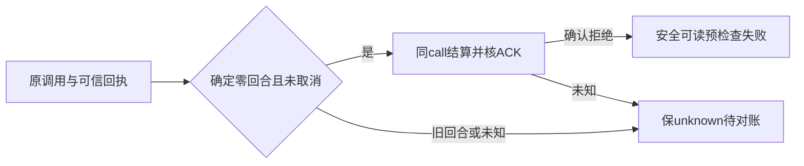

# T1294 第二轮规格独立复审

结论：当前完整SPEC及新增窄段没有待修finding，可进入所列范围的RED实现。此结论不代表实现、真实聊天或原生App验收通过。

绑定Main `6ff8b6e317330711e08426b1cbc39aeb243f16c1`；SPEC `8566bd08588a0a58935cc96309b713dc076cde52277471c62607e61d5af40afd`；宪法 `86bc2c8add6a01ebf5b2ecf9de05d448770ca14a4e0bdbbf376fffc6387e3800`。完整逐文件SHA见SOURCE_BINDING.json。已有initial正式记录230e4235a3f2；实读reviewctl.mjs 559/584行只允许initial/recheck，故本packet使用recheck，描述中保留新增范围性质，不伪造revision枚举或新周期。

## 必要性与实际事实

同task execution-task-af598f48-d694-4d1a-9d4a-71745c2db937的隔离UI诊断捕获未包装CodexHostError/CODEX_RPC_REJECTED，外层显示WORKER_EXECUTION_INTERRUPTED。当前external-chat-worker-run.ts中reserve、v2 credential及createControlledCodexSession均位于主try前，原账本可能仍reserved。该源码事实支持局部异常边界修复；诊断栈并不含rpcMethod，不证明该次一定在account/read，也不证明原用户“你好”和这次同一上游原因。前次受控探针account/read曾拒绝，后次成功，原FAIL保留。

## 精确范围与安全合同

三生产路径仅external-chat-worker-run.ts、codex-app-server-protocol.ts及ai-error-humanize.ts；四直接测试为SPEC原列native-run、app-server、worker-runtime及humanize测试。worker-runtime只作消息链回归，无全局错误映射生产改动。协议仅pending中的固定允许method和上游有限整数code，必须剔除message/data/frame/config/account与密钥，不改变握手参数、SDK或真实能力检查。

clean reserved必须可信parse、同原callId、无session/providerTurn且未尝试startExternalChatTurn；取消先排除。明确本地握手CodexHostError/typed配置身份拒绝，须同call rejected ACK严格parse并核callId/status，才waiting_user/CODEX_SESSION_PRECHECK_REJECTED。账本保原安全码。reserve未知、plain host/lease/fence未知和settlement丢失/错误ACK仍unknown；不能吞settle异常后假报拒绝。旧started/unknown不能沿初始admission=false拒绝；prepared thread仍reconciliation，已尝试admission即使ACK未知不能改零回合。已启动turn、原只读恢复、冻结ID、owner/ref及预算均不扩权或续期。

清理只关闭实际取得资源，清理错误不能盖根因；取消不制造rejected。前端新码只表示确定预检查失败，不把全局CODEX_RPC_REJECTED都解释成零回合或登录失败。不自动reserve/retry/prompt重发、不换来源/模型。

## 实施后必须实际验证

SPEC列出的clean reserved握手/typed拒绝、取消、reserve未知、host/lease未知、settle抛错及错call/status、started/unknown/prepared恢复、已尝试admission与正常完成族足以覆盖本次引入边界。须先实跑新增RED再GREEN，保原完整回归、timeout/边界和实际Worker消息链。安全RPC测试应同时覆盖已知method/整数与raw错误污染字段不存在。

真实公开新对话仍须四ID同一任务完成与可读持久文本；waiting_user只是准确失败，不算恢复聊天。当前没有新真实probe/模型/付费/服务调用，也未运行实现测试。初审全部默认/图片/向量/缓存/充值/RedFox/聊天界面与隔离浏览器要求不变；原App自动化仍未授权。
