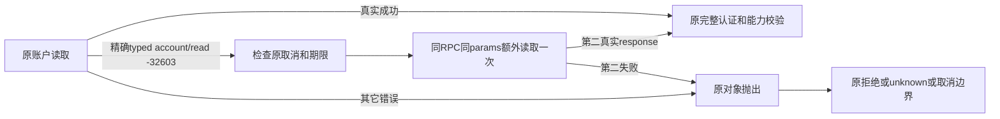

# T1294 第三轮独立 SPEC 复审

结论：当前完整SPEC的第三轮窄补充**未发现待修finding**，已交`spec-review-round/v2`、`review_kind: recheck`、`findings: []`。这是规格必要性、范围和边界复审；Root负责reviewctl正式登记。本代理未改生产/测试/control，未执行模型、浏览器、RPC、服务或新测试，不签新实现、RED/GREEN、普通bundle及最后聊天。

绑定SPEC SHA `ccb3ec15c3bcd967956f46fff4503e6fdb31b6f04b5d8be57514cb7e95eb5a78`；宪法SHA `86bc2c8add6a01ebf5b2ecf9de05d448770ca14a4e0bdbbf376fffc6387e3800`；Main HEAD `6f75509fc715045035559d622c3fc9ffd932e16f`。packet及逐文件源绑定在SOURCE_BINDING.json。当前代理独立于Root新增factory实现作者，模型继承未切换，不猜具体未暴露的型号。

## 必要性与证据准确性

正常close之后仍有实际`CodexHostError/CODEX_RPC_REJECTED/account/read/-32603`，因此不能把关闭屏障当唯一RPC根因或恢复结论。完整same-session32结果为27个原OK、5个原FAIL（3/10/19/22/31），5次均在同RPC同params、refreshToken=false下额外一次account/read得到RPC成功。原5轮仍重抛首次错误、保持FAIL，未发thread/turn/模型/资金。97PID全absent、owned PGID空、TMP句柄0，已核CLOSURE.json。

这支持“同会话有限非付费读取有可恢复实际样例”的必要性；不支持“第二次已登录”“所有环境恢复”“原失败任务已重试”或“原生内部唯一根因确定”。实验observer没有检查第二response账号或认证值，只记录rpc-ok；SPEC要求生产使用第二真实response继续原认证/权限检查，准确填补这一证据与产品成功真值之间的距离。

实验一次import的app-server TS `af38c7…`、protocol TS `3110cc…`前后相同；期间dist再生，sourceDrift=true明确单列。因该controlled-only入口直接import TS，dist漂移不否认其有限读现象，也不能据此代签普通bundle/最终产品。SPEC中trial3/10是阶段性样例，且明确后续以完成记录为准；本审已核最终5个样例，没有将32轮误写全绿。

## 范围与恢复边界

|约束|规格判断|
|---|---|
|只新增codex-app-server.ts原factory账户读取与codex-account-precheck.test.ts|必要且精确；没有新public port、费用账本或恢复owner|
|真实CodexHostError且code/method/rpcCode精确匹配|避免按裸错误文本、名称或泛化内部错误猜恢复|
|同一仍存活RPC/同一原params/refreshToken=false，只多一次|不重开会话、不刷新认证、不重跑initialize/config/MCP；正常第一次成功仍一次|
|第二response作为当前事实继续原认证、MCP、配置、图片权限校验|不拿缓存、空值或单纯RPC成功冒认证/图片ready|
|第二次错误原对象抛出，其它错误不重读|原pre-admission/unknown/取消链仍为最终权威；不将未知turn变可重发|
|原signal与绝对deadline、不续期，保120000ms请求预算|有限额外读有原总预算约束，不从第二读另开完整任务窗口|
|不reserve/thread/start/turn/start/换来源模型/业务重试|非付费读取不扩成用户未授权的生成重放|

这与宪法的真实数据、失败不伪成功、受控模型/本机安全、可取消长任务及LED-053一致。属于同一已授权聊天可用性目标的必要窄补充；不需要重复用户确认，也不意味着可以越过本轮独立审或扩大握手/认证协议。

## 实现和测试应落实的已审约束

这些是现有规格约束的可执行核对点，不是新增写集：

- 经真实`createControlledCodexSession`入口验证原两次受控握手、session实例和调用顺序；不能只测孤立helper或把mock外壳当真实模型。
- 精确四元组是typed类、code、method、整数-32603。其它method/code、缺metadata、普通Error、timeout/明确认证/配置/权限拒绝都不重读。
- 首次正常读取一次；精确拒绝仅第二读一次，不能第三次。必须同一个实际RPC实例和同一个params（refreshToken:false），不得插入新session/initialize/config或auth refresh。
- 取消/到期覆盖首次拒绝前后、额外读发出前与进行中；原Signal不能替换，不能因第二请求默认120000ms而延长外层绝对deadline。取消后的错误不得被缓存成能力失败或误报拒绝。
- 第二读失败保第二个原错误对象及安全typed元数据；不隐藏为第一次错或普通成功。后续是否明确precheck拒绝/未知仍沿原账本/ACK权威，不新增自动重提。
- 第二read返回真实未认证、图片能力不足、配置/MCP变化仍走原失败，不能把rpc-ok直接提升成ready。原关闭屏障和安全诊断保持，不输出account/config/raw error内容。
- 需实际新增RED→实现GREEN、原Worker/状态公共链、类型、timeout/边界、正常标准build，再用新普通bundle/fresh完整10项与唯一真实新聊天验收；此前10PASS及诊断成功不能替代这次未发生的后置验收。

本轮仅签上述完整规格无待修finding；实现、红绿、build和最后新聊天均 **NOT-RUN**。
