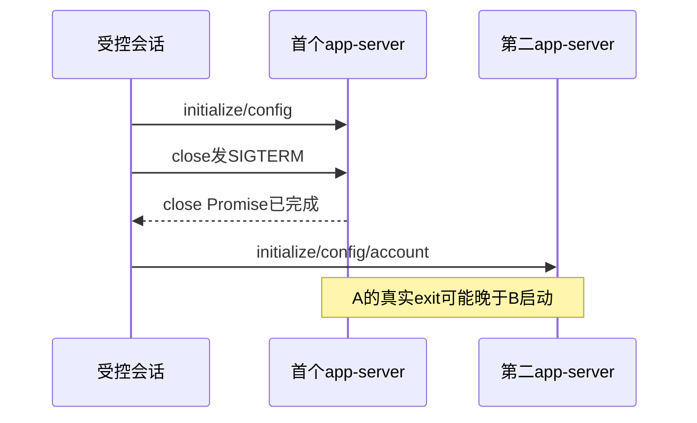

# Codex 会话关闭与状态交接：只读生命周期核对

结论：当前`CodexRpcSession.close()`在POSIX上**不等待子进程实际exit/close**；因此第一/第二受控会话和status结果的`await close()`均不是进程退出屏障。这是源码可确定事实，尚无证据证明它造成当前间歇预检查拒绝。不得把暖成功/冷失败相关性直接解释成竞态根因，也不据此加盲重试。

本轮只读，无真实模型/SDK/协议调用，未改source/dist/control，以下测试均是建议而非已跑RED。Main HEAD `6ff8b6e317330711e08426b1cbc39aeb243f16c1`，读取时间2026-10-15T04:14:30.347243+00:00；生产字节绑定见末表。

## close的真实语义

`codex-app-server-protocol.ts`的close先同步设closed=true、移除abort listener、拒绝/清空pending。POSIX随后对detached子进程组发SIGTERM（失败才child.kill），登记非阻塞、unref的1000ms清理宽限后SIGKILL，并在child的exit取消该定时器。这个分支没有await child exit或close，返回的Promise在登记完成后即完成。

因此同一个实例第二次close看到closed立即return，也不会join第一次清理。fail使用void this.close，abort处理也另启异步过程；后续调用者await close不能取得正在进行的退出屏障。1000ms仅清理宽限，不能缩短原120000ms正执行/RPC预算；当前代码没有“最迟1000ms已完成退出”的证明。

Windows分支await的是taskkill.exe辅助进程exit；辅助进程error时只调用child.kill即resolve，不等待Codex child close。不能把这一Promise等同所有平台目标进程树完全退出。POSIX监听原child exit取消后续组SIGKILL也不单独证明所有孙进程退出；本报告不据此断言真实存在残留。

## 受控第一/第二会话

`codex-app-server.ts:70`原路径先启动第一app-server，initialize/config/read收集原MCP名字，finally await first.close；接着检查signal，再用同binary/cwd/env及禁用原MCP名字启动第二app-server做initialize/config/account检查。依据上述实现，第一次进程可能尚在退出时第二次已经启动。这是允许发生的控制流重叠，非实际冲突或拒绝原因的证明。

第二session正常返回给调用者；失败时catch await rpc.close后抛原错。initialized自身失败同样await close。若实例之前已被fail/abort标closed，这些await也会立即返回。因此“会话函数已经返回/抛错”不足以替代真实PID退出观测。我们前次零turn探针额外轮询83356/83359均不存在，证明的是该次实例最后已退出，不能改变本方法通用语义。

## status探针与父队列

`codex-status-entry.ts:23-33`先持有text session并读取真实model/list，随后**有意保持text第二session存活**，在同cwd启动独立imageGeneration=true受控双session；image探针finally关闭image session。最后outer finally close text、rm临时cwd、移除active槽，再send结果。此处多连接本身是实际实现，不是自动违规或已经证明的认证互斥；不能擅自串行/重试来换成功。

但因为真实close没有等exit，outer finally可在原生进程尚未完全关闭时删除cwd和回复。父requestIO收到result即finish/delete/pump，下一个FIFO请求因此只等到了close Promise语义，不等原生PID终止。现有public-handoff测试的cleanup gate替换了createControlledCodexSession，并将mock close真实阻塞，能证明producer将结果放在await清理后，不能证明真实CodexRpcSession.close会等待目标子进程退出。两者必须区分。

同一状态producer允许两个真实在途请求，状态service以user+宿主代际合并缓存，不是跨所有业务Worker的Codex会话全局互斥。cache/force只影响观察IO，普通聊天自己的会话仍独立建立；状态检查成功不承诺后续握手永远成功。

`request-io.service.ts`stop等待的是fork的producer close；terminate直接向producer发SIGKILL。Codex app-server由RPC层detached创建，因此这个close不是其孙进程退出证明。producer的disconnect handler通常会abort active后在1200ms退出，但对该producer的SIGKILL不会让其执行JS disconnect/finally。源码不能保证这一强制stop路径的原生子树都已关闭。当前证据未证明实际残留，更不能指认其为当前预检查拒绝根因。

## 最小且不调用真实模型的测试建议

1. 在当前protocol直接测试中用本轮owned Node假子进程：ready后捕获SIGTERM，只有父fixture明确放行才exit。断言close Promise在真实child close前不应完成；重复close必须join同一次关闭。失败前后都独立强制清本fixture PID，不能依赖被测close自证。保持请求>=120000ms、外层覆盖启动/请求/退出观察/清理，不拿200ms短请求冒正常执行预算。此族可精确证明目前“Promise提前完成”，不证明认证原因。
2. 受控双session用同协议fixture记录第一PID SIGTERM/exit及第二initialize顺序；关闭gate未放行前第二不能启动作为若要新增退出屏障的目标RED。必须保原MCP名字传递、原cancel/timeout、不自动重发initialize/account或修改环境。若需求仍只是既有close语义观察，则仅记录实际顺序，不把新目标假称当前已承诺。
3. status公共handoff保原5族，在真实RPC关闭fixture下再验证回复/FIFO槽释放与原生child close的顺序，区别现有gated mock close覆盖边界；单observer取消不反杀另一合法读者、全observer离开无late cache仍照原合同。
4. requestIO强制stop需另一个owned假producer产生detached Node孙进程，核stop仅等producer的实际边界，并由fixture独立清孙进程。若要改变该强制停止协议，须先补准确owner/SPEC与公共关闭契约；不能把protocol.close局部等待修复冒称同时闭合父进程SIGKILL路径。

若真实错误tap显示CAPABILITY_UNVERIFIED/CONFIG_CHANGED/RPC具体方法与整数码，先按事实缩小原因并补正式SPEC再改最小生产源。**仅凭本静态审查不授权新增重试、取消后重开、缓存永久ready或修改认证/SDK/资金期限。**

## 精确源hash

| 源/现有测试 | SHA256 |
|---|---|
| ai-worker/src/execution/codex-app-server-protocol.ts | `9cbc438bf97444108f58a4483e52ddb07fb6b6d2fcd16887a5b6577bbeda348e` |
| ai-worker/src/execution/codex-app-server.ts | `af38c7ede2f8c5a056a384f1d2e8a2433a0b7df7a53da125472c99134ce4105a` |
| ai-worker/src/execution/codex-status-entry.ts | `17bb483c5d83c416ca3fca6bcd21efb7b280a396b288ffa199a69fce6d1e8829` |
| backend/src/modules/ai-runtime/request-io.service.ts | `b350dd6c483429ad05de751d3b9b151e7db300c98da6606b604067d70b6cf178` |
| backend/src/modules/ai-runtime/local-codex-status.service.ts | `56ea42fab0305cd19b809365b88bb0f7ae8577484f20c37cd9f869e17dd60644` |
| backend/src/modules/ai-runtime/local-codex-status-handoff.public.test.ts | `8698f6584fd332153b62480684d843786608a17d39b07217e511608edb4d0d21` |
| ai-worker/src/execution/codex-app-server.test.ts | `2d1ce63b5e5a4fc8b16b394a3d27340b544fbffae48fdef6c4f99853799e681e` |
