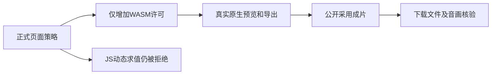

# T1295 本轮实际验证

用户报错中的正式 script-src 缺少 WebAssembly 专用许可。生产修改仅为 desktop-csp.mjs 的 script-src 加入 `wasm-unsafe-eval`；JavaScript `unsafe-eval` 仍禁止，其余指令、来源与权限均未放宽。

原 Node 两文件真实 RED 为 3 FAIL / 6 PASS；单 token 修复后 9 PASS，末次 csp-final-node.log 仍为 9 PASS。没有事后补拍历史 RED。

真实浏览器验证：

- 同一 release CSP 的页面脚本执行非空 WASM，结果为 42；eval 与 Function 均实际抛 EvalError。原 CSP 拒绝的对照保留在 browser/REPORT.md。
- 系统 Chrome 的真实 native.js 内核初始化、载入、seek、预览、导出 MP4 与全流解码通过，画面非黑、音轨非静音。
- V1 公共上传/准备/保存/预览/制作/确认/下载通过；V2 主轨真实文件采用、预览/制作/确认/下载通过。
- V3 从真实工作台点击一次导出，同一 snapshot 保存后，点击一次采用成片；原公开上传与相邻状态推进、exports.complete、ready 和最终文件下载通过。最终资产与 native 下载逐字节 SHA 相同，没有虚构 V3 后端渲染任务。
- 当前正式用例 page-origin 在 1536×1024 和 640×450 两个独立 Chrome context 再实跑，2 PASS / retry 0；每档独占证据目录、进程与 HTTP 端口均闭合，临时副本已移除。

证据入口：browser/REPORT.md；browser/v2-native-candidate/V2_ACTUAL_REPORT.md；browser/v3-native-ui-candidate/V3_ACTUAL_REPORT.md；strict-csp-candidate/ACTUAL_REPORT.md；FRONTEND_VALIDATION.md。正式 source/test 的精确绑定在对应报告，当前实现提交为 6f75509fc715045035559d622c3fc9ffd932e16f。

准确限制：原 bundled Chromium 的软件 GPU 黑片 FAIL 仍保留，不能用系统 Chrome Metal 成功覆盖。原生 AAC 音轨为 2.089796 秒，视频为 2 秒，原内核 padding 归 T1277，不擅自裁音。本轮不签 Windows 或原生 App 自动化；用户此前明确暂不授权 macOS 原生自动化。新包打包、安装、打开另外留真实证据，浏览器通过不等于 App 全功能验收。
