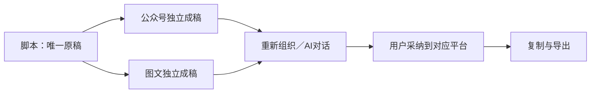

# T-1296 验收记录

日期：2026-10-15。基线：`c0065d85905433c0b993641533d8dee4db87746b`。用户明确确认“脚本是原稿，各平台成稿独立调整”。

## 实际交付

公众号与图文不再提供第二套文字输入和逐项精调。无独立正文时逐字承接已保存脚本；已有成稿保持。主动作统一为“重新组织内容”，进入原 AI 对话与候选采纳链；工具读取包含本平台成稿与最新已保存脚本。改稿不回写脚本，不影响另一平台。

必要复制、HTML/图片 ZIP、分页与原图配文交付保留，导出前保存并精确读回。旧 Doocs 版式、暂存恢复、历史候选与原请求恢复保留。缺作者资料时不再把模板占位署名输出到文章。

剪辑助手改为右侧全高可调区域，素材/转录/属性位于左侧。窄窗切换工作面保留同一画布和输入。修复自动最小缩放持久化导致候选采纳后工程被误标为有修改的问题；用户主动视图操作继续保存。

## 本轮实际执行

| 验证 | 结果与证据 |
| --- | --- |
| 内容工作区、保存竞态、交付、旧候选 | 10 文件 93 测试通过，`logs/frontend-final.log` |
| NoteRelay 原生署名来源与生产 bundle | 5 测试通过，`logs/noterelay-green.log`；官方构建与校验通过 |
| 后端属主、工具与采纳链 | 85 通过、3 个 PostgreSQL 专用用例跳过，`logs/backend-integration.log` |
| Worker 提示与运行链 | 19 通过，`logs/worker-final.log` |
| 合同兼容 | 2 通过，`logs/contract.log` |
| LED-047 | 174 通过，`logs/led047.log` |
| 原生内核 | 89 测试、392 断言通过；类型与 process AST 校验通过，`logs/native-verify-final.log` |
| 生产构建与类型 | frontend production build、backend/worker/contract 类型检查均退出 0 |
| boundary / timeout | 均通过，`logs/boundary-final.log`、`logs/timeout-policy-final.log` |
| orphan | 0 错误，保留已有 100 警告，`logs/orphan-final.log` |
| 原生可重建交付 | 716 源文件、标准 patch fuzz=0、归档再构建七产物及双目录逐字节一致，`native-package/*reconstruction.json` |
| 真实公共浏览器旅程 | 系统 Chrome、隔离 PGlite 与素材根，2 测试通过，`logs/browser-accessibility-chrome.log` |

公共内容旅程实际验证默认承接、无二次文字框、HTML/ZIP 导出前保存、刷新、原稿版本保留、平台独立与旧 Doocs 交付版本。公共剪辑旅程实际上传视频、读取原片、确定性文字剪辑、播放候选、采纳与保存、跨视口、导出 MP4、登记成片、刷新和历史恢复。候选与成片均与本轮改动前 HEAD 的同机 Chrome 产物逐帧/PTS及完整 PCM 一致；未放宽容差。

1920、1366、1280、1024、390 及 200% 留有实际截图。小窗口初始首屏发送行位于下方；追加真实滚动后按钮完整处于视口内、输入框可聚焦的断言与截图，见 `native-browser/assistant-reachable-*.png`。独立视觉评审者 `/root/final_visual_review` 已实际看图并复核证据，最终 PASS，无剩余视觉/可达性阻塞。旧 Doocs 状态文案已复拍。

## 红测与失败记录

原稿承接初始红测为模块尚未实现的 import 失败，不冒充行为断言失败。脚本上下文红测真实断言缺失字段；原生布局、署名资料和自动缩放分别保留真实红测与修正后绿测。首次 zoom 测试的 WASM 替身导入失败与后续实际行为红测分开保存。

公共旅程曾发现旧候选采纳后自动缩放写入 `timelineViewState`，已通过 live/current 全字段差异和独立审计定位。修正后保留原完整工程比较与请求回执，完整公共旅程通过，没有靠额外保存新版本掩盖。

追加复验曾误用 bundled Chromium，与系统 Chrome 历史像素基线不一致；失败日志保留为 `logs/browser-accessibility.log`。固定同一 Chrome 后完整复验通过，不宣称跨浏览器编码一致。

追加原生几何检查中，ArrowRight 被既有全局 seek 快捷键拦截，未改变缩放滑块。独立审计确认 `actions/use-keybindings.ts` 缺少对 `role=slider` 的避让，与此次 zoom 持久化修正无关。失败保留于 `logs/native-geometry-final.log`，登记 T-1297；真实鼠标拖动已验证缩放持久化，`logs/native-geometry-pointer.log` 通过，未将键盘失败洗绿。

## 明确保留的限制

- 隔离环境未配置模型，未执行真实文字重组、对话改稿、图片生成或 ASR；主按钮和上下文/候选边界经过代码及测试验证，但不能写成真实模型端到端 PASS。
- 本轮是 Web 产品实现和生产构建，没有打包、部署或替换现用桌面 App。
- 聚焦 lint 仍有 20 个既有错误（article 19、graphic results 1）；同文件基线 25 个，新增共享 helper 为 0。见 `lint-summary.json`，不冒充 lint 全绿。
- 全局 reconcile 的既有欠债由 T-1292 跟踪，最终结果另列；不得用本任务通过覆盖全产品状态。

标准 patch 文件的上下文行包含 unified diff 必需的空格前缀和原源码 tab，完整 `git diff --check` 因此报告空白；非 patch 源码单独检查，不能改坏可复原补丁来消警。

正式 SPEC 复审回执：`REV:54efa4aaf044`，独立实现复审无未解决阻断。追加独立鼠标缩放与非零水平滚动取证见 `native-geometry/t1296-explicit-view-with-timeline.json`；场景内容与 playhead 保持不变。

## 页面证据

UI验收的机器回执见 `FRONTEND_VALIDATION.md`；范围映射见 `JOURNEY_CONTRACT.md`，不替代本任务SPEC。

最终全局对账：完整运行真实退出1，30 ERROR/0 WARN。29项与T1294原门身份相同；另1项T1296审核漂移是在本轮复审登记前取样，后续 `reviewctl` 已登记 REV:54efa4aaf044，独立当前审核函数核验 T1296 错误为0。本任务源代码/公共旅程/重建/独审Gate通过，其余全局欠债属于T1292范围，未修改或降级。完整30项原输出保留于 `logs/reconcile-final.log`，逐项归因见 `GLOBAL_RECONCILE_COMPARISON.json`、`review-receipts-current.json`；没有声称全局转绿。

任务通过 taskctl 正式完成：`T-1296 🔨→✅`，界面验收回执 `PASS:ce66e0ff5ee0`。完成工具在源码提交 `8bb8facc7` 上再次实际执行两项公共E2E并成功，事件已留审计；随后 frontend receipt audit 的T1296错误为0。
