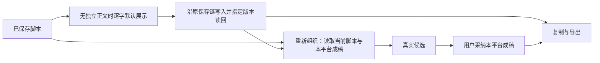

# T-1296 独立 SPEC 初评

评审日期：2026-10-15。评审者：独立子 Agent `/root/spec_review`。范围：需求必要性、数据流、既有调用链与实现边界；未进行实现验收或独立视觉评分。

评审时 HEAD：`c0065d85905433c0b993641533d8dee4db87746b`。SPEC SHA-256：`beed4c8409ede3b0dc77ef7d0dc019ec2b51194d971941d66f825cd2bb697c28`。产品宪法 SHA-256：`86bc2c8add6a01ebf5b2ecf9de05d448770ca14a4e0bdbbf376fffc6387e3800`。

## 结论

当前 SPEC 与用户已确认的内容流一致，未发现阻断性范围、必要性或可实现性缺陷。脚本是原稿，公众号和图文是独立成稿；逐字默认承接与平台语义改写分开，AI 只产候选，采纳继续由原属主服务保存。删除细碎控件、保留真实交付和恢复能力、扩大剪辑助手，均在确认范围内。正式审核状态由 Root 的 reviewctl 登记；本报告不自行签发实现或产品通过。

评审发现正式写集曾将 panel-store 路径写为 `apps/web/src/stores/panel-store.ts`；已通知 Root，最终核读确认修正为归档真实存在的 `apps/web/src/editor/panel-store.ts`。这是已在初评期间校正的字面路径，不留下未解决 finding。

## 源码核对

| 关注点 | 已核读的现有事实 | 对 SPEC 的判断 |
| --- | --- | --- |
| 首次默认承接 | `script-derived-metadata.ts` 当前只填空标题、摘要、标签。`project-script-source.ts` 已有 ready/empty/unavailable、scriptText 和可空 scriptRef；articleSection.body、graphicPostDocument.body 都是字符串。 | 本地逐字投影不需要新增模型或数据库。仅对无独立正文初始化，保留已有分段/图卡和图片，避免把历史稿判成空稿。投影未保存须如实呈现。 |
| 保存与采纳 | ArticleWorkbench 的 prepareForTurn 与 saveCore、GraphicPostWorkbench 的 prepareForTurn 与 saveCore 已通过 createVersion、指定 versionId 读回、current 核对和原 clientRequestId 恢复执行。 | 沿原 port 接入可行；删保存按钮不等于删保存协议。SPEC 已明确交付与对话前准备、失败保留原请求。应以真实公共操作验证，不以本地 state 代替保存。 |
| 最新脚本 | articles.service.ts:getArticle 与 graphic-posts.service.ts:getGraphicPost 已通过 optionalScriptContext 读取脚本上下文。work-editor-candidate.ts 的 load 每次从对应 service port 读当前属主，但当前仅留下 owner.current。 | 给 work.editor.context 增可选 scriptContext 并从同次 owner 读取取得，可落实最新已保存脚本。普通讨论不应无条件重组；重组必须用读取回执，脚本不可读不能替代为空。无需回写脚本服务。 |
| 冻结工具兼容 | chat-work-editor-tool-host.ts 会按冻结任务重建工具并比较 definitions；chat-tool-definitions.ts 冻结 version 由 description、parameters、effect 等形成。当前 work.editor.read 输入形状与 description 不引用新增 scriptContext 输出。workEditorContext 是 strict 对象。 | 只增加可选输出字段并保留 input、description、旧版本选择，可保持旧冻结任务定义。不可顺手修改工具描述/输入；如实现触及这些字段须保留旧变体。contract 解析应覆盖带/不带新字段及旧 frozen host，SPEC 的兼容约束必要且可实现。 |
| 图片生成与恢复 | ArticleResultActions 内有封面/段落图结果、原请求与采用状态；GraphicPostResults 内有图卡候选、原 series request、精确素材 ID 预览与采纳。 | 不能整组件删除后仅剩文本对话。SPEC 已要求将有效能力接到对话结果并保留原请求恢复后再删旧入口；这是保已有能力，无需扩新生成机制。 |
| 导出完整性 | NoteRelay deliver 当前直接导出原生预览，没有调用父级 save；Doocs 导出要求 value 与 savedDocument 一致，并导出 HTML+绑定图片 ZIP；图文 exportGroup 已 save 后读取正式稿导出精确图片、配文与顺序。 | SPEC 特意要求所有导出消费者经过保存准备，闭合当前入口差异。NoteRelay 不能代替 Doocs 的 HTML+图片 ZIP，也不能代替图文原图整组交付。历史 Doocs/NoteRelay nativeLayout 应按原格式继续呈现，不应无声改版式。 |
| 原生助手尺寸 | 直接读取 native-source.tar.gz 内 editor-layout.tsx，右栏位于上半部 horizontal group，外层 vertical group 再分 timeline；compact 右栏固定340px。WorkspacePanel 右侧目前把 director/properties 放在同一工作面。panel-store 持久化 creatoros.opencut.native.panel-sizes。 | 全高右助手必须调整原生树的分区和 command 路由；仅改外层宽度或默认百分比无效。SPEC 已覆盖真实源码、旧偏好、同一 slot/portal/canvas/输入实例、窄窗工作面与重建一致性，没有扩展专业 NLE。 |

## Gate 与证据界限

已读取 BACKLOG 顶部任务、SPEC、PROJECT、PROJECT_CONTEXT、产品宪法、物理架构、项目 UI_RULES；已加载 product-to-code-orchestrator、阶段路由和 oil-ui-pro 及存量项目说明。技能与项目版本均为 3.29.0。

本次实际运行 `context-plan.mjs --root . --task T-1296 --json` 返回退出码2：`task T-1296 无法从 progress.json 唯一确定当前 pending/claimed step`。Root 已说明 task packet 编译另被既有 T1111 write_set 阻断；本评审未重跑或修改该控制面，也未把任务包视为通过。源码归档只用 tar 列表/标准输出读取，没有解包改源或重建。

本次没有运行产品测试、模型生成、保存/采纳、浏览器或桌面操作；没有新视觉截图。SPEC 已列出的真实 RED、公共保存/重组/采纳/导出、双作品隔离、原任务恢复、图片与旧版式保留、原生同实例、四类视口/200%、LED-047、timeout-policy、边界和重建 Gate 仍需实现阶段执行。历史图和旧通过记录不能替代本轮证据。

独立初评 JSON：`round-1.json`，schema 为 `spec-review-round/v2`，review_kind 为 `initial`，findings 为空。空 findings 仅表示本轮未发现未解决的 SPEC 缺陷。
