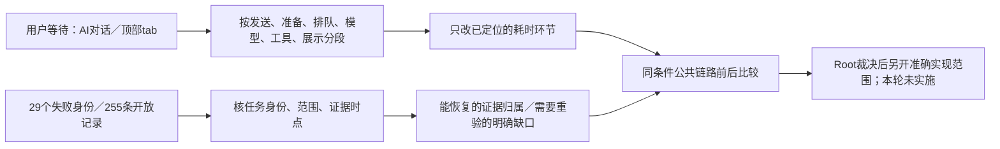

# T-1299 欠账根因与落地建议（供Root裁决）

本轮基线为`cd4974feb`，只做诊断和建议。用户明确最痛的是“AI对话慢、切换tab慢”，先查项目顶部脚本、文章、图文、制作视频tab。下面所有产品、测试和流程改动建议均**未执行**；没有重发旧任务、启动付费模型、访问现用App或用户库，也没有把旧任务改成完成。

先讲结论：应把用户等待的具体链路与工程账本分开推进。20条审核漂移不能解释一次聊天为什么慢，也不能证明某页渲染慢；四个Windows门共享一个测试文件，不等于四个独立运行时故障；255条开放记录也不能直接当作255个仍然复现的产品缺陷。先按A/B实际链路证据处理用户等待，同时用有限、可复核的办法消除验证噪声，才能判断下一次改动是否真的更快、更稳。

## 观测口径

- 原完整reconcile：`docs/verification/t1298/logs/reconcile.log`，真实33ERROR/0WARN；其中本轮新增T1294/T1296 receipt、LED055/061已实际闭合。29项身份来自`GLOBAL_RECONCILE_COMPARISON.json`，不是今天重新跑出29项全量失败。
- 本轮只读审核：`logs/receipts-current.json`，20条审核错误、前端receipt错误0。T1294/T1296/T1298的真实完成保留，未用这些PASS代签所有旧功能。
- 本轮看板健康：`logs/backlog-health.log`，85.3KB、exit2/RUNAWAY、1ERROR/5WARN。它影响Agent每轮读取与工程收尾；没有证据说明App聊天或tab在运行时读取BACKLOG。
- 本轮LED052原入口：`logs/led052-precondition.log`，因当前C进程缺显式隔离PG配置而exit1，业务测试没有开始。没有启动数据库或访问用户数据。这证明当前验证前置条件不满足，不证明collector业务逻辑坏。
- 其余7个lesson没有在本轮重新执行；以下均注明历史证据、当前源码线索与尚缺验证，不将旧日志写成当前复现。
- 技能与项目均3.29.0；T1299由taskctl实际📋→🔨。context-plan的analysis入口通过；progress generate因T1111旧绝对路径exit2，新任务因缺派生binding无法编译Task Packet，原始日志保留。未绕门写progress。

## 29个失败身份：逐项归因

分类“记录”指当前确定性绑定/流程问题；“验证条件”指尚未进入业务验证；“待分辨”指无法据旧总门失败判断产品还是测试。这里只给已证实层级，不能把“疑似旧夹具”当作已证实无产品问题。

### 20条审核绑定

共同证据为`logs/receipts-current.json`和`orchestrator/process/reviewctl.mjs:776`。该验证器先核BACKLOG receipt与snapshot，再核event、SPEC和constitution；因此“receipt不一致”是第一处失败，不代表修正该字符串后其余检查都会通过。16项同类receipt冲突不得直接抄snapshot哈希洗绿，必须核真实任务身份、完整链、当前SPEC/宪法，再决定恢复真实记录还是独立复审。

| 身份 | 已证实分类／当前原因 | 真实范围与用户影响；与两痛点的关系 | 最小落地建议、证伪及必要验证（均未执行） |
| --- | --- | --- | --- |
| T-1255 | 记录：constitution hash改变 | 日志直传Growth和观测；影响可审核性/观测可信度，未证明是聊天或tab慢因 | 先核T1260已登记的生成PROJECT绑定问题、实际constitution路径及变更；范围只到该任务真实绑定/适用复审，不删宪法校验。验证当前SPEC/constitution/event一致，并单独验原日志上传范围。SPEC：`docs/features/t1255-reporting-full-delivery.md` |
| T-1072-owned-devices | 记录：缺任务hash-chained event | 手机号连接和双设备授权；无法证明当前授权变更已审核，未证明与两痛点有关 | 查原来源任务/alias和review事件真实出处；可证明的原链才通过受支持迁移恢复，否则新独评。不可虚构旧event。验证双设备归属/激活合同，不能用普通聊天PASS代签。SPEC：`docs/features/t1072-owned-devices.md` |
| T-1021 | 记录＋真实范围待实施：SPEC变更 | 目前SPEC明确追加双模板库、无限画布、私人收藏与发布接线；旧complete事件不覆盖追加范围。与本轮AI聊天/tab无实证关联 | 对当前完整范围核独评，不以旧封面库PASS关闭追加需求。先确认哪些旧能力仍有效，后续只实现新增缺口；合同/隐私/失败页恢复/发布revision需分别验证。SPEC：`docs/features/t1021-cover-template-library.md` |
| T-915 | 记录：BACKLOG692283…与snapshot ad76cf…不符 | 旧任务本来就针对AI卡慢/失败/缺自主循环；**领域相关，但receipt错误本身不是慢因**。后续T930/T1070/T1238/T1278/T1294/T1298已覆盖部分执行链 | 先核当前任务真实范围及后续承接，不重做整套旧架构。以B的本轮AI分段证据定位未完成项，再核原可靠性验收；不能用4轮编辑成功代签搜索/跨供应商/重启恢复。SPEC：`docs/superpowers/specs/2026-09-04-agent-runtime-refactor.md` |
| T-859 | 记录：9895a9…与581839…不符 | 竖屏人物/白闪；原SPEC已有T902纠偏，旧hidden人物规则被取代；无两痛点实证关联 | 审核按T902和最新用户方向承接，只保仍有效的几何/预加载/无白闪；禁止恢复已否定规则。必要验证是实际视频交接画面，非聊天计时。SPEC：`2026-08-16-portrait-material-pip-smooth-transition.md` |
| T-858 | 记录：2521be…与c76009…不符 | 旧制作编导、舞台与字幕；实际制作质量范围未由receipt错误证明坏，无两痛点实证关联 | 对照后续T859/T902/当前剪辑消费者，保留仍支持的旧工程输入族；独立审适用改动，再真实横竖成片验证。SPEC：`2026-08-16-video-direction-stage-and-caption-emphasis.md` |
| T-824 | 记录：18361d…与f0e215…不符 | 连续口播与制作分镜分责；最新T1070不做自动视频，不能为旧任务恢复自动制作；无两痛点实证关联 | 核旧写稿消费者与当前仅真实录像方向的交集，范围收敛需用户/DEC真实依据。若仍使用旧链则验证逐字冻结与制作分责，不能只改记录。SPEC：`2026-08-13-continuous-voiceover-storyboard-pipeline.md` |
| T-819 | 记录：0425ab…与a8879e…不符 | 普通对话定位当前稿单段；与AI工具领域相关，未证明其绑定错误导致延迟。T1298已证两平台末句校正，只是其中一族 | 核“第N段/引用句/歧义/已变化稿”等未验族；与T816共用真实稿读取，保局部候选/CAS，不重复造工具。用无歧义/歧义/过期版本公共链证伪。SPEC：`2026-08-13-natural-language-current-script-section-editing.md` |
| T-816 | 记录：fb03de…与7896df…不符 | 当前确认稿是配图/封面真相；可能影响上下文装配，但本轮尚无延迟因果证据 | 复用T1298已证当前稿/原稿工具上下文，核图片与封面仍缺的真值链，不将“读取很多”直接等同低效。验证执行时重读、当前版本、旧回执不覆盖。SPEC：`2026-08-13-current-script-truth-and-natural-language-section-editing.md` |
| T-768 | 记录：3eb189…与64f801…不符 | 云ASR到本地Whisper回退；本轮用户痛点不是ASR，且T1298未跑ASR | 独立复核后验同原持久任务的各失败族与真实本地准备；不能用LED041源码检查或一般聊天通过代签ASR。SPEC：`2026-08-11-asr-universal-local-fallback.md` |
| T-726 | 记录：280982…与39e3f4…不符 | 退役独立论点骨架；旧数据保持可读。没有证据说明当前tab或对话还在读取该步骤 | 核当前消费者确已退出新脚本路径，保历史只读；如仍混入上下文再记录精确性能证据。验证新稿零隐性依赖、旧版本可读。SPEC：`2026-08-08-thesis-skeleton-retirement.md` |
| T-707 | 记录：06867c…与87de34…不符 | 定位Copilot工作流，与T652指向同一SPEC；与项目顶部tab不同范围 | 核共享SPEC与两任务实际身份/后续范围，避免双份实现和共享snapshot相互覆盖；不能据一个新receipt给两任务补签。验证定位入口真实读写。SPEC：`2026-08-01-positioning-pre-interview-workflow.md` |
| T-703 | 记录：c1a392…与0662da…不符 | 视频分镜/预览/采纳闭环；T1274/T1296已实测部分原生链，不能覆盖全部旧制作/渲染输入 | 按实际仍支持消费者列差集，复用可绑定的公共MP4证据，只重验缺的输入族。保存、历史和旧工程不得因新质量规则hard-fail。SPEC：`2026-08-05-video-production-editing-loop.md` |
| T-691 | 记录：9444ca…与2f2a13…不符 | Copilot全生命周期、跨项目历史与审核改稿；领域相关，无本轮卡慢因果 | 与T1074/T1091/T1070等按操作族核承接，避免重复工具/历史展开。重验跨项目/审核候选原权限及采纳，聊天编辑成功不能覆盖全生命周期。SPEC：`2026-08-04-copilot-project-lifecycle-tool-closure.md` |
| T-694 | 记录：2c7be1…与171b7c…不符 | 渠道包工厂和安全增量更新；影响交付可证明性，非日常AI/tab已证慢因 | 核品牌身份、源码/产物/更新签名的当前契约，结合下方打包门去重验证；不通过改商业身份/删运行时校验提速。SPEC：`2026-08-04-channel-package-factory-and-incremental-update.md` |
| T-656 | 记录：5f6970…与bd8a6a…不符 | 桌面verdict安全；无两痛点实证关联 | 保原无bypass/真实token边界核当前变更并独评，不能把移除校验当性能方案。验证错误身份拒绝、正常授权链可用。SPEC：`2026-08-02-desktop-verdict-basic-hardening.md` |
| T-652 | 记录：审核仍待审 | 与T707同一定位SPEC，但方向已多次修订；真实未完成的适用审核不能伪装为导入问题 | 与T707先核唯一当前范围及任务身份；真正需要实施的变化先独审。不能用T707历史PASS替待审。证据：BACKLOG-details的T652/T707及上述共享SPEC |
| T-645 | 记录：5dfe24…与7ff0c3…不符 | 渠道逐能力模型权威；T1278/T1294已改变部分来源/向量配置，不能恢复旧UI | 以最新用户确认和真实合同作准，旧范围只保仍有效的票据/归属/防降级。验证当前来源选择和冻结任务，不用删除预检缩短聊天。SPEC：`2026-08-02-capability-scoped-channel-model-authority.md` |
| T-642 | 记录：7728c9…与9002b8…不符 | 雷达→选题→稿件血缘，和T1017/T1233部分承接；无顶部tab慢实证关联 | 核当前来源/项目直读与血缘，不重复生成整套雷达链。对保留入口做当前稿与旧引用隔离验证。证据：BACKLOG-details T642，原review事件绑定SPEC |
| T-635 | 记录：b8add2…与846610…不符 | 构建固化Growth产品身份；无两痛点实证关联 | 核正式包固定身份和原跨仓合同，独立审核实际变化；不能放松验签/允许运行时换productKey。验证正常/篡改两族。SPEC：`2026-07-30-growth-product-identity-binding.md` |

表内日期式SPEC文件均位于`docs/superpowers/specs/`。待审/绑定错误在工程上是真问题，但产品是否完成与是否存在性能故障仍要分别取证。

### 8个消费者门与看板

| 身份 | 当前证据与分类 | 用户影响及两痛点关联 | 如何证伪、最小落地范围与必要验证（未执行） |
| --- | --- | --- | --- |
| LED-006 | 待分辨，历史原命令2FAIL/41PASS：启动标记断言绑定`|_window,payload|`而当前源码用`|window,payload|`且仍有MAIN_PAGE_LOAD_FINISHED；资源断言期待2项，当前含额外`sidecar.tar.gz.sig`。历史日志`docs/verification/t1274/global-startup-diagnostic.txt`，当前源/测试可直接对照 | 可能是静态契约过时；尚不能据此说安装启动坏。没有对AI发送或项目tab耗时的直接证据 | 先独审确认应保护的是“主页面完成后标记”和“签名资源完整”，再最窄校准测试或修真实路径；保负例。需实际受支持平台GUI首次启动和失败可见性，不只改变量名regex |
| LED-018 | 待分辨；与006共享startup-safety-contract；该前段失败会因`&&`阻止Cargo windows_执行。较早T1238另有缺构建binaries的Cargo前置失败，不能混为一因 | 涉及桌面浏览器交付可用性；与本轮AI/tab没有已证因果 | 分开记录frontend前段和Cargo后段执行事实；先修/证伪前段，再在合法构建资源齐备的隔离Windows环境验真实浏览器，不造空binary或临时读宿主缓存 |
| LED-031 | 待分辨；原命令先backend executor/child-env，再`node --test tools/windows-closure-rat/*.test.mjs`。总门未留本轮子段错误，后段包含051同一失败测试 | 若真实resolver缺失会导致Windows渲染失败；不能由总门失败断定发生，也不解释普通tab慢 | 先分别捕获两段原输出。仅证实消费者缺resolver才改生产argv；需公共真实渲染及打包RAT同一解析协议。共享closure测试可一次取证，保各门身份 |
| LED-041 | 待分辨；Whisper worker→managed-ASR→build-production-closure三段，最后一段与051共享；原T1298完整输出没有失败段详情 | 真失败可能影响本地ASR，不是已证聊天/tab慢因 | 按段记录开始/退出和缺资源；若前两段通过仍不能签Windows真实worker。必要时用随包Node启动真实Whisper消费者，保权限/取消，不仅主进程import |
| LED-046 | 待分辨；旧原始段0失败后段1/2未跑证据位于`docs/verification/t1204/current-four-original-diagnostic/raw/`。当前总命令第一段同样含051测试，不能把后段称已失败或已通过 | 后台Worker可能受影响，但实际打包/启动问题尚需复现；无本轮两痛点实证 | 分开closure、Pi packaged runtime、frontend worker入口三段。核真实安装目录和必需workers依赖后再修；公共真实worker consumer闭合，不以HTML可开代签 |
| LED-051 | 待分辨；历史`global-windows-closure-diagnostic.txt`缺`CREATOROS_PRODUCTION_CLOSURE`字符串断言。当前测试仍要求该串及“跳过…V8字节码”，而package.mjs T1273段已改clean-sidecar且取消该字节码路径；还需核Windows正式链是否被实际破坏 | 构建计划/测试可能过时，也可能真实Windows接线缺失，不能只改断言。与现有聊天/tab慢无直接证据 | 将T1273批准范围、正式Windows workflow、package入口和公共closure plan逐调用对照，独审后修精确差异。验证真实干净闭包/随包Node/CLI/Whisper/浏览器，禁止为过门恢复无用字节码或取消类型检查 |
| LED-052 | 验证条件：本轮原入口exit1缺显式PG变量、测试没开始；run-archive-guard只接受显式55422隔离服务，不能skip。早期59例PASS只属当时 | 未证明归档/collector业务故障，不是当前AI/tab慢因；影响验证可靠性 | 以后在专属隔离PG生命周期内传入两显式变量，原三文件完整运行并清理；若仍失败再按具体case定生产/夹具范围，不降低隔离护栏。不访问现有55422或用户库来凑条件 |
| LED-058 | **证据不足**：T1274同门曾OK、T1298原完整门FAIL；后者没有底层子段输出。不能据计数归为“又一个旧夹具” | 真失败可能导致无效等待、错误重试或未知结果，是8门中与AI痛点最相关的可靠性候选；但目前没有延迟因果证据 | 先保存原worker6文件、backend5文件、frontend3文件的分段实际输出，遇失败先定位；模拟模型/隔离库不冒真上游。维持原call/期限、unknown不重放、单在途和取消边界；只修明确case，再走公共同任务恢复链 |
| backlog-health | 记录/流程：本轮85.3KB exit2，4条长活动行、5历史撞号警告；255开放任务中未验/待收尾混杂。日志`logs/backlog-health.log` | 增加Agent上下文和维护成本；**没有证据说明App热路径读它，不能称清看板使tab变快** | 复用T1171/T1204的无损归档/详情外置；先核状态身份再归档已✅，不能批量关任务或删历史。前后逐字段/SHA、ID/顺序/状态及health核；本轮未执行压缩 |

确定的结构重叠是：006/018共享一个启动测试；031/041/046/051共享`build-production-closure.test.mjs`。这是“重复触发机会”，不是已经证实的六项同根。原始reconcile只给门总退出，后续验证应逐段留原输出，避免又花一次大suite才拿到8个标签。

## 255条开放记录：哪些能合并调查，哪些不能批量关闭

机械库存`logs/open-task-inventory.json`以登记本轮前`cd4974feb:BACKLOG.md`为准，与pmem规则一致，只计🔨/📋/⛔，不计暂停项：188进行中、67待办、0重复ID。新增T1299不混入基线255。库存逐项保存标题、原状态/审核/验收、原说明链接、最后taskctl事件，未以关键词或相似度给产品自动结案。

事件覆盖：56条没有taskctl事件，179条最后是start，5条resume，15条最后是complete但看板仍开放；18条有过历史complete，其中3条后来又start。旧状态`🔨 待办`统一按实际emoji视为进行中，不能读成待办；这只解释表述，不代表完成。

15条应优先核“任务身份与收尾证据”，而不是直接关闭：T1018、T1071、T1070、T1069、T1063、T1024、T1023、T1021、T1020、T1017、T1004、T1006、T1009、T916、T643。至少有明确身份冲突线索：T1063当前是字面方括号路径，旧complete写Windows流水线；T1070当前是Codex/成稿，旧complete写转录后处理；T643当前是激活入口，旧complete写Apple Developer凭据索引。T1071旧complete属于资源排查，BACKLOG-details已有`T1071-resource-audit`来源别名说明，与当前导航修复不同。合并来源/历史编号/别名需查原commit、SPEC、事件归属，不能把旧event套给当前标题。T1004/1006/1009/T916已有same-identity历史锚，也必须结合那里的原记录。

下表是人工核范围后的**调查组织建议**。重叠指共用问题或证据，并不宣称功能等价；旧ID与原范围继续保留。没有为其余记录编造精确的“已完成/真缺陷”数量：255条并未逐个在当前运行时重验。

| 调查对象 | 现有任务及重叠关系 | 本轮确定事实／仍未完成的证据 | 建议处理（未执行） |
| --- | --- | --- | --- |
| 当前tab慢 | T1071、T1069、T919、T677 | T1071 SPEC有旧视频→文章3710ms/RSC3304ms；BACKLOG-details记四路径a2b803ed已修、RED5→GREEN35、六步工程GET12→0/同句柄/保存MP4通过，安装后切页仍待用户反馈。不能当今天计时，也不能用旧资源审计complete结当前导航任务 | A本轮隔离小项目观察同视频host及返回后hidden=false、工程/素材重读0；计时只称点击至自动化检测指定控件状态，不能称精确可交互时间。后续生产模式/代表性项目先补可见与实际操作测量；保未保存state/实例/后退/真实路由 |
| 当前AI对话慢 | T915、T934、T935、T1070、T1191、T1189、T1249、T1251、T1238、T1265、T1283 | 可靠性、准备、未知恢复、模型协议分属不同环节；T1294/T1298真实成功证明可完成，不证明每段快 | B按首个可见反馈/首token/首工具/完成分段，A核发送前准备；只修已证串行/放大环节，不能删合法历史或重放付费任务 |
| 新原稿与旧成稿入口 | T1070、T1091、T1093、T1097、T1074，后续T1296/T1298 | T1296最新确认脚本唯一原稿、平台独立重组；T1070旧联合按钮并非当前必需UI。T1298只补齐两平台重组/末句校正，不等于所有工具与旧目标全验 | 以当前用户方向列旧SPEC保留/取代/未验差集，防止为清旧账复活已删除入口或另建状态机 |
| 契约/库存 | T1268/T1288，T1270/T1272/T1286，T1279 | 库存断言、迁移谱系和产品手工保存并非一回事；旧43FAIL/31FAIL/6FAIL必须保留；部分当前测试已有绿色但任务仍未收尾 | 对实际契约/迁移权威源和当前被测树逐一核库存；共享根因一次修验后由各原任务按真实范围收尾，不直接改数字或生产schema洗绿 |
| 旧冻结调用与夹具 | T1248/T1249/T1251/T1253/T1261/T1263/T1264/T1265/T1267 | 有过真实unknown/准备失败、协议/夹具错配及后续修复，未全部绑定当前稳定源码 | 按原任务ID和公共入口重验必要族；保真实失败与费用/归属，不能把恢复改为自动新发 |
| Doocs源码与产物 | T1254/T1256，以及T1296旧版式导出 | 原TS6133/网络默认预算与当前能导出既有bundle可同时为真，现成bundle成功不证明独立静态源码build可重现 | 比较实际源码/官方build/发布产物来源后，隔离复现准确剩余步骤；不仅手改bundle/manifest |
| 超时/等待 | T1066/T1081/T1109/T1247/T1250/T1252/T1254 | T1298 LED053当前相关门通过，但不是每个旧端口/慢请求/归档树验收均发生；预算不是性能时延 | 按真实消费者串行预算与绝对deadline做差集；修等待分段和可见性，不通过缩短120秒下限或自动重发制造“快” |
| 剪辑与原生 | T1274/T1275/T1276暂停、T1289/T1291、T1277、T1297 | T1296两公共旅程、T1298正式回归已有MP4/CAS/历史证据；旧严格receipt、归档库存与AAC样本仍有范围未覆盖。T1297键盘失败独立成立 | 不把新48帧MP4等价当所有旧工程全验。先核可复用源码/范围与原receiptwatch，再验真正差集；保持旧任务和暂停研究门 |
| 全功能/App验收总账 | T1062/T1082/T1207/T1208/T1246/T1292及各专项 | 不同来源/源码时点/安装版授权不一致；本轮未操作现用App，不能把浏览器新PASS当安装验收 | 一份当前源码旅程清单映射各旧任务未完项；能复用的有精确绑定，剩余需真实发生，不再反复建同义总验收任务 |
| 工程记录 | T714/T916/T1023/T1083/T1171/T1204/T1292/T1101-global-gates/T1025/T1260 | 20审核错、T1111绝对路径与超限是真实当前流程问题；ID冲突与缺事件需分辨 | 以T1292作调查索引、保原ID，一次解决真实归属/规则兼容，不制造另一套状态真相；root按最小原任务推进 |
| 打包/Windows | T992/T980/T845/T826/T562/T734/T754/T705/T640/T694/T1273 | 六门存在共享静态检查；T1273有已批准7项基线且用户暂缓的验证，未有本轮Windows/App启动证据 | 先核当前合法包布局与旧测试合同，再在专用Windows环境跑真实consumer；不为对账重开大build或影响当前App |
| 授权/渠道与历史方向 | T635/T643/T645/T653/T679/T715/T1278 | 新模型来源/授权范围已多轮修订，旧范围有被取代部分；不能用移除权限/完整读取缩短时延 | 依据最新确认与DEC核差集；保冻结任务/身份/验签和费用真相，性能建议不得绕开这些边界 |

其余任务的原目标、状态与证据链接均在255库存中，本轮未逐个重验。没有当前足够证据的条目应保持“待核”，不能为了输出漂亮比例把它们强行归为“纯旧债”或“已经完成”。

## 单列两个确定问题

**T1297键盘缩放。** 原真实公共几何日志`docs/verification/t1296/logs/native-geometry-final.log`显示ArrowRight后增量仍0并等待120秒失败；同次指针拖动日志通过。原独立核对指向归档`actions/use-keybindings.ts`的全局capture未避让`role=slider`。这是实际输入交互缺陷，**不在29个全局身份中**，也不是目前AI对话慢或切项目tab慢的证据。后续最小范围是全局键盘目标避让、原生归档源/标准patch/产物同步；需原生slider方向键/Home/End与普通timeline seek都验证，不能仅删热键或放松未保存保护。本轮未解包修改或复跑真机。

**T1111流程入口。** 模块write_set含旧私有冻结脚本绝对路径，T1125另有同类绝对路径。二者不是255条开放任务：T1111在`BACKLOG-archive.md:1072`为✅，最后taskctl complete为2026-10-09 06:03:34；T1125也在10-09 12:12:33实际complete。当前progress没有两者vertical，但modules.config仍保留旧定义。`progress.mjs`在所有命令路由前验证全modules，只允许安全repo-relative文件或terminal/**，因此一个历史终态条目就使合法新任务不能generate；context-compile只读取现有progress，随后报缺T1299 binding。当前独立分析可继续，但不能声称Task Packet成功。

后续优先独审**历史终态模块的可审计归档/兼容迁移**，而非重新修T1111业务或放宽绝对路径权限：保原模块定义、授权、审核和完成事件可追溯，同时让现役执行队列按现役安全边界校验。若仍需让外部辅助操作参与现役任务，再单独明确其能力表示与受控适配。不能简单删除历史、把旧路径改成更宽目录或绕门手写progress；路径逃逸/符号链接拒绝仍需负例。先修T1111后还可能遇T1125等历史条目，因此需先完成准确清单和全量读取验证，不能保证改一行全队列即绿。

## 落地次序建议

1. **先处理用户聊天的具体等待链。** Root已结合A/B裁决：真实已验证工具阶段反馈与当前owner专属工具schema优先，其次同turn发送准备去重；Tab保有效视频常驻，先补文章/图文剩余分段证据。反馈、输入体积与最终耗时分别验，计时检测误差和可见/实际操作条件分别标明。精确范围及待验证目标见`REPORT.md`，不能拿清20审核/删255记录代替产品提速。
2. **并行收敛影响可靠验收的记录与环境噪声。** 先处理已定位的T1111/T1125规则表示、任务身份冲突和ledger归属，再对可恢复的审核链精确核验；LED052使用专用隔离PG，六包装门分段取证并去重共享检查。此步让后续结果可信，不承诺直接提升App帧率或模型速度。
3. **依据最新需求，对可复用证据的旧任务作收尾差集。** 先核15条最后complete但仍开放的身份；再核T1071/T1070等后续承接及契约/库存组，逐原任务验范围，不能批量✅。保旧失败及未发生的App/Windows证据。
4. **单独处理明确交互缺陷与需要真实环境的剩余族。** T1297按原输入边界修；Windows/ASR/长任务恢复在有完整环境和清理归属的验证窗口做，失败按真实公共链定生产/测试范围。不要把这些大工程并入用户当前tab/聊天窄修。

本轮未实施上述任何修复；Root逐条裁决后，准确实现范围仍须进入相应原任务或新SPEC/审核与公共验证，不能把本分析报告本身当成产品验收PASS。
